# AWS Managed Microsoft AD und Trust

Dokumentation zu Auftrag 05: In AWS wird ein verwaltetes Active Directory
(`aws.m159giacomo.dynv6.net`) erstellt und mit meinem Active Directory auf `dc1`
(`corp.m159giacomo.dynv6.net`) über eine Gesamtstruktur-Vertrauensstellung (Forest Trust)
verbunden. Aufgabenstellung siehe
[Modul-Repository](https://gitlab.com/ch-tbz-it/Stud/m159/-/tree/main/03-auftraege/05-aws-managed-microsoft-ad).

Autor: Giacomo Betsch, Klasse Pe24d

Passwörter (Admin und Trust) stehen nicht in diesem Repository.

**Kosten:** AWS Managed AD kostet laufend Geld (laut Aufgabe etwa 18 $ pro Woche). Ich habe
den Auftrag deshalb erst am Ende des Moduls gemacht, zusammen mit Auftrag 06, und baue das
Verzeichnis nach der Abnahme wieder ab.

## 1. Verzeichnis erstellen

In der AWS-Konsole unter *Directory Service* habe ich die Variante **AWS Managed Microsoft AD**
gewählt und eine neue, von AWS verwaltete Domäne erstellen lassen:

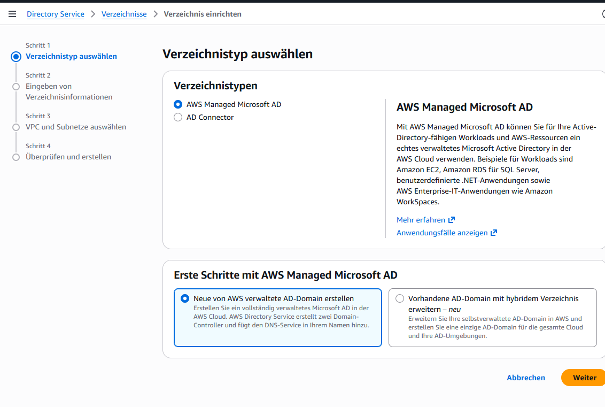

Meine Entscheide dazu:

| Einstellung | Wert | Begründung |
| --- | --- | --- |
| Edition | Standard | reicht für wenige Objekte, günstiger als Enterprise |
| DNS-Name | `aws.m159giacomo.dynv6.net` | Sub-Domain meiner öffentlichen Domain, gleiches Muster wie `corp.…`, aus meiner Planung |
| NetBIOS-Name | `AWS` | kurz und eindeutig, aus meiner Planung |
| Betriebssystem | Windows Server 2019 | von AWS vorgegeben |
| Admin-Benutzer | `Admin` | von AWS vorgegeben, das Passwort steht nicht im Repository |

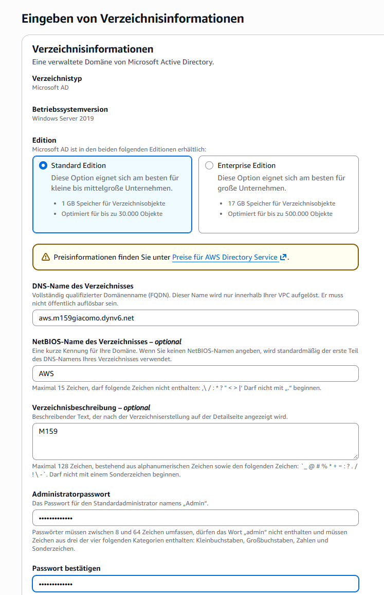

Als Netzwerk dienen die **zwei privaten Subnetze** in unterschiedlichen Availability Zones
meiner VPC `m159-vpc`: `private1` (`10.0.128.0/20`, us-east-1a) und `private2`
(`10.0.144.0/20`, us-east-1b). AWS legt in jedem Subnetz einen Domänencontroller an. Zwei
Zonen sind Pflicht, und weil die Subnetze privat sind, sind die Domänencontroller nicht
direkt aus dem Internet erreichbar:

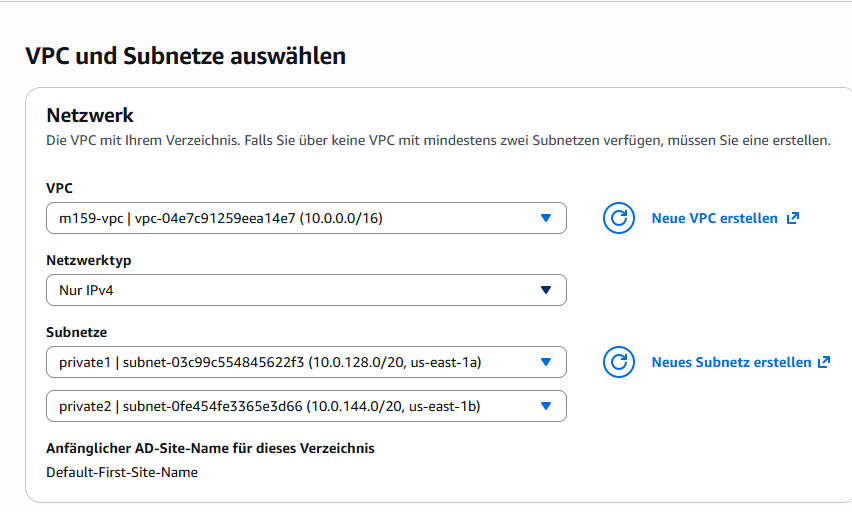

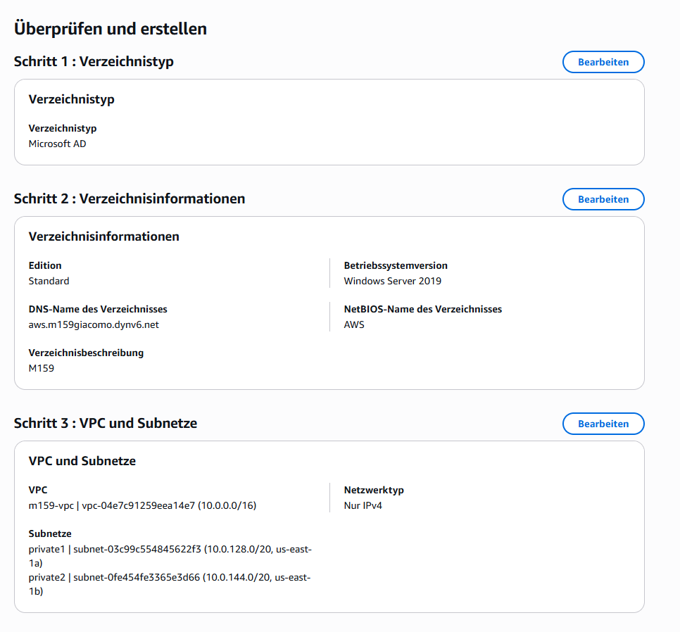

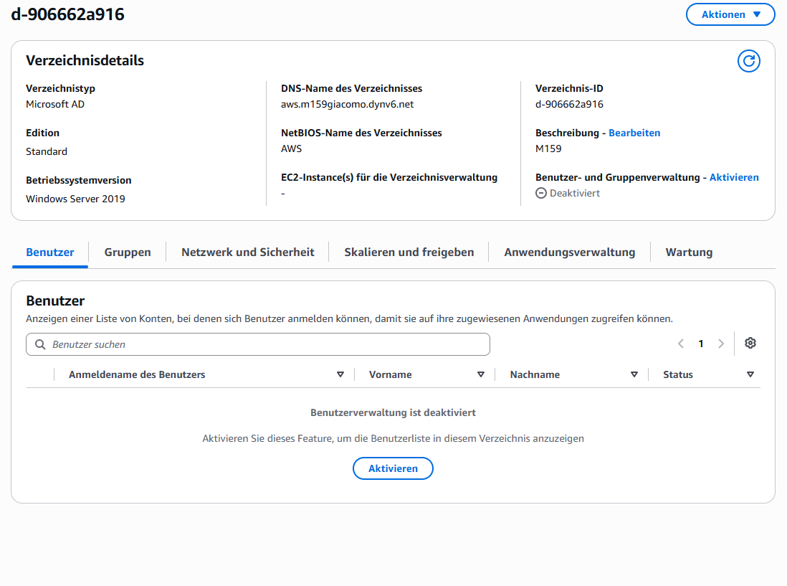

Nach rund 20 bis 40 Minuten steht der Status auf **Aktiv**. Die zwei DNS-Server des Verzeichnisses
haben die Adressen `10.0.134.64` (`private1`) und `10.0.148.74` (`private2`):

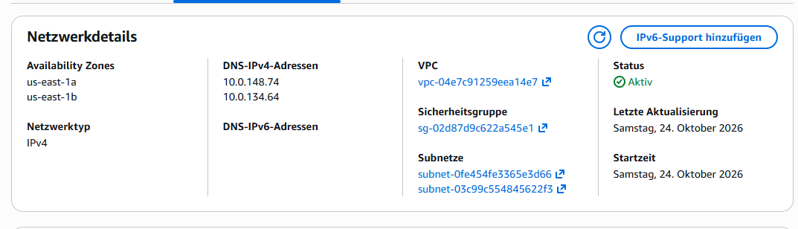

## 2. Ports

Die Ports, die ein Trust braucht (DNS 53, Kerberos 88 und 464, RPC 135 und 49152 bis 65535,
LDAP 389 und 636, SMB 445, Global Catalog 3268 und 3269, NetBIOS 139, ICMP), hatte ich schon
in meiner Planung und in Auftrag 03 in der Sicherheitsgruppe `m159-dc-sg` von `dc1` geöffnet.
Als Quelle steht überall `10.0.0.0/16`, das ist der Adressbereich der VPC. Dort liegen auch die
Domänencontroller von AWS. Eine Anpassung war nicht nötig. Ausnahme ist RDP (Port 3389), der
aus `0.0.0.0/0` erreichbar ist (siehe Abschnitt 6):

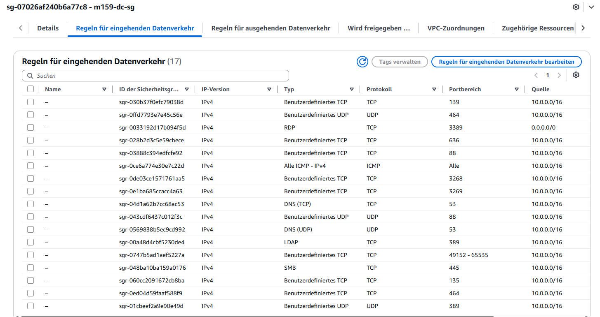

## 3. Conditional Forwarder

Normalerweise gehen DNS-Anfragen von `dc1` an den eigenen DNS-Server. Die Zone
`aws.m159giacomo.dynv6.net` kennt er aber nicht. Der Conditional Forwarder leitet Anfragen für
genau diese Domäne an die zwei DNS-Server des AWS-Verzeichnisses weiter:

```powershell
Add-DnsServerConditionalForwarderZone -Name "aws.m159giacomo.dynv6.net" -MasterServers 10.0.148.74,10.0.134.64 -ReplicationScope Domain
nslookup -type=SOA aws.m159giacomo.dynv6.net
```

Die Zone ist als `Forwarder` eingetragen, und `nslookup` bekommt eine Antwort von
`ip-c613013f.aws.m159giacomo.dynv6.net` (`10.0.148.74`):

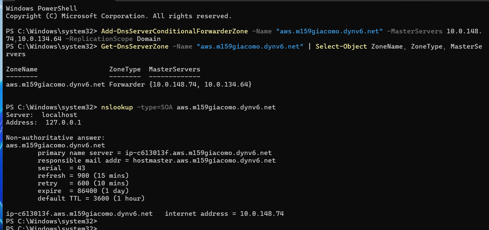

Umgekehrt braucht AWS die Weiterleitung für `corp.m159giacomo.dynv6.net` auf `dc1`
(`10.0.0.10`). Die trägt man beim Erstellen des Trusts auf der AWS-Seite ein.

## 4. Trust einrichten

**AWS-Seite.** Im Verzeichnis unter *Netzwerk und Sicherheit → Vertrauensstellungen*: Typ
**Gesamtstruktur-Vertrauensstellung**, Remotedomäne `corp.m159giacomo.dynv6.net`, Richtung
**bidirektional**, selektive Authentifizierung aus, bedingte Weiterleitung `10.0.0.10`. Das
Trust-Passwort ist ein eigenes Passwort (nicht das des Admins), das auf beiden Seiten gleich
sein muss:

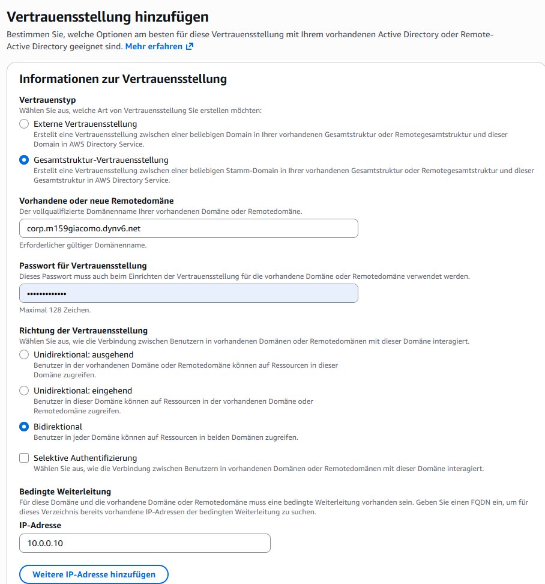

**Seite von `dc1`.** In *Active Directory Domains and Trusts* habe ich einen neuen Trust zu
`aws.m159giacomo.dynv6.net` angelegt (Forest trust, Two-way, nur diese Domäne, Forest-wide
authentication, gleiches Passwort). Der Assistent meldete: Der ausgehende Trust ist bestätigt,
der **eingehende** liess sich nicht bestätigen («The supplied credentials were not adequate»).
Das ist kein Fehler im Trust: Der Assistent hat versucht, die eingehende Richtung mit meinem
Corp-Konto zu prüfen, dafür braucht er ein Konto der AWS-Domäne:

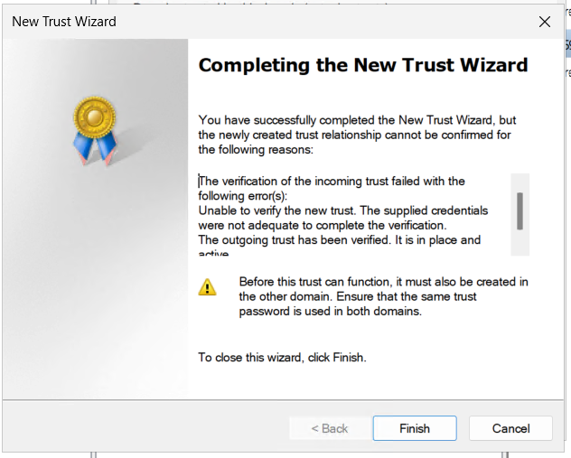

Beide Richtungen stehen im Reiter *Trusts* (Typ *Forest*, transitiv):

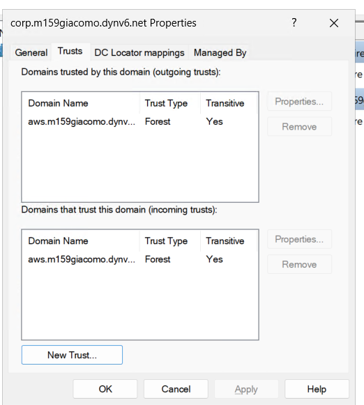

**Bestätigung auf AWS.** Direkt nach dem Anlegen stand der Status auf AWS auf *Bestätigung
fehlgeschlagen*. AWS prüft den Trust nämlich sofort beim Erstellen, und zu dem Zeitpunkt gab es
die Gegenseite auf `dc1` noch nicht. Erst als sie existierte, habe ich in der AWS-Konsole
*Aktionen → Vertrauensstellung überprüfen* ausgeführt:

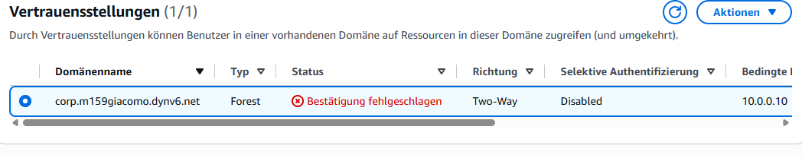

Danach steht der Status auf **Bestätigt**:

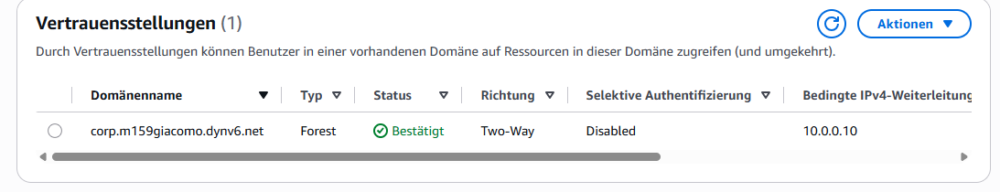

## 5. Trust prüfen

Auf `dc1` zeigt `Get-ADTrust` den bidirektionalen Forest Trust. Mit `Get-ADDomain -Server`
frage ich die AWS-Domäne über den Trust ab, und `nltest` listet beide Richtungen:

```powershell
Get-ADTrust -Filter * | Select-Object Name, Direction, TrustType, ForestTransitive, SelectiveAuthentication
Get-ADDomain -Server aws.m159giacomo.dynv6.net | Select-Object Name, DNSRoot, NetBIOSName, DomainMode
nltest /domain_trusts
```

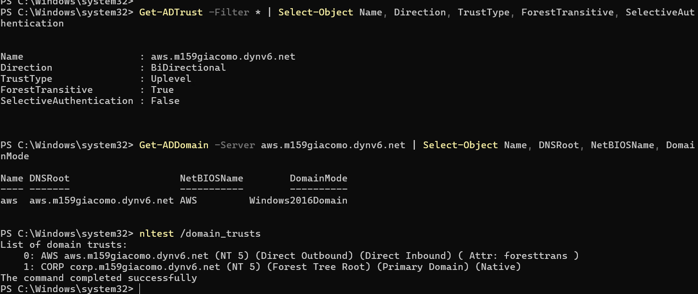

## 6. Sicherheitsvorkehrungen

| Massnahme | Wirkung |
| --- | --- |
| Domänencontroller von AWS nur in **privaten Subnetzen** | nicht direkt aus dem Internet erreichbar |
| AD-Ports in der Sicherheitsgruppe nur aus **`10.0.0.0/16`**, nicht aus `0.0.0.0/0` | die Dienste von `dc1` sind nur aus der eigenen VPC erreichbar |
| **Conditional Forwarder** statt öffentlicher DNS-Einträge | die Namen der AWS-Domäne werden nur intern aufgelöst |
| **Eigenes, starkes Trust-Passwort**, nur im Passwort-Manager, nicht im Repository | der Trust ist nicht vom Admin-Passwort abgeleitet |
| **Gesamtstruktur-Vertrauensstellung** statt externer Trust | transitiv für die ganze Gesamtstruktur, und das SID-Filtering (Standard bei Forest Trusts) schützt vor eingeschleusten Berechtigungen |
| Admin-Passwort des Verzeichnisses lang, nur im Passwort-Manager | der Admin hat volle Rechte in der AWS-Domäne |

**Offene Risiken, die ich kenne:**
- **RDP (3389)** ist aus dem ganzen Internet erreichbar. Besser wäre die Einschränkung auf meine
  eigene IP-Adresse oder ein Jump Host.
- **Selektive Authentifizierung ist ausgeschaltet.** Dann dürfen alle Benutzer der Gegenseite
  auf Ressourcen zugreifen, sofern sie berechtigt sind. In einer produktiven Umgebung würde ich
  sie einschalten und nur bestimmten Gruppen den Zugriff erlauben.
- Der Trust ist **bidirektional**. Für das Verwalten der AWS-Domäne von `corp` aus würde ein
  Trust in einer Richtung genügen.

## 7. Aufräumen

Nach der Abnahme lösche ich das Verzeichnis (*Directory Service → Aktionen → Verzeichnis
löschen*), damit keine Kosten mehr entstehen. Auf `dc1` entferne ich danach den Trust in
*Active Directory Domains and Trusts* und den Conditional Forwarder.
