# RSAT und Windows Admin Center

Dokumentation zu Auftrag 06: Der Server `adminctr1` wird in die AWS-Managed-AD-Domäne
(`aws.m159giacomo.dynv6.net`) aufgenommen, bekommt die Verwaltungswerkzeuge (RSAT) und
Windows Admin Center, und damit wird der Domänencontroller `dc1` aus meiner eigenen Domäne
über den Browser verwaltet. Aufgabenstellung siehe
[Modul-Repository](https://gitlab.com/ch-tbz-it/Stud/m159/-/tree/main/03-auftraege/06-rsat-admin-center-v2).

Autor: Giacomo Betsch, Klasse Pe24d

Passwörter und die öffentlichen IP-Adressen stehen nicht in diesem Repository. Wo eine
IP-Adresse oder die AWS-Konto-ID auf einem Bild vorkam, habe ich sie abgedeckt.

## 1. adminctr1 in die AWS-Domäne aufnehmen

`adminctr1` war bisher Mitglied meiner Domäne `corp.m159giacomo.dynv6.net`. Ein Server kann
nur in einer Domäne sein, deshalb musste er zuerst raus und dann in die AWS-Domäne.

**Austritt.** `Remove-Computer` mit meinen Zugangsdaten für `corp` schlug fehl («NTLM
authentication has been disabled»): Windows Server 2025 hat NTLM abgeschaltet. Der Austritt
ohne Zugangsdaten geht, das Computerobjekt in `corp` bleibt dann allerdings stehen (ich räume
es unter «Aufräumen» auf):

```powershell
Remove-Computer -WorkgroupName WORKGROUP -Force -Restart
```

**Beitritt.** `adminctr1` muss die AWS-Domäne per DNS finden. Dafür habe ich als DNS-Server die
zwei Domänencontroller des AWS-Verzeichnisses eingetragen, danach habe ich ihn mit dem
Domänenadmin `Admin` aufgenommen (das Passwort habe ich vorher in `$pw` eingelesen, es steht
nirgends im Klartext):

```powershell
Set-DnsClientServerAddress -InterfaceAlias "Ethernet" -ServerAddresses 10.0.134.64,10.0.148.74
Resolve-DnsName aws.m159giacomo.dynv6.net | Select-Object Name, Type, IPAddress
```

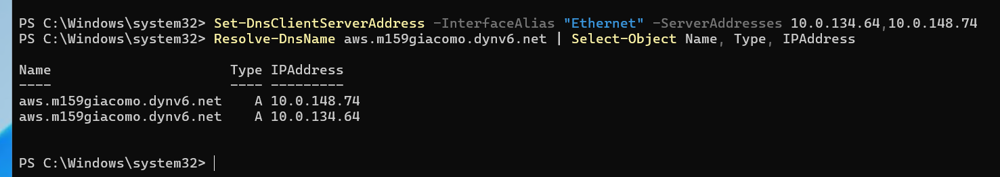

```powershell
$cred = New-Object System.Management.Automation.PSCredential("Admin@aws.m159giacomo.dynv6.net", $pw)
Add-Computer -DomainName aws.m159giacomo.dynv6.net -Credential $cred -Restart
```

Nach dem Neustart ist `adminctr1` in der AWS-Domäne, und ich bin als `aws\admin` angemeldet:

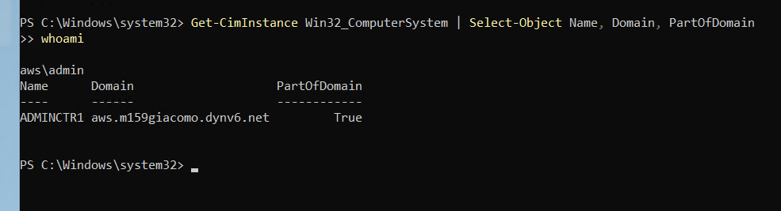

## 2. RSAT installieren

RSAT (Remote Server Administration Tools) sind die Verwaltungskonsolen für Active Directory,
Gruppenrichtlinien und DNS. Ich habe das ganze Paket installiert:

```powershell
Install-WindowsFeature -Name RSAT -IncludeAllSubFeature -IncludeManagementTools
```

Die Installation lief, das Fenster zeigte aber lange nichts an. Die Ausgabe erschien erst, als
ich `Ctrl+C` gedrückt habe. `Success` steht auf `True`, `Restart Needed` auf `Yes`:

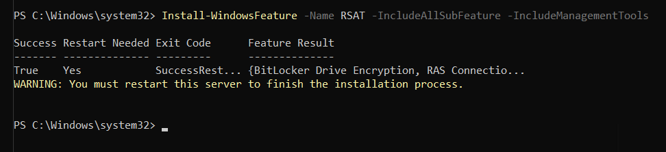

Nach dem Neustart habe ich die drei Konsolen geöffnet, die ich brauche.

**Active Directory Users and Computers** (`dsa.msc`) zeigt die AWS-Domäne. Bei AWS Managed AD
sind alle Objekte, die ich verwalten darf, in der OU `AWS` (benannt nach dem NetBIOS-Namen).
Dort gibt es die OUs `Computers` und `Users`:

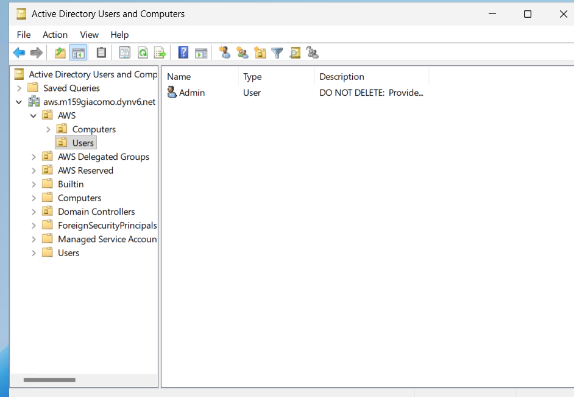

Als Test habe ich in `AWS` → `Users` den Benutzer `Test AWS` (`testaws`) angelegt:

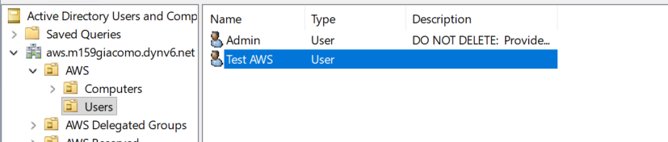

**Group Policy Management** (`gpmc.msc`) zeigt die Richtlinien der Domäne, darunter die
Default Domain Policy und die von AWS mitgelieferten:

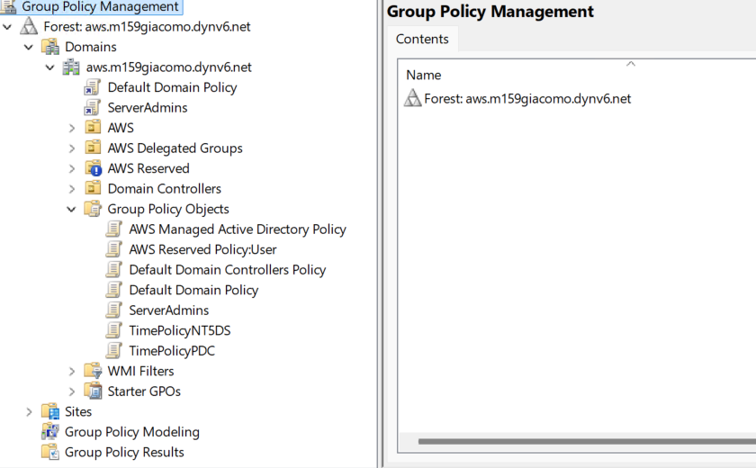

Wichtig: Der `Admin` von AWS Managed AD ist kein vollwertiger Domain Admin. Er darf nur in der
OU `AWS` Objekte anlegen und ändern. Die Standard-Container (`Users`, `Computers` an der
Wurzel) und die Domänencontroller-OU sind von AWS verwaltet.

## 3. Windows Admin Center installieren

Windows Admin Center (WAC) ist eine Webanwendung, mit der man Server im Browser verwaltet. Man
installiert sie auf einem Server (dem Gateway) und verwaltet von dort andere Server. Ich habe
die aktuelle Version (v2) von Microsoft heruntergeladen und auf `adminctr1` installiert.

Im Installer habe ich **Express setup** gewählt. Auf einem Windows Server nimmt er Port 443 und
ein selbst signiertes Zertifikat und legt die dazugehörige Windows-Firewallregel an:

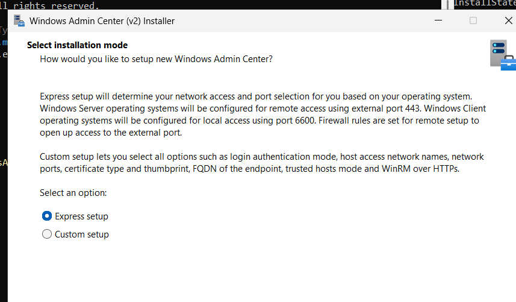

Updates sollen automatisch installiert werden (empfohlen). Die Installation schloss ohne Fehler
ab:

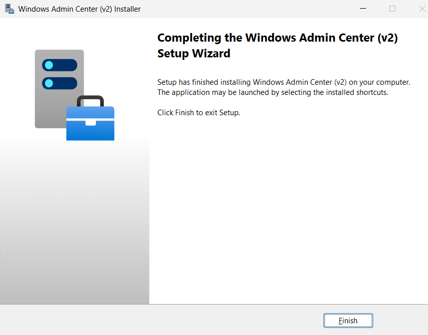

### Dienst prüfen

Der Dienst heisst in dieser Version `WindowsAdminCenter`. Er läuft unter `NT AUTHORITY\NetworkService`
und lauscht auf Port 443 (auf allen Adressen):

```powershell
$p = (Get-CimInstance Win32_Service -Filter "Name='WindowsAdminCenter'").ProcessId
Get-NetTCPConnection -State Listen -OwningProcess $p | Select-Object LocalAddress, LocalPort
```

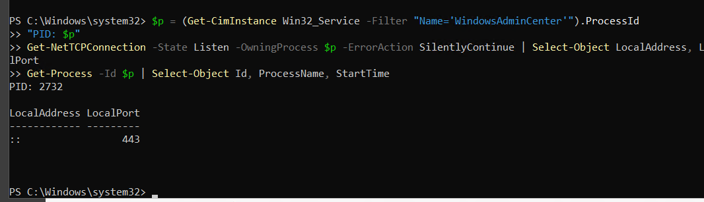

Direkt nach der Installation stand der Dienst auf `Stopped` und fiel nach dem Start wieder
um. Die Ursache habe ich in der Fehleranalyse unten beschrieben (Abschnitt 8).

## 4. Zugriff von aussen und Sicherheitsgruppe

`adminctr1` steht im öffentlichen Subnetz `public2` und hat eine öffentliche IP-Adresse.
Damit mein Laptop auf die Seite kommt, habe ich in der Sicherheitsgruppe `m159-client-sg` eine
Regel für **HTTPS (443)** mit der Quelle **meine IP / 32** angelegt. Das heisst: Nur mein Anschluss
darf die Seite überhaupt erreichen, nicht das ganze Internet.

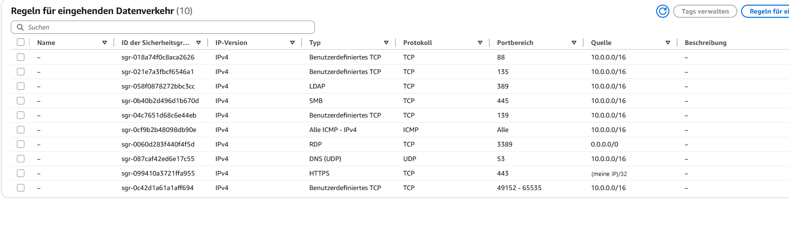

Beim ersten Aufruf von `https://<öffentliche IP>` zeigt der Browser «Nicht sicher». Das ist
erwartet, denn das Zertifikat ist selbst signiert, keine öffentliche Zertifizierungsstelle hat es
bestätigt. Ich habe die Warnung bewusst bestätigt und mich
mit dem **lokalen** `Administrator` von `adminctr1` angemeldet, nicht mit dem AWS-Domänenkonto.

## 5. dc1 über WinRM verbinden

Windows Admin Center spricht mit den verwalteten Servern über **WinRM**, den Windows-Dienst für
Remoteverwaltung (HTTP-Port 5985). Auf `dc1` läuft der Dienst schon:

```powershell
Get-Service WinRM | Select-Object Name, Status
Get-NetTCPConnection -LocalPort 5985 -State Listen | Select-Object LocalAddress, LocalPort
```

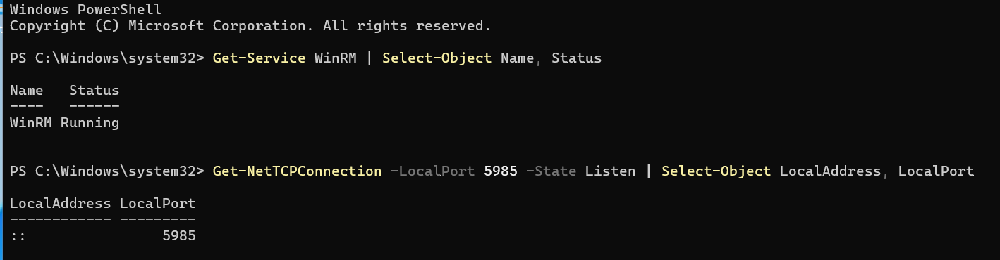

Von `adminctr1` aus kam ich aber nicht durch. Der Namenstest klappte (`dc1.corp.…` löst
sich über die bedingte Weiterleitung aus Auftrag 05 auf, und der Ping geht), nur der Port nicht:

```powershell
Test-NetConnection 10.0.0.10 -Port 5985
```

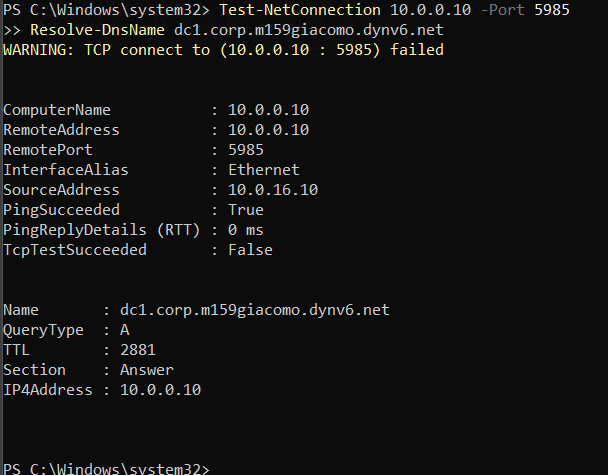

Der Grund war die Sicherheitsgruppe `m159-dc-sg` von `dc1`: Dort gab es keine Regel für Port 5985.
Ich habe eine Regel **WinRM-HTTP, 5985, Quelle `10.0.16.10/32`** angelegt. Das ist die private
Adresse von `adminctr1`, nur dieser eine Server darf WinRM auf `dc1` erreichen. Port 5986
(WinRM über HTTPS) habe ich nicht geöffnet, weil es auf `dc1` keinen HTTPS-Listener mit
Zertifikat gibt.

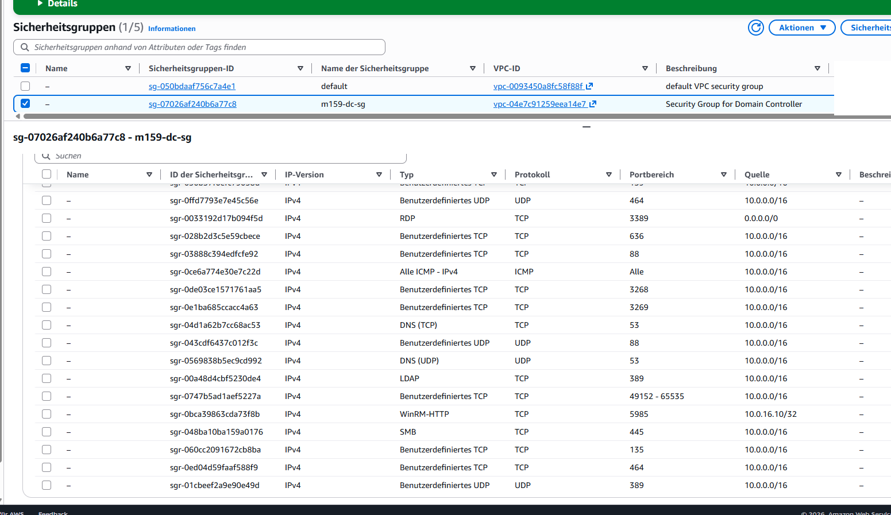

Danach funktioniert der Test:

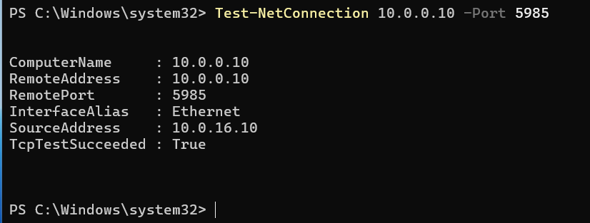

### dc1 in Windows Admin Center hinzufügen

Beim Hinzufügen von `dc1.corp.m159giacomo.dynv6.net` hat Windows Admin Center zuerst mit dem
Konto von `adminctr1` versucht, sich anzumelden, und die Meldung «Anmeldeinformationen
erforderlich» gezeigt. Das ist normal: `ADMINCTR1\Administrator` kennt `dc1` nicht. Ich habe
**Anderes Konto für diese Verbindung** gewählt und `CORP\Administrator` angegeben. Die
Anmeldeinformationen speichert Windows Admin Center nur für die Sitzung, und die Option «für
alle Verbindungen verwenden» habe ich nicht aktiviert.

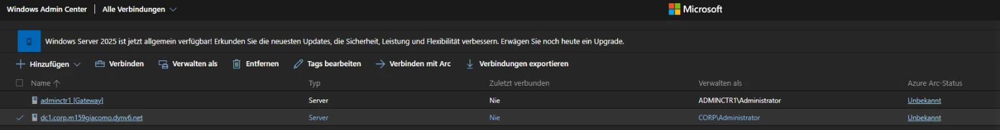

Die Übersicht von `dc1` zeigt Computername, Domäne `corp.m159giacomo.dynv6.net`, Windows
Server 2025 und die Live-Werte für CPU, Speicher und Netzwerk:

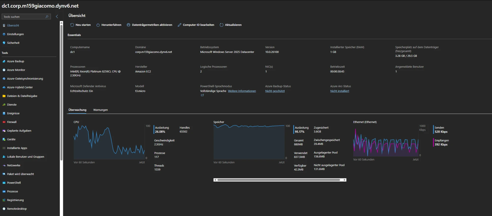

Dass nicht nur gelesen, sondern wirklich auf `dc1` gearbeitet wird, zeigt die PowerShell-Ansicht
von Windows Admin Center: `hostname` antwortet `dc1`, und `whoami` zeigt `corp\administrator`:

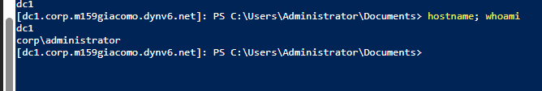

## 6. Entscheid: öffentliches oder privates Subnetz

`adminctr1` steht im **öffentlichen** Subnetz `public2` (`10.0.16.0/20`). Meine Begründung:

| Frage | Antwort |
| --- | --- |
| Wer muss die Seite erreichen? | Ich, von meinem Laptop aus dem Internet. |
| Was bräuchte ein privates Subnetz? | Einen Zugang von aussen: ein VPN, einen Jump Host oder einen Load Balancer. Das ist für diesen Auftrag unverhältnismässig. |
| Was bräuchte `adminctr1` sonst? | Das Herunterladen von Windows Admin Center und Updates braucht Internet. Im privaten Subnetz ginge das nur mit einem NAT-Gateway, und das kostet Geld. |
| Wie begrenze ich das Risiko? | Mit der Sicherheitsgruppe: Port 443 nur für meine IP. |

Ein privates Subnetz mit VPN wäre in einer echten Umgebung besser. Hier war der öffentliche
Weg mit enger Sicherheitsgruppe die kleinste Lösung, die den Auftrag erfüllt.

## 7. Sicherheitsüberlegungen

Windows Admin Center ist ein mächtiges Werkzeug: Wer sich anmelden kann, kann alle verbundenen
Server steuern. Deshalb habe ich so wenig wie möglich offen gelassen.

| Massnahme | Wirkung |
| --- | --- |
| **443 nur für meine IP (`/32`)** | Das Verwaltungsportal ist nicht aus dem ganzen Internet erreichbar. |
| **WinRM (5985) nur von `10.0.16.10/32`** | Nur `adminctr1` darf `dc1` verwalten, nicht das ganze VPC und nicht das Internet. |
| **Kein Port 5986 geöffnet** | Es gibt dort keinen Listener, also auch keine Regel. |
| **Anmeldung mit dem lokalen `Administrator`** von `adminctr1` | Für die Weboberfläche brauche ich kein Domänenkonto der AWS-Domäne. |
| **`CORP\Administrator` nur für die Sitzung** | Die Zugangsdaten für `dc1` werden nicht dauerhaft gespeichert. |
| **Automatische Updates für Windows Admin Center** | Sicherheitslücken im Portal werden ohne mein Zutun geschlossen. |
| **Dienstkonto `NetworkService`** | Der Dienst läuft nicht als `SYSTEM`, hat also weniger Rechte. |
| **Domänencontroller von AWS im privaten Subnetz** | Aus Auftrag 05, die AWS-DCs sind nicht aus dem Internet erreichbar. |

**Offene Risiken, die ich kenne:**
- **Selbst signiertes Zertifikat.** Der Browser warnt, und ein Angreifer im Netz dazwischen
  könnte sich als Server ausgeben. Besser wäre ein Zertifikat einer echten Zertifizierungsstelle
  für einen Namen wie `admin.m159giacomo.dynv6.net`.
- **WinRM über HTTP.** In einer Domäne verschlüsselt Kerberos den Inhalt der WinRM-Nachrichten,
  trotzdem wäre WinRM über HTTPS (5986) mit Zertifikat sauberer.
- **RDP (3389) ist aus dem ganzen Internet erreichbar** (`0.0.0.0/0`). Das ist das grösste Risiko
  in meiner Umgebung. Besser wäre «meine IP» oder ein Jump Host.
- **Meine IP ändert sich** (Anbieter oder Standort). Dann komme ich nicht mehr auf die Seite und
  muss die Regel in AWS neu setzen.
- **Ein Konto für alle Server.** `CORP\Administrator` hat in `corp` alle Rechte. In einer
  produktiven Umgebung würde ich ein eigenes Konto für die Verwaltung mit den nötigen Rechten
  verwenden.

## 8. Fehleranalyse

**RSAT: «Provider_UserIsNotAdmininistrator».** Der erste Versuch von `Install-WindowsFeature`
scheiterte mit der Meldung, die PowerShell-Sitzung habe keine ausreichenden Rechte (Success:
False). Die Konsole war nicht als Administrator gestartet (keine erhöhten Rechte). Mit einer
PowerShell **als Administrator** lief die Installation.

**RSAT: Fenster scheint zu hängen.** Nach dem Start zeigte das Fenster nichts mehr an, und
`Get-Process TiWorker,TrustedInstaller,dism` fand keinen Installationsprozess. Als ich `Ctrl+C`
drückte, erschien die Ausgabe: Die Installation war längst fertig (`Success: True`), das Fenster
hatte die Ausgabe nur nicht gezeichnet.

**Windows Admin Center: Dienst fällt um.** Nach der Installation stand der Dienst auf `Stopped`.
Beim Start lief er und fiel nach kurzer Zeit wieder zurück. Im Ereignisprotokoll steht der
Absturz `APPCRASH` und die .NET-Meldung `Win32Exception (5): Access is denied` in
`ServiceProcessManager.StopOrphanProcessesAsync` → `Process.Kill()`. Das Programm versucht beim
Start, übrig gebliebene Prozesse eines früheren Laufs zu beenden, und `NetworkService` darf das
nicht. Ich habe die verbliebenen `WindowsAdminCenter`-Prozesse als Administrator beendet
(`Get-Process | Where-Object Path -like "*WindowsAdminCenter*" | Stop-Process`, der Prozess für
die Kontenverwaltung blieb) und den Dienst danach neu gestartet. Seither läuft er, auch nach dem
Neustart des Labs. Dass es wirklich ein übrig gebliebener Prozess war, habe ich nicht belegt, ich
schliesse es aus der Fehlermeldung und daraus, dass der Dienst danach lief.

**Dienstname beim Prüfen.** Meine erste Abfrage `Get-Service ServerManagementGateway` fand
nichts: Das ist der Name aus der älteren Version. In v2 heisst der Dienst `WindowsAdminCenter`.

**WinRM: Port 5985 geschlossen.** Siehe Abschnitt 5. Namensauflösung und Ping gingen, nur der
Port nicht. Der Grund war eine fehlende Regel in der Sicherheitsgruppe von `dc1`, nicht Windows
oder WinRM. Dass `Get-NetTCPConnection` auf `dc1` den Port 5985 als `Listen` zeigte, hat mir
gezeigt, dass der Fehler nicht auf `dc1` selbst lag.

## 9. Aufräumen

Nach der Abnahme (zusammen mit Auftrag 05):
- Das Computerobjekt `adminctr1` bleibt in meiner Domäne `corp` stehen, weil der Austritt ohne
  Zugangsdaten gemacht wurde. Ich lösche es auf `dc1`:
  `Get-ADComputer adminctr1 | Remove-ADObject -Recursive -Confirm:$false`.
- Das AWS-Verzeichnis, den Trust und den Conditional Forwarder entferne ich wie in Auftrag 05.
- Die Regeln für 443 (`m159-client-sg`) und 5985 (`m159-dc-sg`) sind nur für diesen Auftrag nötig
  und werden mit dem Aufräumen entfernt.
- Den Testbenutzer `testaws` lösche ich mit dem AWS-Verzeichnis.
