# DIT und Gruppenrichtlinien (GPO)

Dokumentation zu Auftrag 07: Directory Information Tree (DIT), Struktur im AD und sechs
Gruppenrichtlinien-Aufgaben. Aufgabenstellung siehe
[Modul-Repository](https://gitlab.com/ch-tbz-it/Stud/m159/-/tree/main/03-auftraege/07-dit-gpos).

Autor: Giacomo Betsch, Klasse Pe24d

Domäne: `corp.m159giacomo.dynv6.net` (`DC=corp,DC=m159giacomo,DC=dynv6,DC=net`), siehe
[Planung](../01-planung/planung.md). Alle Befehle liefen auf dc1, die Tests auf client1.
Passwörter stehen nicht in diesem Repository.

## 1. DIT

Der DIT bildet `Intern` und `Extern` als eigene Ebene unter der Domäne ab. Darunter liegt jede
Abteilung genau einmal als OU. Die letzte Ebene trennt in jeder Abteilung Benutzer- und
Computerkonten. Alle Namen sind eindeutig.

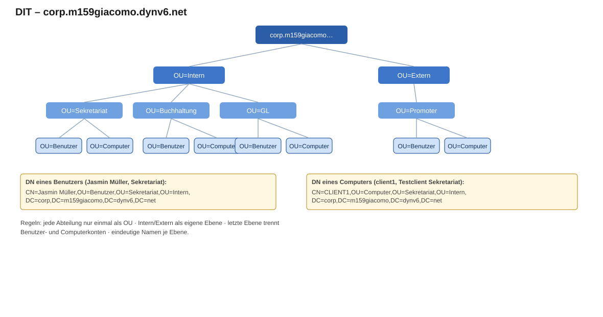

Ansicht des Diagramms als Bild:

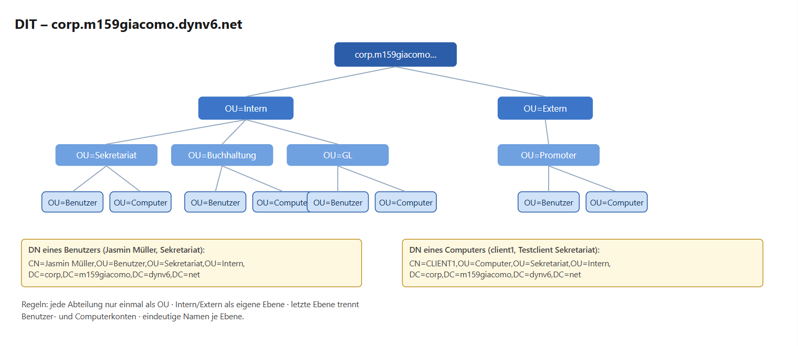

Beispiel-DNs (im Diagramm eingezeichnet):

- Benutzer Jasmin Müller (Sekretariat):
  `CN=Jasmin Müller,OU=Benutzer,OU=Sekretariat,OU=Intern,DC=corp,DC=m159giacomo,DC=dynv6,DC=net`
- Computer client1 (Testclient, im Diagramm beispielhaft beim Sekretariat):
  `CN=CLIENT1,OU=Computer,OU=Sekretariat,OU=Intern,DC=corp,DC=m159giacomo,DC=dynv6,DC=net`

Im Labor gibt es nur einen gemeinsamen Testclient. Er steht nur zur Illustration des
Computer-DN im Diagramm, im AD liegt er weiter im Standardcontainer *Computers*.

## 2. Struktur im AD anlegen und Benutzer verschieben

```powershell
$domDN = "DC=corp,DC=m159giacomo,DC=dynv6,DC=net"

New-ADOrganizationalUnit -Name "Intern" -Path $domDN
New-ADOrganizationalUnit -Name "Extern" -Path $domDN

foreach ($a in "Sekretariat","Buchhaltung","GL") {
    New-ADOrganizationalUnit -Name $a -Path "OU=Intern,$domDN"
    New-ADOrganizationalUnit -Name "Benutzer" -Path "OU=$a,OU=Intern,$domDN"
    New-ADOrganizationalUnit -Name "Computer" -Path "OU=$a,OU=Intern,$domDN"
}
New-ADOrganizationalUnit -Name "Promoter" -Path "OU=Extern,$domDN"
New-ADOrganizationalUnit -Name "Benutzer" -Path "OU=Promoter,OU=Extern,$domDN"
New-ADOrganizationalUnit -Name "Computer" -Path "OU=Promoter,OU=Extern,$domDN"

Move-ADObject -Identity (Get-ADUser jmueller).DistinguishedName -TargetPath "OU=Benutzer,OU=Sekretariat,OU=Intern,$domDN"
Move-ADObject -Identity (Get-ADUser tbucher).DistinguishedName -TargetPath "OU=Benutzer,OU=Buchhaltung,OU=Intern,$domDN"
Move-ADObject -Identity (Get-ADUser slehmann).DistinguishedName -TargetPath "OU=Benutzer,OU=GL,OU=Intern,$domDN"
Move-ADObject -Identity (Get-ADUser kpromoter).DistinguishedName -TargetPath "OU=Benutzer,OU=Promoter,OU=Extern,$domDN"
```

Die OU-Struktur stimmt mit dem DIT überein (die OUs `User`, `IT`, `Marketing`, `Support` stammen
aus [Auftrag 09](../09-automation-und-debugging/identity-management-und-debugging.md)):

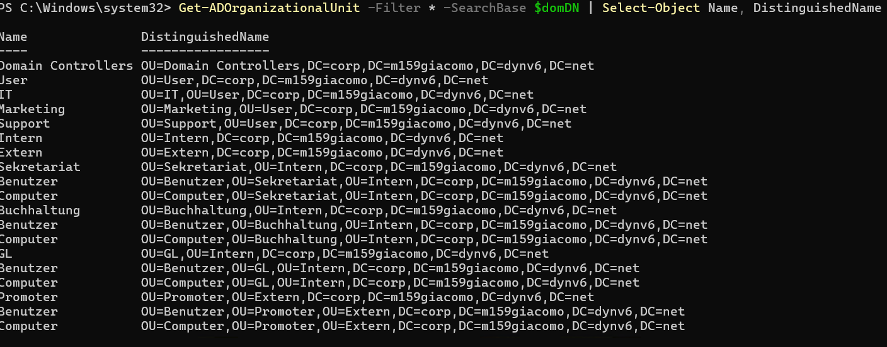

Alle vier Benutzer liegen in der OU `Benutzer` ihrer Abteilung:

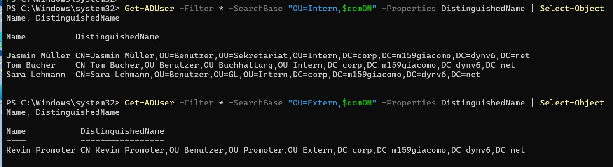

## 3. Namenskonvention für GPOs

Nach Kapitel 5.4 des Gruppenrichtlinien-Buchs setzt sich ein GPO-Name aus Kategorie, Zweck und
dem Hinweis auf Computer- oder Benutzereinstellungen zusammen. Ich verwende:

```
<Kategorie> <Zweck> <Comp|User> - GB
```

`GB` sind meine Initialen als Bearbeiter. Beispiele: `Konfiguration Netzlaufwerk Intern User - GB`,
`Installation 7-Zip Comp - GB`.

## 4. Teil 1: Passwortrichtlinie in der Default Domain Policy

Nur die Passwortrichtlinien wurden geändert, sonst nichts an den Standardrichtlinien. Die
Passwortkomplexität und das Erzwingen einer Passwortänderung sind deaktiviert (gilt nur für die
Testumgebung):

```powershell
Set-ADDefaultDomainPasswordPolicy -Identity corp.m159giacomo.dynv6.net -ComplexityEnabled $false -MaxPasswordAge (New-TimeSpan -Days 0)
Get-ADDefaultDomainPasswordPolicy
```

`ComplexityEnabled` steht auf `False`, `MaxPasswordAge` auf `00:00:00`:

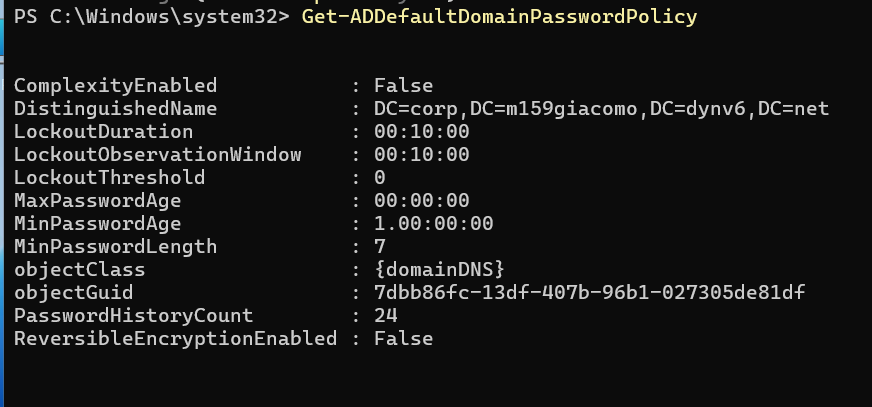

## 5. Teil 2: Netzlaufwerke per GPO

Sechs GPOs verteilen die Laufwerke. Sie sind mit den passenden OUs verknüpft und arbeiten
nicht über die Zielgruppenadressierung. Die Buchstaben habe ich selbst festgelegt:

| GPO | Laufwerke | verknüpft mit |
| --- | --- | --- |
| `Konfiguration Netzlaufwerk Intern User - GB` | `P:` Pool, `I:` Intern | `OU=Intern` |
| `Konfiguration Netzlaufwerk Extern User - GB` | `P:` Pool, `E:` Extern | `OU=Extern` |
| `Konfiguration Netzlaufwerk Sekretariat User - GB` | `S:` Sekretariat | `OU=Benutzer,OU=Sekretariat,OU=Intern` |
| `Konfiguration Netzlaufwerk Buchhaltung User - GB` | `B:` Buchhaltung | `OU=Benutzer,OU=Buchhaltung,OU=Intern` |
| `Konfiguration Netzlaufwerk GL User - GB` | `G:` GL | `OU=Benutzer,OU=GL,OU=Intern` |
| `Konfiguration Netzlaufwerk Promoter User - GB` | `M:` Promoter | `OU=Benutzer,OU=Promoter,OU=Extern` |

Die GPOs habe ich mit `New-GPO` und `New-GPLink` angelegt. Die Laufwerke sind Einstellungen
unter *User Configuration → Preferences → Windows Settings → Drive Maps*, dafür gibt es kein
PowerShell-Cmdlet. Alle Einträge haben die Aktion `Create` und *Reconnect*.

Die GPO für Intern mit den Laufwerken `I:` und `P:`:

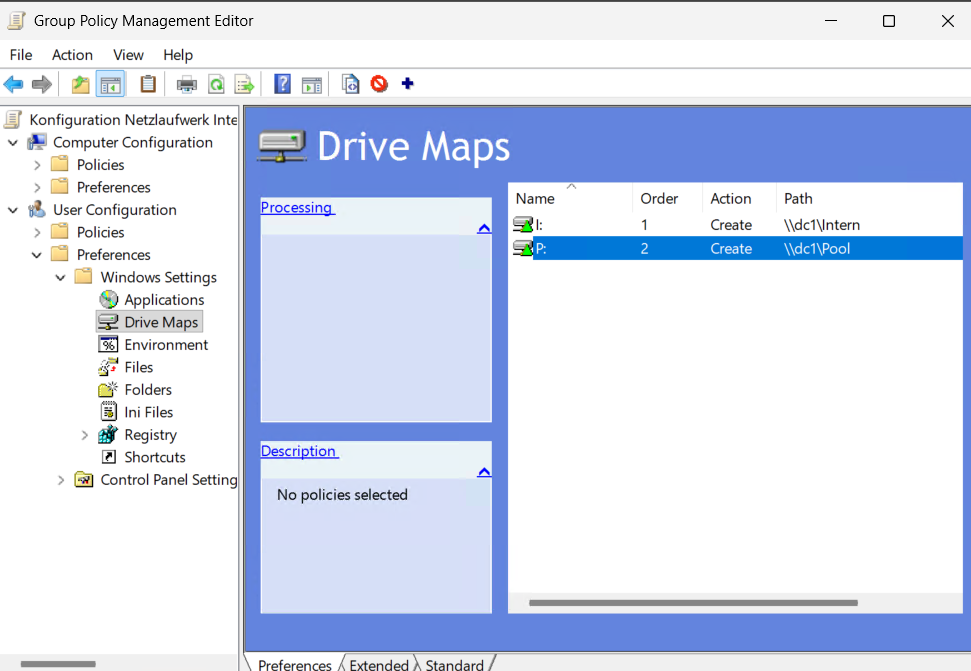

Ein Eintrag im Detail (Buchhaltung, `B:` auf `\\dc1\Abteilungen\Buchhaltung`):

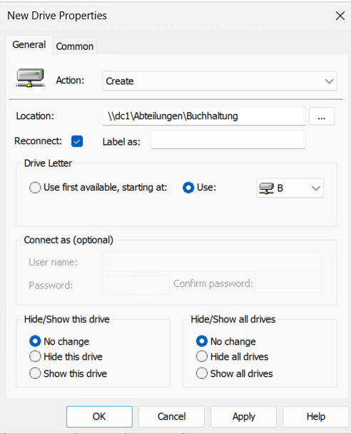

**Test:** Angemeldet auf client1 als `CORP\jmueller` (Sekretariat). `gpresult /r` zeigt die
angewendeten GPOs `Netzlaufwerk Sekretariat` und `Netzlaufwerk Intern`. Im Explorer erscheinen
genau `I:`, `P:` und `S:`, aber nicht `E:`, `B:`, `G:`, `M:`:

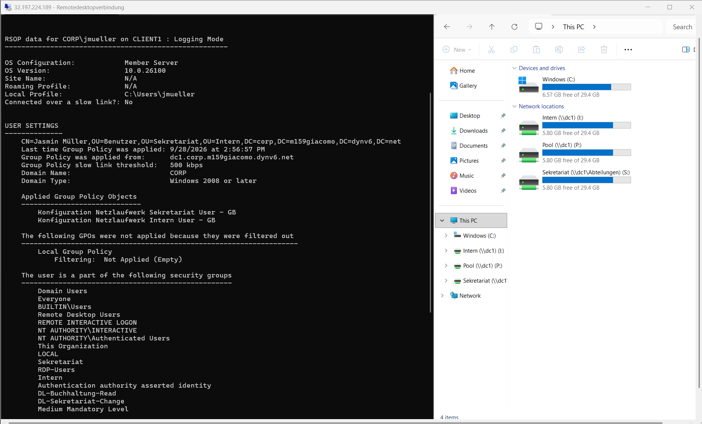

## 6. Teil 3: Desktop-Verknüpfung mit positiver Sicherheitsfilterung

Die GPO `Konfiguration Desktop-Verknuepfung CRM User - GB` ist mit der obersten Ebene (der
Domäne) verknüpft. Damit nur interne Benutzer sie erhalten, habe ich die positive
Sicherheitsfilterung verwendet: `Authenticated Users` entfernt und stattdessen die Gruppe
`Intern` mit `GpoApply` eingetragen. Zusätzlich bekommt `Domain Computers` das Leserecht
(`GpoRead`). Seit dem Patch MS16-072 werden Benutzer-GPOs im Kontext des Computers gelesen, ohne
dieses Recht würde die GPO nicht mehr angewendet.

```powershell
New-GPO -Name "Konfiguration Desktop-Verknuepfung CRM User - GB"
New-GPLink -Name "Konfiguration Desktop-Verknuepfung CRM User - GB" -Target $domDN
Set-GPPermission -Name "Konfiguration Desktop-Verknuepfung CRM User - GB" -TargetName "Authenticated Users" -TargetType Group -PermissionLevel None
Set-GPPermission -Name "Konfiguration Desktop-Verknuepfung CRM User - GB" -TargetName "Intern" -TargetType Group -PermissionLevel GpoApply
Set-GPPermission -Name "Konfiguration Desktop-Verknuepfung CRM User - GB" -TargetName "Domain Computers" -TargetType Group -PermissionLevel GpoRead
```

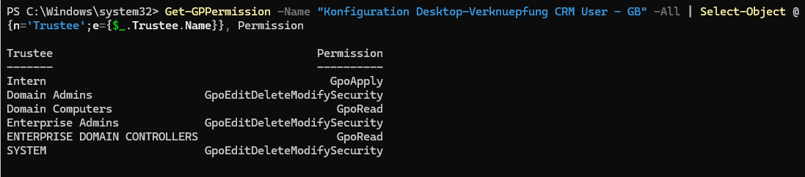

Die Verknüpfung `Web-CRM` (Ziel `https://crm.webapp.ch`, Ort Desktop) ist ein Preference-Element
unter *User Configuration → Preferences → Windows Settings → Shortcuts*:

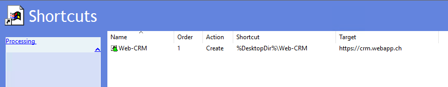

**Test:** Ein interner Benutzer (Sekretariat) sieht die Verknüpfung auf dem Desktop:

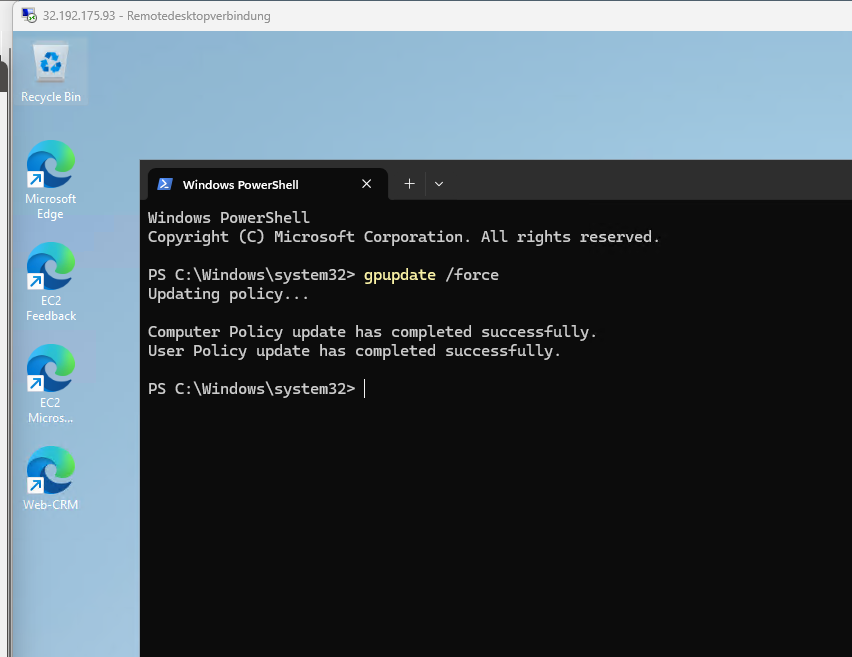

Der externe Benutzer `kpromoter` sieht sie nicht:

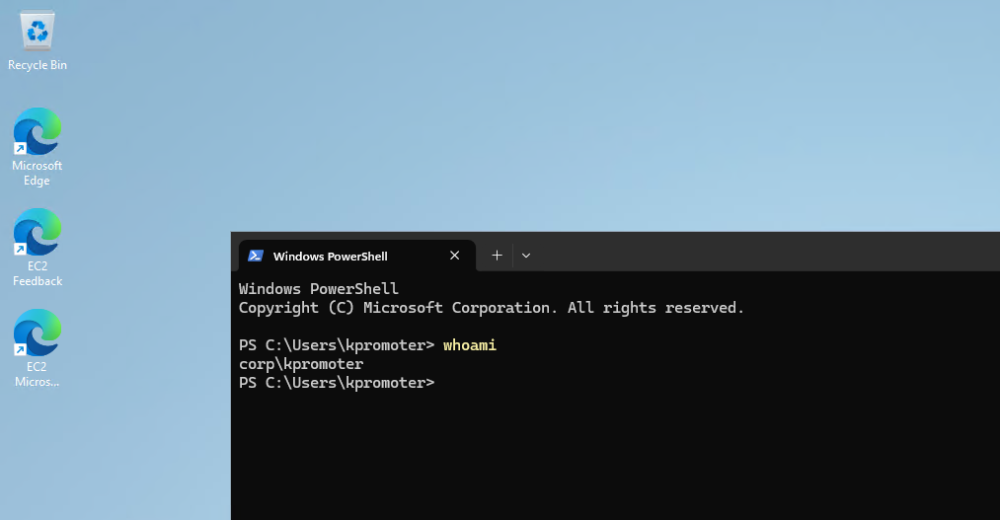

## 7. Teil 4: GPO mit WMI-Filter

Client1 ist ein **Windows Server 2025** (Version `10.0.26100`, `ProductType 3`), kein
Windows 10. Der geforderte Windows-10-Filter schliesst client1 deshalb korrekt aus. Damit ich
trotzdem zeigen kann, dass die GPO und der Mechanismus funktionieren, habe ich zwei Filter
angelegt und nacheinander getestet:

| Filter | Abfrage |
| --- | --- |
| `Windows 10 Arbeitsstation` (gefordert) | `SELECT * FROM Win32_OperatingSystem WHERE Version LIKE "10.0.1%" AND ProductType = "1"` |
| `TEST Windows Server 2025` (nur zum Testen) | `SELECT * FROM Win32_OperatingSystem WHERE Version LIKE "10.0.26100%" AND ProductType = "3"` |

Windows 10 hat Build-Nummern `10.0.1xxxx`, Windows 11 beginnt bei `10.0.22000`. `ProductType = 1`
steht für eine Arbeitsstation (kein Server).

Vorbereitung: Die leere Datei `WMI-Filter.txt` auf der Freigabe `Pool`, die GPO
`Konfiguration Textdatei kopieren User - GB`, verknüpft mit `OU=Promoter,OU=Extern`:

```powershell
New-Item -ItemType File -Path "C:\Daten\Pool\WMI-Filter.txt" -Force
New-GPO -Name "Konfiguration Textdatei kopieren User - GB"
New-GPLink -Name "Konfiguration Textdatei kopieren User - GB" -Target "OU=Promoter,OU=Extern,$domDN"
```

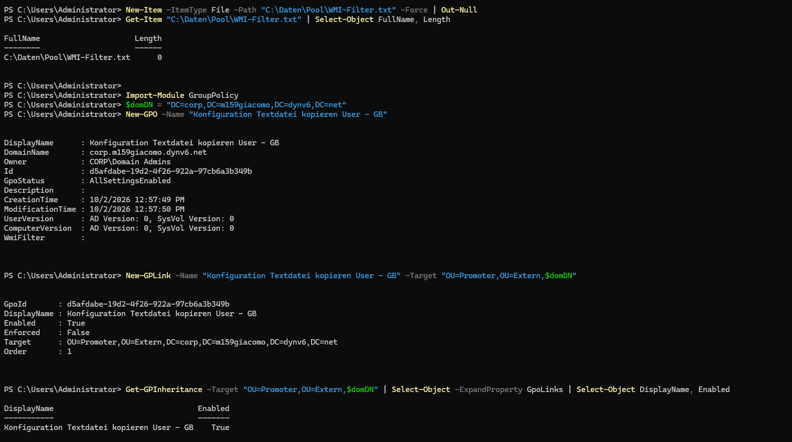

Der Windows-10-Filter in der Gruppenrichtlinienverwaltung (unter *WMI Filters*):

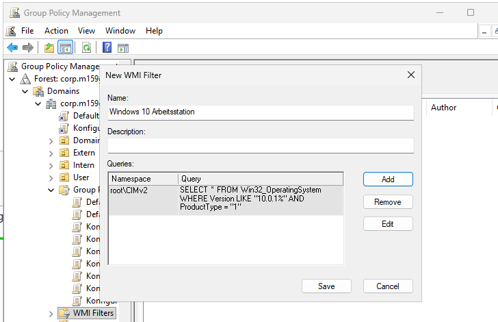

Die GPO kopiert die Datei per Preference *Files* (User Configuration) nach `%temp%`. Der
Dateiname steht im Zielpfad, die Aktion ist `Replace`:

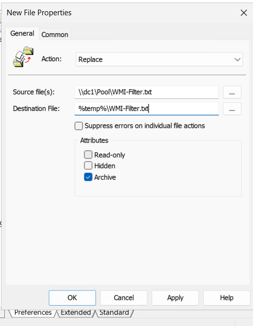

Im Reiter *Common* ist *Run in logged-on user's security context* aktiviert:

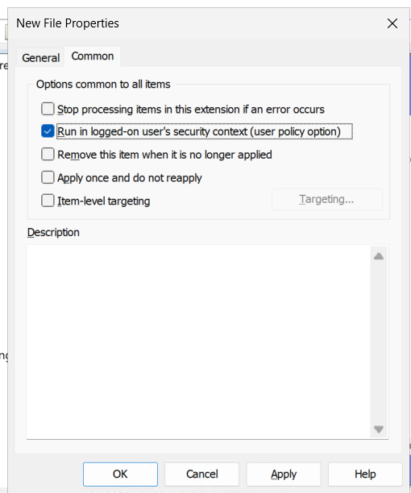

### Test mit dem Server-2025-Filter: Datei kommt an

Zuerst war der Test-Filter an die GPO gebunden:

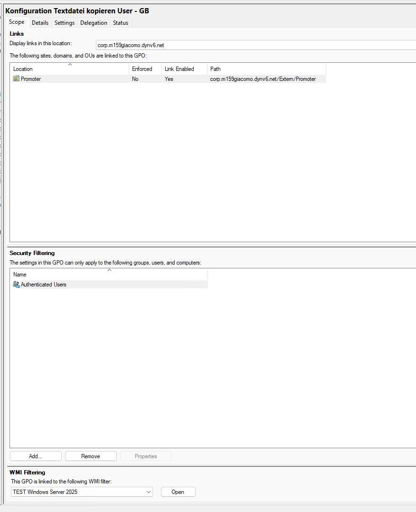

Angemeldet als `kpromoter` auf client1 fand ich die Datei zunächst nicht in `$env:TEMP`:

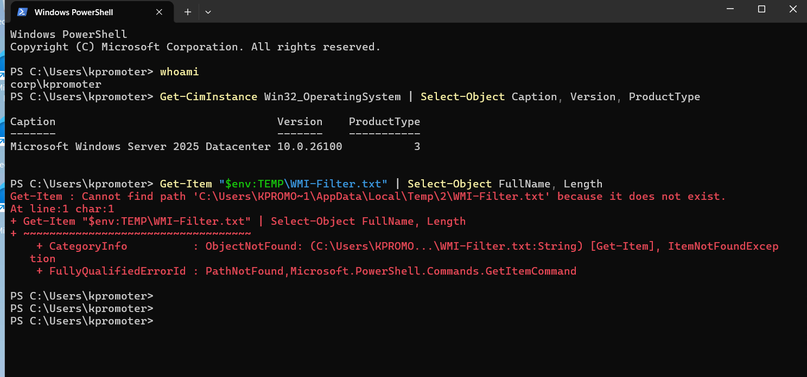

Die Ursache: In einer RDP-Sitzung hängt Windows eine Ziffer an den Temp-Pfad
(`...\Temp\2`). Der Gruppenrichtlinien-Dienst löst `%temp%` ohne diese Ziffer auf und hat die
Datei direkt in `C:\Users\kpromoter\AppData\Local\Temp\` abgelegt:

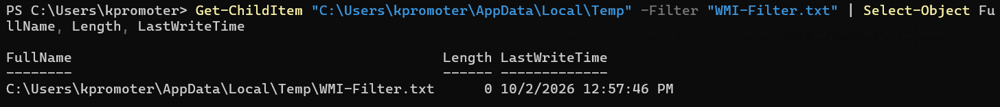

`gpresult /r /scope user` bestätigt, dass die GPO angewendet wurde:

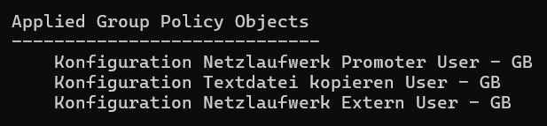

Die HTML-Auswertung `gpresult /h` (in diesem Zustand erstellt) liegt als
[gpo.html](resources/gpo.html) im Repository. Die Datei habe ich auf die Freigabe `Pool` kopiert:

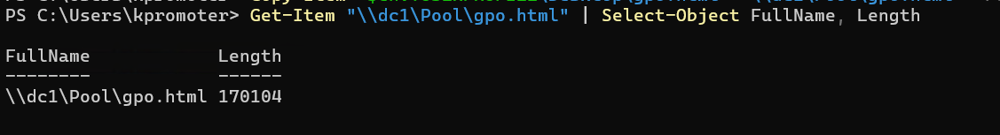

### Test mit dem Windows-10-Filter: Datei bleibt aus

Danach habe ich den Filter der GPO auf `Windows 10 Arbeitsstation` umgestellt:

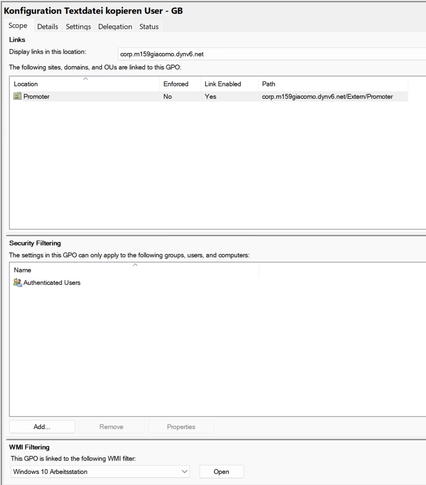

Nach dem Löschen der Datei und einem neuen Anmelden wird sie nicht mehr kopiert:

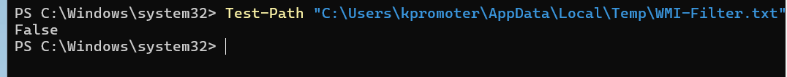

`gpresult` zeigt die GPO unter den gefilterten GPOs mit `Denied (WMI Filter)`. Darunter steht
auch `Konfiguration Desktop-Verknuepfung CRM User - GB` mit `Denied (Security)`, weil
`kpromoter` nicht in der Gruppe `Intern` ist:

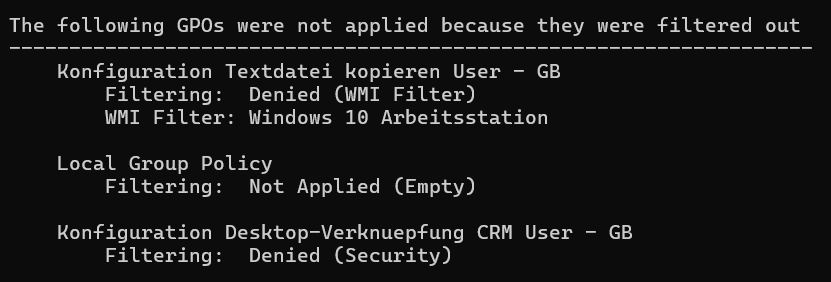

Der Endzustand der GPO ist der geforderte Windows-10-Filter.

## 8. Teil 5: Drucker

Zwei fiktive Drucker mit der fiktiven IP `10.0.0.99` auf dc1. Der Treiber
`Microsoft PCL6 Class Driver` war nicht in der Liste der installierten Treiber, ich habe ihn
mit `Add-PrinterDriver` nachgeladen. `Drucker_Farbe` hat als Standard Farbe, `Drucker_SW`
Schwarzweiss. Beide sind freigegeben:

```powershell
Add-PrinterDriver -Name "Microsoft PCL6 Class Driver"
Add-PrinterPort -Name "IP_10.0.0.99" -PrinterHostAddress "10.0.0.99"
Add-Printer -Name "Drucker_Farbe" -DriverName "Microsoft PCL6 Class Driver" -PortName "IP_10.0.0.99"
Add-Printer -Name "Drucker_SW" -DriverName "Microsoft PCL6 Class Driver" -PortName "IP_10.0.0.99"
Set-PrintConfiguration -PrinterName "Drucker_Farbe" -Color $true
Set-PrintConfiguration -PrinterName "Drucker_SW" -Color $false
Set-Printer -Name "Drucker_Farbe" -Shared $true -ShareName "Drucker_Farbe"
Set-Printer -Name "Drucker_SW" -Shared $true -ShareName "Drucker_SW"
```

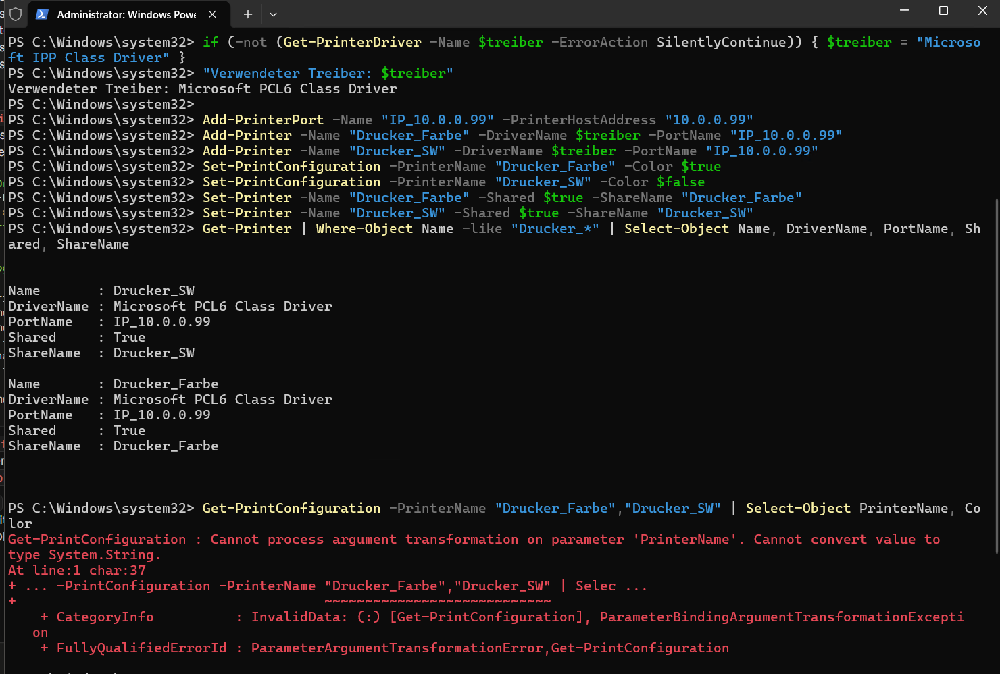

Kontrolle der Standardfarbe (`Drucker_Farbe` Farbe, `Drucker_SW` Schwarzweiss):

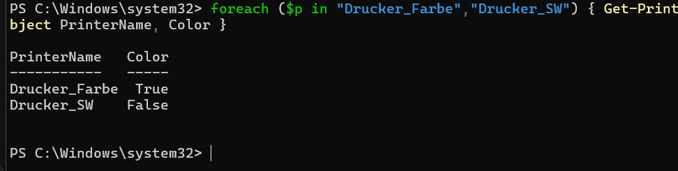

Die GPO `Konfiguration Drucker User - GB` ist mit `OU=Intern` und `OU=Extern` verknüpft. Sie
verteilt beide Drucker als *Shared Printer* (*User Configuration → Preferences → Control Panel
Settings → Printers*) per UNC-Pfad `\\dc1.corp.m159giacomo.dynv6.net\Drucker_Farbe` bzw.
`...\Drucker_SW`, Aktion `Replace`. Den Standarddrucker setzt die GPO nicht, sonst würden sich
die zwei Einträge gegenseitig überschreiben.

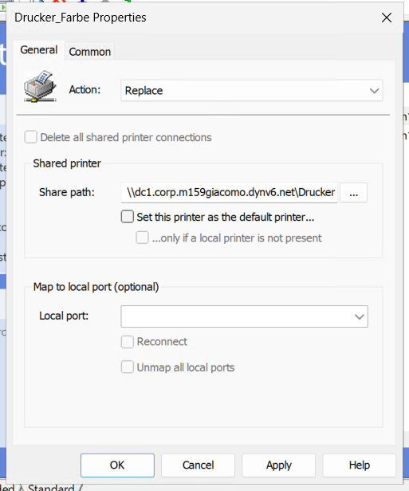

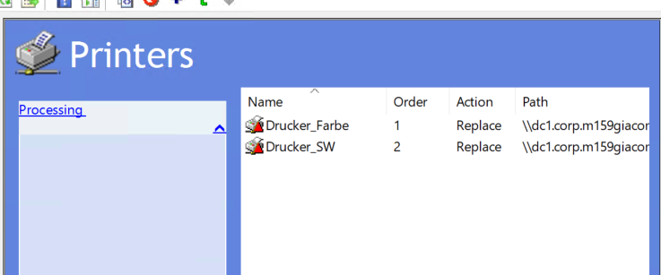

**Test:** Als `CORP\jmueller` auf client1 ist die GPO angewendet und beide Drucker sind als
Verbindung vorhanden:

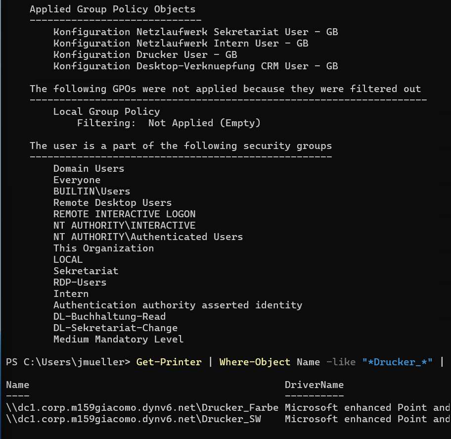

Verteilung nachgewiesen (Drucker löschen, `gpupdate /force`, Drucker erscheinen wieder). Die
Befehle mit Ausgabe, mit `whoami` und `hostname` am Anfang als Nachweis meiner Umgebung:

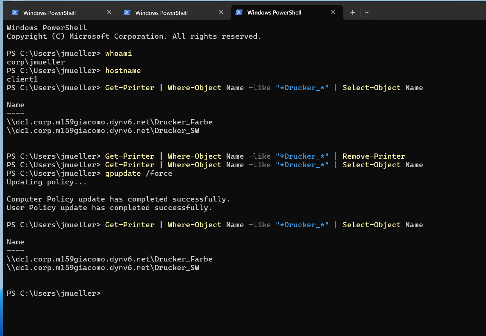

Das Video dazu: [drucker-video.mp4](resources/drucker-video.mp4).

## 9. Teil 6: 7-Zip per GPO

Als Quelle dient eine eigene Freigabe `Software` auf dc1. Die Freigabeberechtigung ist
`Everyone = Lesen` (so verhindert man den Fehler `%%1274`), auf Dateisystemebene haben die
Domänencomputer Lesen und Ausführen. Dazu die Sicherheitsgruppe `7-Zip` mit dem Computer
`client1`:

```powershell
New-Item -ItemType Directory -Path "C:\Software" -Force
New-SmbShare -Name "Software" -Path "C:\Software" -ReadAccess "Everyone"
icacls "C:\Software" /grant "CORP\Domain Computers:(OI)(CI)RX"
New-ADGroup -Name "7-Zip" -GroupScope Global -GroupCategory Security
Add-ADGroupMember -Identity "7-Zip" -Members (Get-ADComputer client1)
```

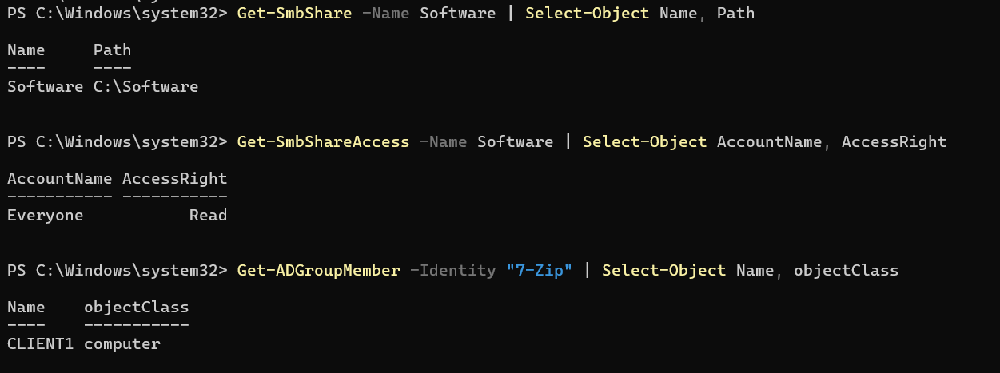

Das MSI-Paket `7z2604-x64.msi` (7-Zip 26.04, von 7-zip.org) liegt in `C:\Software`:

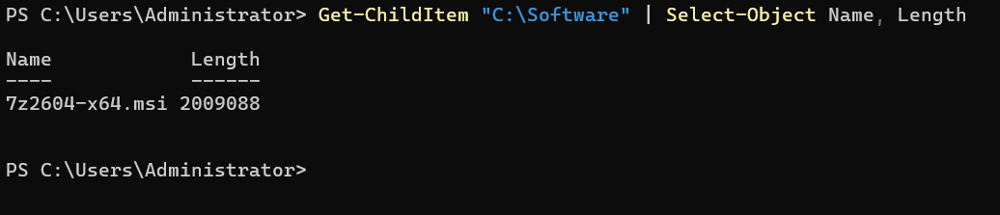

Die GPO `Installation 7-Zip Comp - GB` ist mit der gesamten Domäne verknüpft und enthält das
Paket unter *Computer Configuration → Policies → Software Settings → Software installation*,
Bereitstellung `Assigned`, Quelle `\\dc1.corp.m159giacomo.dynv6.net\Software\7z2604-x64.msi`:

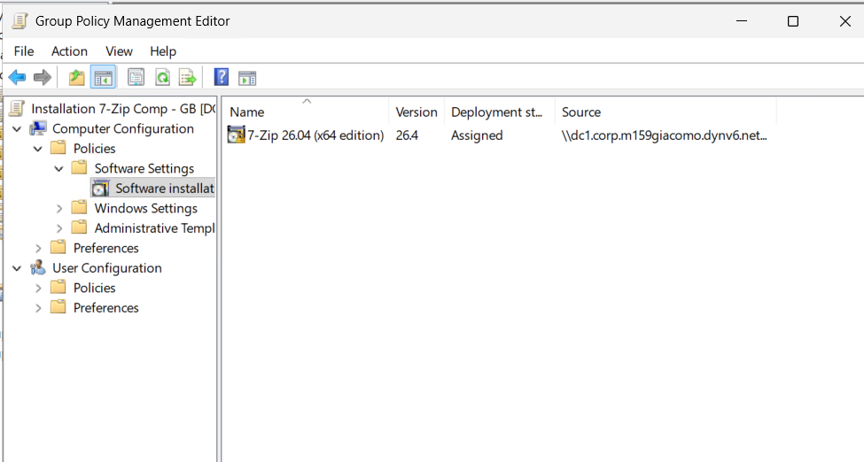

**Zur Zielgruppenadressierung:** Die Softwareinstallation per Gruppenrichtlinie kennt keine
Zielgruppenadressierung (Item-Level-Targeting), die gibt es nur bei den Einstellungs-Elementen
wie Dateien oder Laufwerken. Damit trotzdem nur Computer der Gruppe `7-Zip` die Software
erhalten, habe ich die **Sicherheitsfilterung** verwendet: `Authenticated Users` entfernt,
Gruppe `7-Zip` mit `GpoApply` eingetragen.

```powershell
New-GPO -Name "Installation 7-Zip Comp - GB"
New-GPLink -Name "Installation 7-Zip Comp - GB" -Target $domDN
Set-GPPermission -Name "Installation 7-Zip Comp - GB" -TargetName "Authenticated Users" -TargetType Group -PermissionLevel None
Set-GPPermission -Name "Installation 7-Zip Comp - GB" -TargetName "7-Zip" -TargetType Group -PermissionLevel GpoApply
```

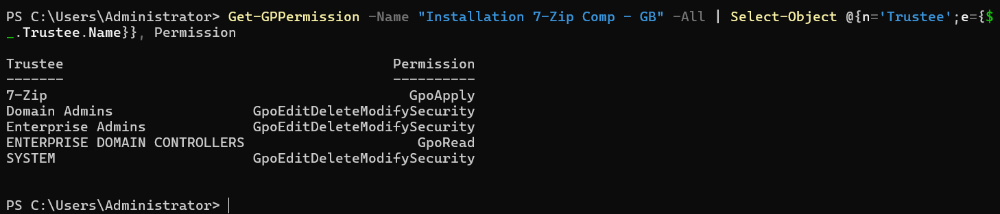

**Test:** Vor dem Neustart ist 7-Zip auf client1 nicht installiert:

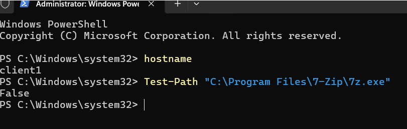

Nach dem Neustart (die Installation läuft beim Start des Computers) ist es da, mit Version
26.04:

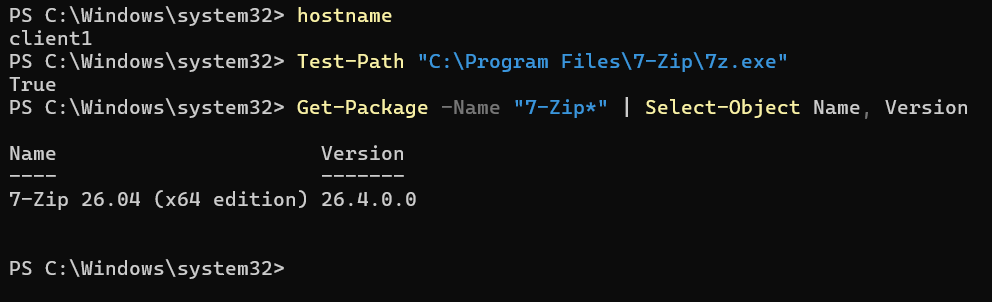

In der Ereignisanzeige (Application, gefiltert auf `MsiInstaller` und `Application
Management`) stehen die Windows-Installer-Ereignisse `1040` (Beginn der Transaktion) und `1042`
(Ende) als Benutzer `SYSTEM`, also die Installation durch die Computerzuweisung:

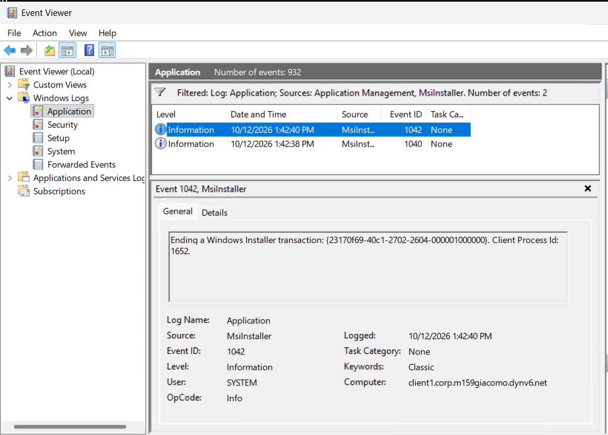

## 10. Abgabe

- Auswertung `gpo.html`: [resources/gpo.html](resources/gpo.html)
- Video zum Druckertest: [resources/drucker-video.mp4](resources/drucker-video.mp4)
- Screenshots und das DIT-Diagramm: Ordner [resources](resources)
