# Suche im Directory

Dokumentation zu Auftrag 08: LDAP-Bind und LDAP-Suche, ein Suchfilter für eine Firewall-Anbindung
(VPN für die externen Mitarbeitenden), der Filter als GPO-Zielgruppenadressierung und das
Konfigurationsblatt der Firewall. Aufgabenstellung siehe
[Modul-Repository](https://gitlab.com/ch-tbz-it/Stud/m159/-/tree/main/03-auftraege/08-suche-im-directory).

Autor: Giacomo Betsch, Klasse Pe24d

Alle Suchen beziehen sich auf meine eigene Struktur aus [Auftrag 04](../04-freigaben-laufwerke-berechtigungen/freigaben-laufwerke-berechtigungen.md)
(Gruppen und Nesting) und [Auftrag 07](../07-dit-gpos/dit-und-gpos.md) (DIT). Wichtig dafür:
`Kevin Promoter` (`kpromoter`) ist Mitglied der Gruppe `Promoter`, und `Promoter` ist Mitglied
der Gruppe `Extern`. Passwörter stehen nicht in diesem Repository.

## 1. Bind und Base-DN

In `ldp.exe` habe ich mich mit `dc1.corp.m159giacomo.dynv6.net` auf Port `389` verbunden. Beim
Verbinden liefert der Server seine Basisinformationen (RootDSE). Daraus liest man den Base-DN
ab: `defaultNamingContext: DC=corp,DC=m159giacomo,DC=dynv6,DC=net`.

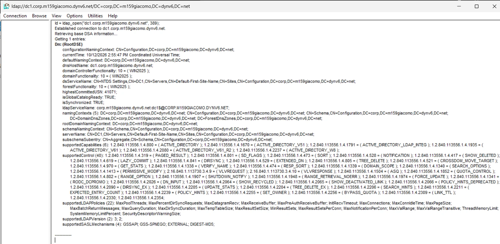

**Herleitung des Base-DN:** Der DNS-Name der Domäne `corp.m159giacomo.dynv6.net` wird an den
Punkten zerlegt, jeder Teil wird zu einem `DC=`: `DC=corp,DC=m159giacomo,DC=dynv6,DC=net`.

**Was der Bind macht:** Er authentifiziert die Verbindung. Ich habe «Bind as currently logged
on user» gewählt, `ldp` meldet `Authenticated as: 'CORP\Administrator'`:

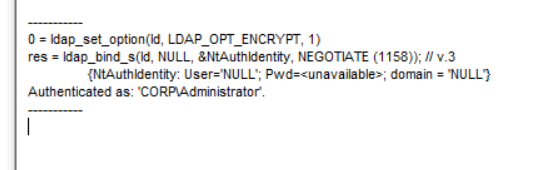

**Was ohne Bind passiert wäre:** Eine Verbindung ohne Bind darf in AD nur den RootDSE lesen.
Eine Suche scheitert mit `Operations Error` und der Meldung, dass zuerst ein erfolgreicher Bind
nötig ist. Das ist mir beim ersten Versuch passiert, weil ich nach einem Neustart von `ldp`
nicht neu gebunden hatte:

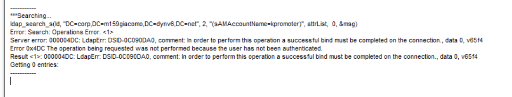

**DN eines Promoters:** Über *View → Tree* habe ich mich bis zu Kevin Promoter durchgeklickt:

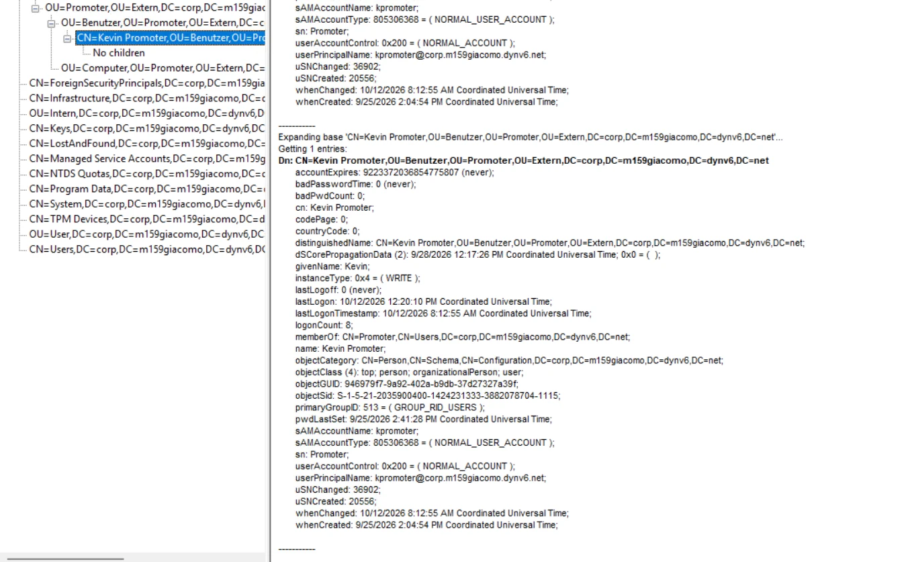

```
CN=Kevin Promoter,OU=Benutzer,OU=Promoter,OU=Extern,DC=corp,DC=m159giacomo,DC=dynv6,DC=net
```

In den Attributen steht `memberOf: CN=Promoter,CN=Users,...`: Er ist **direkt** nur in
`Promoter`, nicht in `Extern`. `userAccountControl: 0x200` bedeutet normales, aktives Konto.

## 2. Drei Suchen

Basis aller Suchen ist der Base-DN `DC=corp,DC=m159giacomo,DC=dynv6,DC=net`.

| # | Gesucht | Filter | Treffer |
| --- | --- | --- | --- |
| 2.1 | Ein Promoter über den Anmeldenamen | `(sAMAccountName=kpromoter)` | 1 (Kevin Promoter) |
| 2.2 | Alle Benutzer der Buchhaltung | `(&(objectCategory=person)(objectClass=user))` | One Level: 0, Subtree: 1 (Tom Bucher) |
| 2.3 | Alle Gruppen der Domäne | `(objectCategory=group)` | 64 |

### 2.1 Anmeldename, in `ldp.exe` und in PowerShell

In `ldp.exe` unter *Browse → Search* mit Scope `Subtree`:

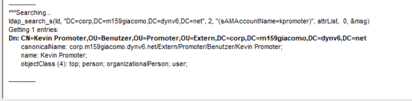

Dieselbe Abfrage in PowerShell. `Get-ADUser -LDAPFilter` stellt dieselbe LDAP-Suche wie `ldp.exe`:

```powershell
Get-ADUser -LDAPFilter "(sAMAccountName=kpromoter)" -SearchBase $domDN | Select-Object Name, DistinguishedName
```

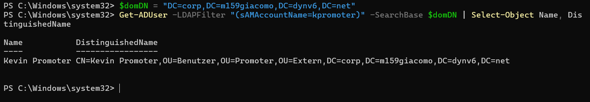

### 2.2 Benutzer der Buchhaltung, One Level und Subtree

```powershell
$ou = "OU=Buchhaltung,OU=Intern,$domDN"
$f = "(&(objectCategory=person)(objectClass=user))"
@(Get-ADUser -LDAPFilter $f -SearchBase $ou -SearchScope OneLevel).Count
Get-ADUser -LDAPFilter $f -SearchBase $ou -SearchScope Subtree | Select-Object Name, DistinguishedName
```

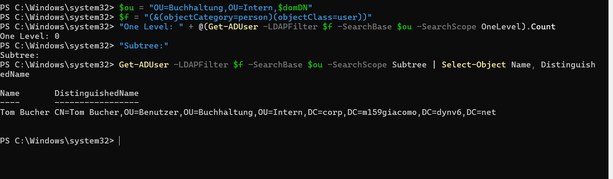

`One Level` liefert 0 Treffer, `Subtree` einen. Der Grund: Direkt unter `OU=Buchhaltung` liegen
nur die zwei Unter-OUs `Benutzer` und `Computer`, weil die letzte Ebene meines DIT Benutzer
und Computer trennt. Der Benutzer liegt eine Ebene tiefer in `OU=Benutzer`. `One Level` schaut
nur eine Ebene tief, `Subtree` den ganzen Ast. Ich verwende `objectCategory=person`, weil
`objectClass=user` allein auch Computerkonten treffen würde (Computer sind eine Unterklasse
von `user`).

### 2.3 Alle Gruppen

```powershell
$gruppen = Get-ADObject -LDAPFilter "(objectCategory=group)" -SearchBase $domDN
"Anzahl Gruppen: " + @($gruppen).Count
$gruppen | Sort-Object Name | Select-Object Name, DistinguishedName
```

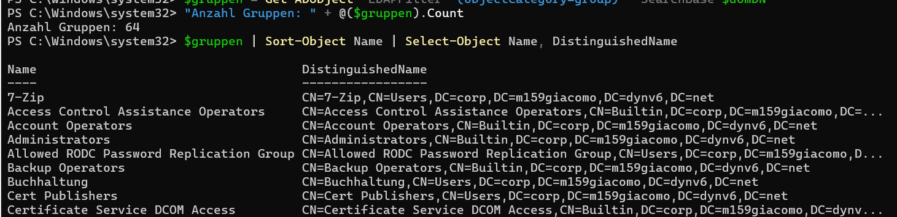

Die Liste enthält die Gruppe `Extern`. Ihren DN brauche ich in Teil 3:
`CN=Extern,CN=Users,DC=corp,DC=m159giacomo,DC=dynv6,DC=net`.

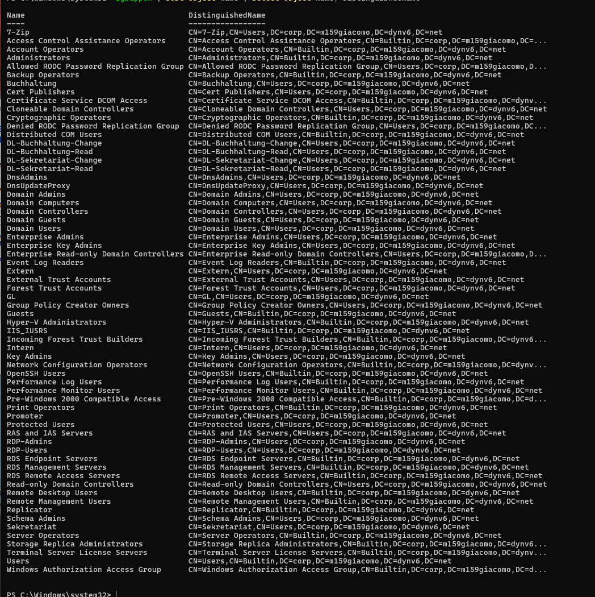

## 3. Der Filter für die Firewall

Die Firewall soll alle **aktiven** Mitglieder von `Extern` finden, auch über verschachtelte
Gruppen hinweg. Ich habe den Filter in drei Schritten aufgebaut:

| # | Gesucht | Filter | Treffer |
| --- | --- | --- | --- |
| 3.1 | Direkte Mitglieder von `Promoter` | `(&(objectCategory=person)(objectClass=user)(memberOf=CN=Promoter,CN=Users,...))` | 1 |
| 3.2 naiv | Mitglieder von `Extern` mit `memberOf` | `(&(objectCategory=person)(objectClass=user)(memberOf=CN=Extern,CN=Users,...))` | **0** |
| 3.2 korrigiert | Mitglieder von `Extern` über mehrere Ebenen | `(&(objectCategory=person)(objectClass=user)(memberOf:1.2.840.113556.1.4.1941:=CN=Extern,CN=Users,...))` | 1 |
| 3.3 | Nur aktive Konten (Filter für die Firewall) | siehe unten | 1 |

Der Filter für die Firewall (3.3), mit dem vollständigen DN:

```
(&(objectCategory=person)(objectClass=user)(memberOf:1.2.840.113556.1.4.1941:=CN=Extern,CN=Users,DC=corp,DC=m159giacomo,DC=dynv6,DC=net)(!(userAccountControl:1.2.840.113556.1.4.803:=2)))
```

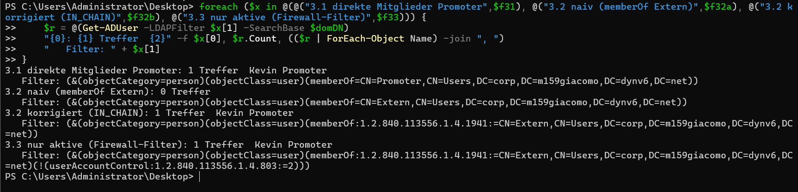

**Warum der naive Filter 0 Treffer liefert:** `memberOf` prüft nur die **direkte**
Mitgliedschaft. Kevin ist direkt nur in `Promoter`, und `Promoter` ist als Gruppe Mitglied von
`Extern` (Nesting aus Auftrag 04). Die Vergleichsregel `1.2.840.113556.1.4.1941`
(`LDAP_MATCHING_RULE_IN_CHAIN`) löst die Mitgliedschaft über beliebig viele Gruppenebenen auf.

**Warum `userAccountControl` mit Bit-Regel:** Ob ein Konto aktiv ist, steht als einzelnes Bit in
`userAccountControl`. Bit 2 (Wert `2`) bedeutet «deaktiviert». Die Regel
`1.2.840.113556.1.4.803` (`LDAP_MATCHING_RULE_BIT_AND`) prüft ein einzelnes Bit. Der Ausdruck
`(!(userAccountControl:1.2.840.113556.1.4.803:=2))` heisst also: nicht deaktiviert.

### Test 1: Ein deaktivierter Promoter verschwindet

Ich habe `kpromoter` deaktiviert und den Filter erneut ausgeführt: 0 Treffer. Nach der
Reaktivierung wieder 1.

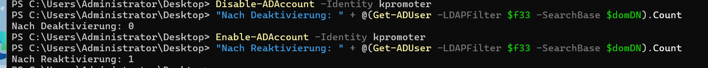

### Test 2: Eine neue externe Abteilung erscheint, ohne dass der Filter geändert wird

Ich habe testweise die Gruppe `Externe Berater` angelegt, in `Extern` aufgenommen und einen
Benutzer `tberater` hineingelegt. Beim ersten Versuch lehnte die Domäne das Passwort ab
(zu kurz, die Richtlinie verlangt mindestens 7 Zeichen). `New-ADUser` hat das Konto dabei
trotzdem angelegt, aber deaktiviert. Der Filter hat es deshalb zu Recht nicht gefunden, der
Filter selbst war in Ordnung:

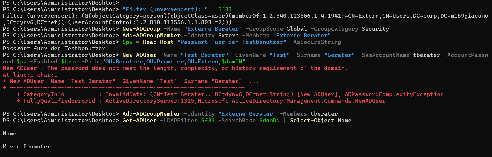

Nach dem Setzen eines gültigen Passworts und dem Aktivieren des Kontos erscheint der Benutzer
mit **unverändertem Filter**:

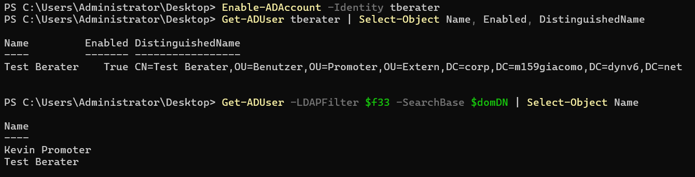

Danach habe ich Benutzer und Gruppe wieder gelöscht. Der Filter liefert wieder 1 Treffer:

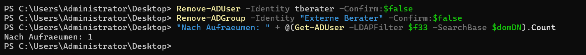

### Warum der Filter auf `Extern` zielt und nicht auf `Promoter`

`Promoter` ist nur eine von möglichen externen Abteilungen. Kommt eine neue externe Abteilung
dazu, wird ihre Gruppe in `Extern` aufgenommen, und der Filter findet deren Mitglieder sofort,
ohne dass man ihn oder die Firewall anfasst (das zeigt Test 2). Ein Filter auf `Promoter`
müsste dagegen für jede neue Abteilung angepasst werden.

## 4. Den Filter wirksam machen: GPO mit Zielgruppenadressierung

Die Aussendienstmitarbeitenden bekommen eine Desktop-Verknüpfung zur VPN-Anleitung, die intern
niemand sieht. Dafür habe ich die GPO `Konfiguration Desktop-Verknuepfung VPN User - GB` angelegt
und mit der Domäne verknüpft, also für alle Benutzer. Die Verknüpfung `VPN-Anleitung`
(Ziel `https://vpn.webapp.ch/anleitung`, Ort Desktop) ist ein Preference-Element, und ihre
Zielgruppenadressierung (Item-Level-Targeting) ist ein **LDAP Query**:

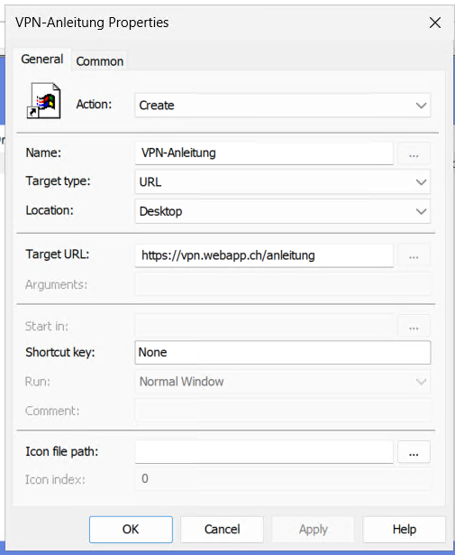

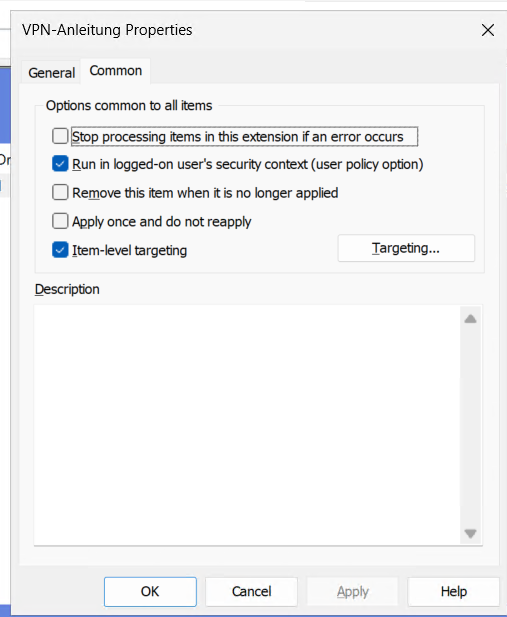

Der LDAP Query ist mein Filter aus 3.3, ergänzt um `(sAMAccountName=%LogonUser%)`, damit nur
der gerade angemeldete Benutzer geprüft wird:

```
(&(objectCategory=person)(objectClass=user)(sAMAccountName=%LogonUser%)(memberOf:1.2.840.113556.1.4.1941:=CN=Extern,CN=Users,DC=corp,DC=m159giacomo,DC=dynv6,DC=net)(!(userAccountControl:1.2.840.113556.1.4.803:=2)))
```

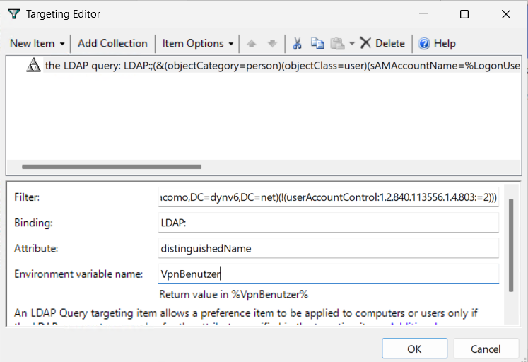

**Test auf client1.** `kpromoter` (extern) hat die Verknüpfung `VPN-Anleitung` auf dem Desktop:

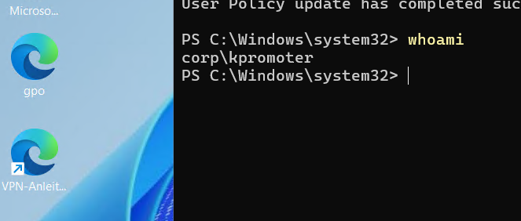

`jmueller` (intern, Sekretariat) hat sie nicht (auf dem Desktop liegt nur `Web-CRM`):

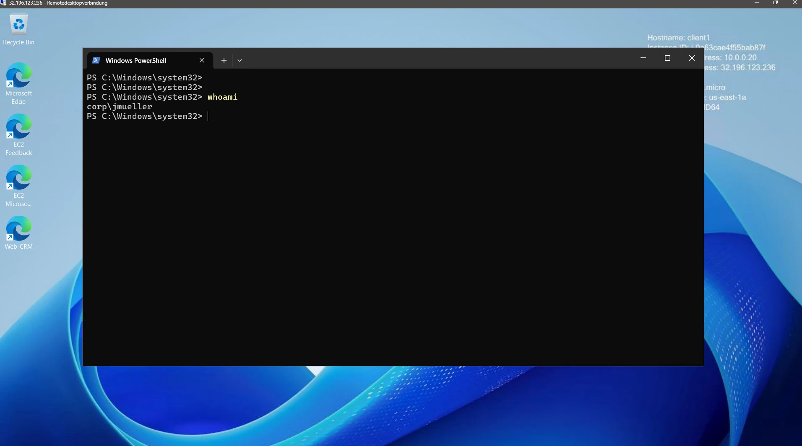

Bei `jmueller` ist die GPO trotzdem angewendet, nur die Verknüpfung darin wird durch die
Zielgruppenadressierung übersprungen. Das ist der Unterschied zur Sicherheitsfilterung, bei der
die GPO selbst nicht angewendet würde:

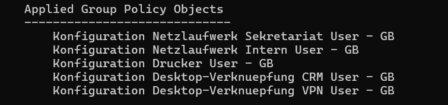

## 5. Konfigurationsblatt der Firewall

### Dienstkonto

**Entscheidungsprotokoll:**

| Option | Vorteil | Nachteil |
| --- | --- | --- |
| Bestehender Administrator | nichts Neues anzulegen | voller Zugriff, wird die Firewall kompromittiert, ist die Domäne kompromittiert |
| Eigenes Dienstkonto (nur lesen) | nur die nötigen Rechte | ein zusätzliches Konto, dessen Passwort man pflegen muss |
| Anonymer Zugriff | kein Passwort nötig | in AD funktioniert er für Suchen nicht (Bild in Teil 1) |

**Entscheid:** Ich habe ein eigenes Dienstkonto `svc-firewall-ldap` angelegt, in einer eigenen
OU `Dienstkonten`. Es ist kein Mitglied einer Gruppe, hat nur die Standardrechte eines
Domänenbenutzers (lesen) und ein Passwort, das nicht abläuft und das es nicht selbst ändern
kann, damit die Anbindung nicht ausfällt. Der Nachteil davon ist, dass das Passwort von Hand
rotiert werden muss.

```powershell
New-ADOrganizationalUnit -Name "Dienstkonten" -Path $domDN
New-ADUser -Name "svc-firewall-ldap" -SamAccountName "svc-firewall-ldap" -UserPrincipalName "svc-firewall-ldap@corp.m159giacomo.dynv6.net" -Path "OU=Dienstkonten,$domDN" -AccountPassword $pw -Enabled $true -PasswordNeverExpires $true -CannotChangePassword $true -Description "LDAP-Leseaccount fuer Firewall, nur lesen"
```

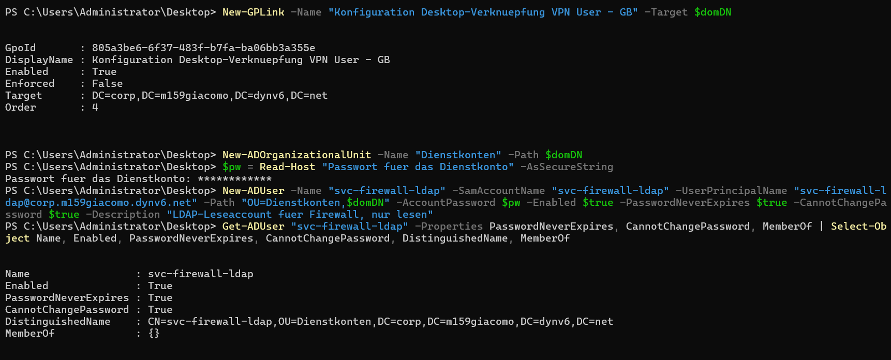

**Was es braucht, um den Filter auszuführen:** Lesezugriff auf die Benutzer- und
Gruppenobjekte. **Was ausdrücklich nicht:** Administratorrechte und Schreibrechte. Der Test
mit dem Konto zeigt es: Der Filter liefert Kevin Promoter, ein Schreibversuch wird mit
`Insufficient access rights` abgelehnt:

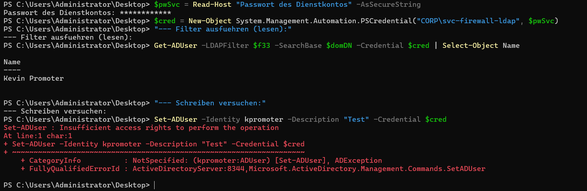

### Port 389 oder 636

**Was bei einem einfachen Bind über Port 389 durchs Netz geht:** Der Bind (DN und Passwort des
Dienstkontos) und alle Suchergebnisse werden im Klartext übertragen. Wer im Netz mitliest,
sieht das Passwort. **Was LDAPS (636) ändert:** Die ganze Verbindung wird per TLS verschlüsselt,
und die Firewall kann über das Zertifikat prüfen, dass sie mit dem richtigen Server spricht.

**Soll-Zustand:** LDAPS auf Port 636 mit Zertifikatsprüfung. **Zustand im Labor:** LDAPS ist
auf meinem DC nicht möglich, weil er kein Serverzertifikat hat (dafür bräuchte man eine
Zertifizierungsstelle). Der Befund: Port 636 nimmt zwar eine TCP-Verbindung an, beendet aber die
TLS-Verhandlung sofort.

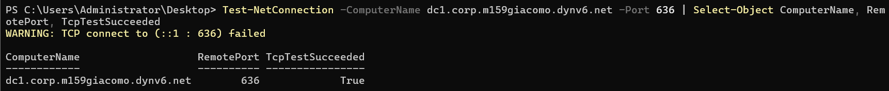

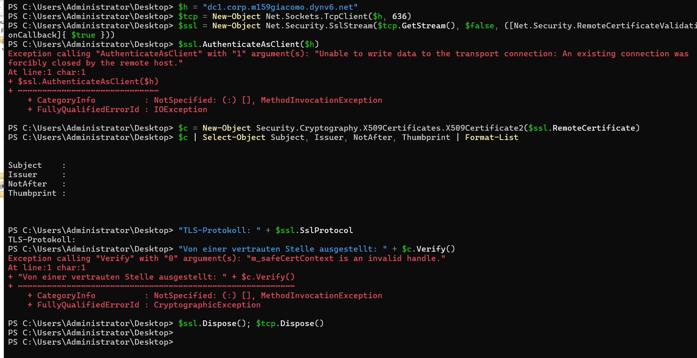

`ldp.exe` meldet bei einer SSL-Verbindung auf 636 `Error <0x51>: Fail to connect` und
`Cannot open connection`:

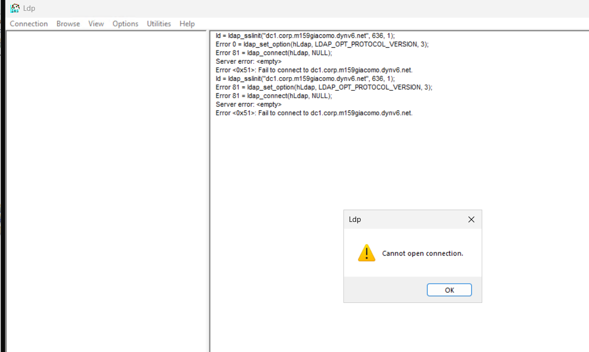

Das Blatt füllt deshalb den Soll-Zustand aus (636, verschlüsselt, Zertifikat prüfen). In
Betrieb nehmen kann man das erst, wenn der DC ein Zertifikat hat. Mit einem Bind über 389 würde
das Passwort des Dienstkontos im Klartext übertragen.

### Formular 1: Sophos Firewall, Server type Active Directory

| Feld | Mein Wert |
| --- | --- |
| Server type | Active Directory |
| Server name | `AD-corp-dc1` |
| Server IP/domain | `dc1.corp.m159giacomo.dynv6.net` |
| Connection security | SSL/TLS |
| Port | 636 |
| NetBIOS domain | `CORP` |
| ADS username | `svc-firewall-ldap` |
| Password | nicht eingetragen, Passwort-Manager |
| Validate server certificate | Ja |
| Display name attribute | `cn` |
| Email address attribute | `mail` (im Labor bei den Benutzern nicht gepflegt, daher leer) |
| Domain name | `corp.m159giacomo.dynv6.net` |
| Search queries | `OU=Extern,DC=corp,DC=m159giacomo,DC=dynv6,DC=net` |

Als Anzeigename nehme ich `cn`, weil `displayName` bei meinen Benutzern nicht gesetzt ist
(das Attribut fehlt in den Einträgen aus Teil 1). Der Server wird per FQDN angesprochen, weil
ein Zertifikat auf den Namen ausgestellt wird und nicht auf die IP.

**Begründung Search queries:** Die Firewall braucht nur die externen Benutzer. Ich gebe ihr
deshalb nur den Ast `OU=Extern` und nicht den ganzen Verzeichnisbaum. So sieht sie die internen
Konten nicht (minimale Rechte, Datenschutz). Neue externe Abteilungen kommen nach den Regeln
meines DIT ebenfalls unter `OU=Extern`.

### Formular 2: OPNsense, Extended Query

| Feld | Mein Wert |
| --- | --- |
| Hostname or IP address | `dc1.corp.m159giacomo.dynv6.net` |
| Port value | 636 |
| Transport | SSL - Encrypted |
| Protocol version | 3 |
| Bind credentials, User DN | `CN=svc-firewall-ldap,OU=Dienstkonten,DC=corp,DC=m159giacomo,DC=dynv6,DC=net` |
| Bind credentials, Password | nicht eingetragen, Passwort-Manager |
| Search scope | Entire Subtree |
| Base DN | `OU=Extern,DC=corp,DC=m159giacomo,DC=dynv6,DC=net` |
| Authentication containers | `OU=Extern,DC=corp,DC=m159giacomo,DC=dynv6,DC=net` |
| Extended Query | `(&(memberOf:1.2.840.113556.1.4.1941:=CN=Extern,CN=Users,DC=corp,DC=m159giacomo,DC=dynv6,DC=net)(!(userAccountControl:1.2.840.113556.1.4.803:=2)))` |
| User naming attribute | `sAMAccountName` |

`Entire Subtree` ist nötig, weil die Benutzer mehrere Ebenen unter `OU=Extern` liegen
(`OU=Promoter`, `OU=Benutzer`). Mit `One Level` fände die Firewall keinen (siehe Suche 2.2).
Der Extended Query ist mein Filter aus 3.3, ohne die Teile für Objektart und Anmeldename, die
die Firewall selbst ergänzt.

### Abnahme

**1. Wer kommt mit dieser Konfiguration aufs VPN, und wer nicht?** Der Filter aus 3.3 liefert
**einen** Treffer: Kevin Promoter (`kpromoter`). Nicht aufs VPN kommen die internen Benutzer
Jasmin Müller, Tom Bucher und Sara Lehmann, das Dienstkonto und alle deaktivierten Konten.

**2. Was passiert, wenn nächste Woche ein neuer Promoter eingestellt wird?** Niemand muss das
Blatt oder die Firewall anfassen. Der neue Promoter kommt in die Gruppe `Promoter`, die
Mitglied von `Extern` ist. Der Filter löst die Mitgliedschaft über beide Ebenen auf und findet
ihn sofort. Test 2 in Teil 3 zeigt dasselbe für eine ganz neue externe Abteilung.
