# MS Entra ID und MS Entra Connect

Dokumentation zu Auftrag 10: Das lokale Active Directory wird mit Microsoft Entra ID verbunden,
die Objekte werden synchronisiert, eine eigene Domain wird als UPN eingerichtet und `client1`
wird hybrid joined. Aufgabenstellung siehe
[Modul-Repository](https://gitlab.com/ch-tbz-it/Stud/m159/-/tree/main/03-auftraege/10-ms-entra-id-ms-entra-connect).

Autor: Giacomo Betsch, Klasse Pe24d

Lokale Domäne: `corp.m159giacomo.dynv6.net`. Öffentliche Domain (Custom-UPN):
`m159giacomo.dynv6.net` (siehe [Planung](../01-planung/planung.md)). Passwörter und die
Tenant-ID stehen nicht in diesem Repository.

## 1. Cloud-Administrator in Entra ID

Entra Connect kann sich nicht mit meinem privaten Microsoft-Konto anmelden. Es braucht ein Konto
im Entra-Verzeichnis mit der Rolle *Globaler Administrator*. Ich habe deshalb den Benutzer
`entra-admin` angelegt:

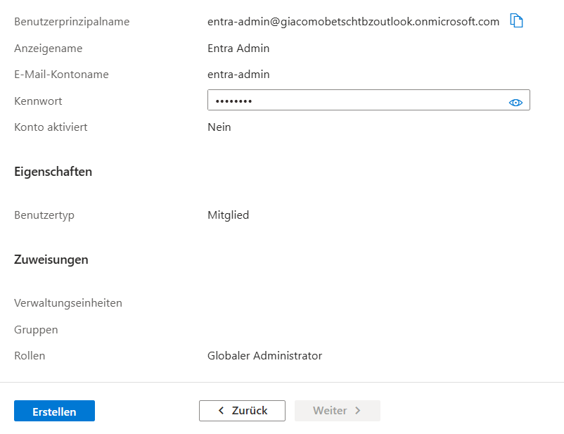

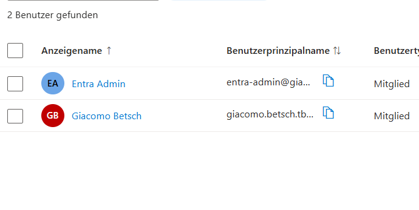

Beim ersten Anmelden kam die Meldung, das Konto sei gesperrt:

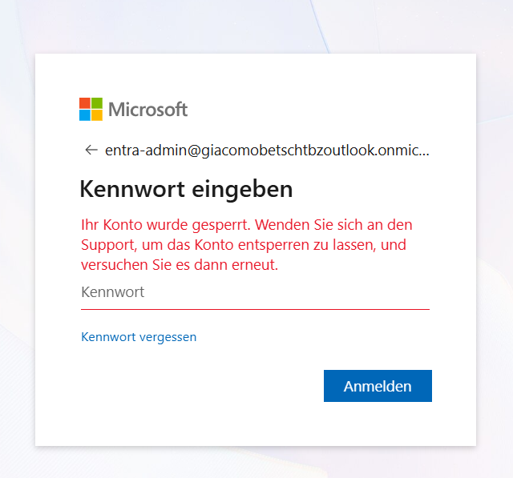

Die Ursache stand schon auf der Zusammenfassung beim Anlegen: «Konto aktiviert: Nein», das
Konto war also deaktiviert. Ich habe es unter *Eigenschaften bearbeiten* aktiviert, danach
funktionierte die Anmeldung:

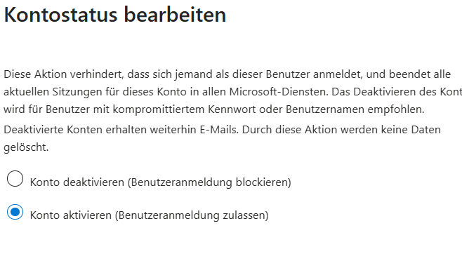

## 2. Eigene Domain in Entra ID

Ich habe die Domain `m159giacomo.dynv6.net` (bei dynv6.com registriert) als benutzerdefinierte
Domain hinzugefügt. Entra ID verlangt zum Besitznachweis einen TXT-Eintrag:

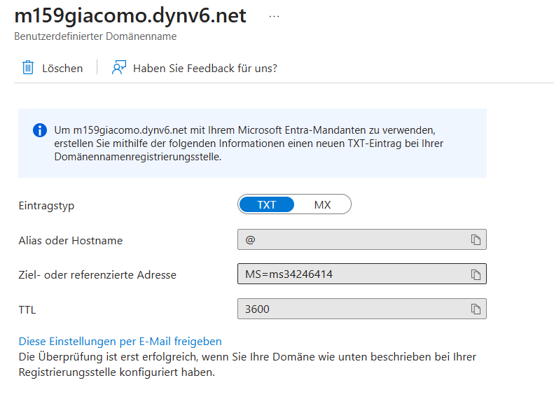

Den Eintrag habe ich in der dynv6-Zone angelegt:

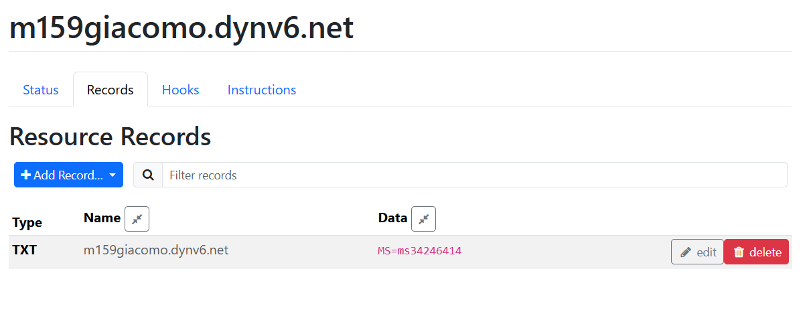

Danach ist die Domain verifiziert:

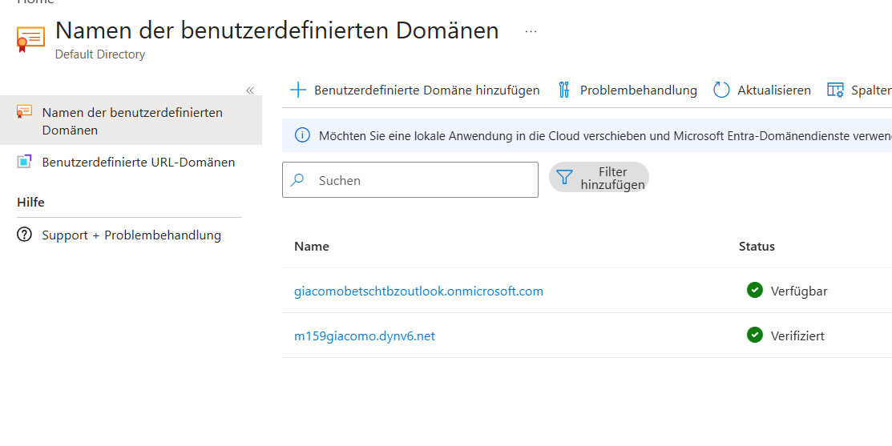

## 3. Eigene Domain im lokalen AD (Custom-UPN)

Dieselbe Domain habe ich als zusätzlichen UPN-Suffix der Gesamtstruktur eingetragen und die
vier Testbenutzer darauf umgestellt:

```powershell
$suffix = "m159giacomo.dynv6.net"
Set-ADForest -Identity corp.m159giacomo.dynv6.net -UPNSuffixes @{Add=$suffix}
foreach ($u in "jmueller","tbucher","slehmann","kpromoter") { Set-ADUser -Identity $u -UserPrincipalName "$u@$suffix" }
```

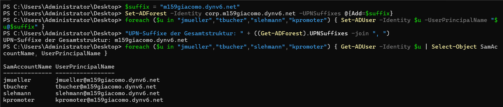

## 4. Entra Connect installieren

**Voraussetzung:** dc1 erreicht die Microsoft-Dienste (Port 443):

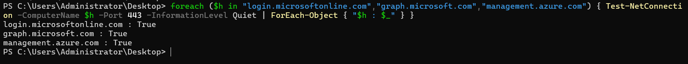

**Vorher:** In Entra ID zeigt die Seite *Connect Sync*, dass Entra Connect nicht installiert ist
und die Synchronisierung nie lief:

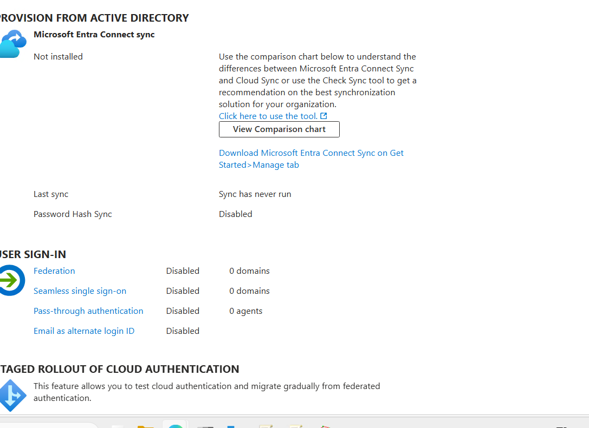

Ich habe Microsoft Entra Connect Sync auf dc1 mit den **Expresseinstellungen** installiert. Das
synchronisiert die Identitäten der ganzen Gesamtstruktur `CORP`, richtet die
Kennworthash-Synchronisierung ein (Password Hash Sync: Benutzer können sich in der Cloud mit
demselben Kennwort anmelden) und startet eine erste Synchronisierung:

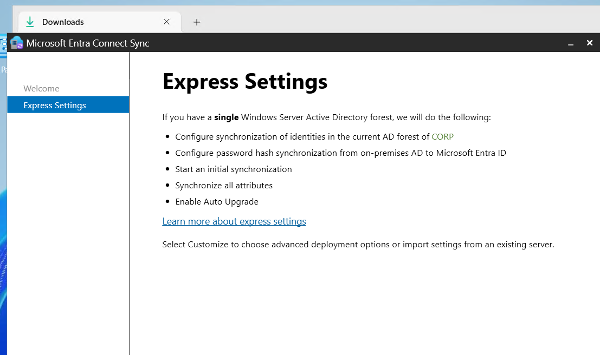

Auf der Seite zur Anmeldung zeigt der Assistent, dass der lokale Suffix
`corp.m159giacomo.dynv6.net` in Entra nicht hinzugefügt ist, `m159giacomo.dynv6.net` aber
verifiziert. Das ist laut Auftrag kein Problem, ich habe deshalb ohne vollständige
Übereinstimmung weitergemacht:

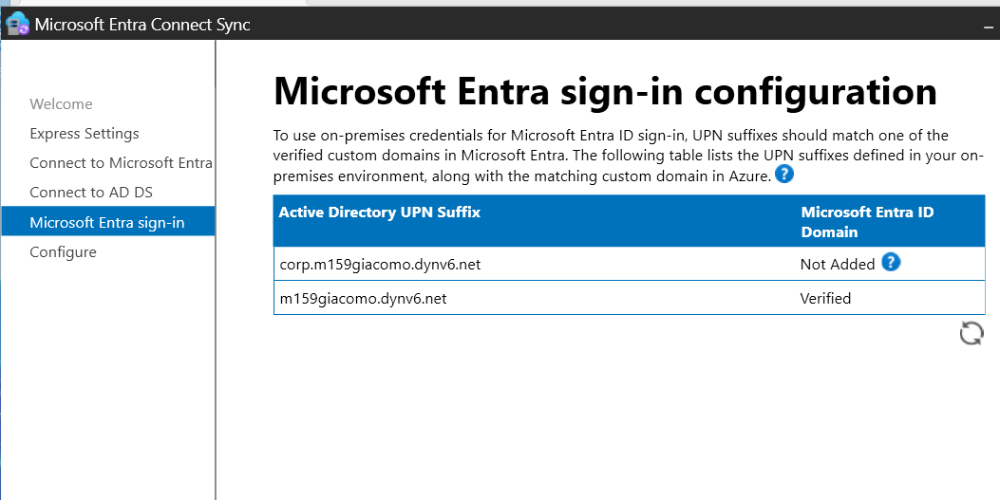

Die Installation lief durch. Der Dienst `ADSync` läuft, und der Scheduler ist aktiv (nächster
Durchlauf `Delta`):

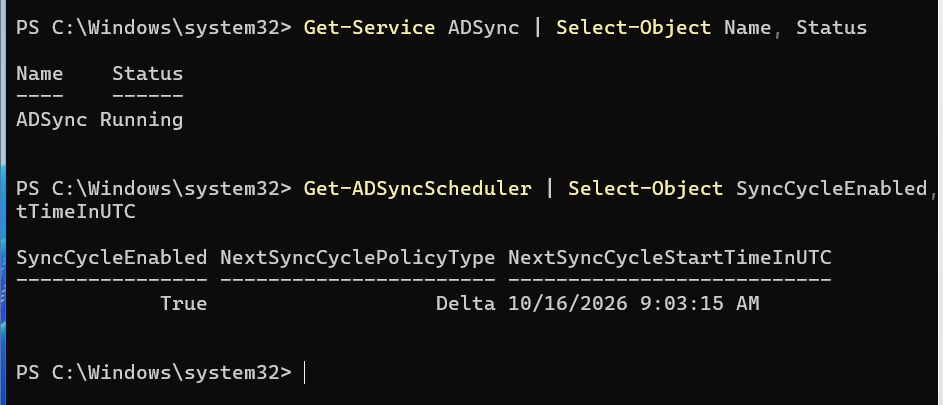

## 5. Synchronisierung prüfen

Eine vollständige Synchronisierung habe ich von Hand gestartet:

```powershell
Start-ADSyncSyncCycle -PolicyType Initial
```

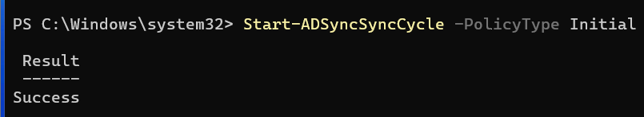

Die lokalen Benutzer sind in Entra ID sichtbar. Die vier Testbenutzer haben den UPN
`@m159giacomo.dynv6.net`. Die übrigen (zum Beispiel `HMuster`) haben einen UPN mit der
`onmicrosoft.com`-Domain, weil ihr lokaler Suffix `corp.m159giacomo.dynv6.net` in Entra nicht
verifiziert ist. Weil die Expresseinstellungen die ganze Gesamtstruktur synchronisieren, steht
auch das Dienstkonto `svc-firewall-ldap` aus Auftrag 08 in Entra. In einer produktiven Umgebung
würde man solche Konten per OU-Filter von der Synchronisierung ausnehmen.

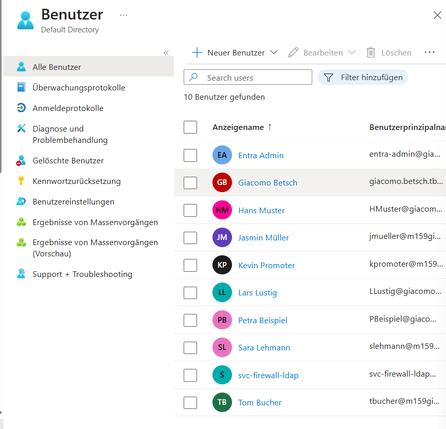

Die Statusseite bestätigt die Synchronisierung: aktiviert, letzte Synchronisierung vor weniger
als einer Stunde, Kennworthash-Synchronisierung aktiviert:

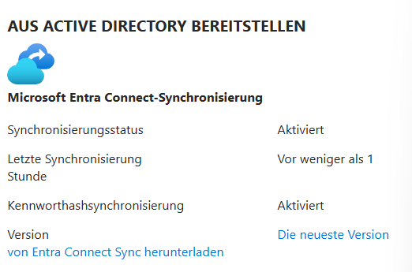

## 6. Hybrid Join von client1

Beim Hybrid Join ist `client1` gleichzeitig Mitglied der lokalen Domäne und als Gerät in Entra
ID registriert.

### Geräteoptionen und Service Connection Point

Im Entra-Connect-Assistenten habe ich unter *Configure device options* den **Hybrid Microsoft
Entra ID join** für Windows-Geräte eingerichtet. Dabei legt der Assistent in der lokalen
Gesamtstruktur einen Service Connection Point (SCP) an, über den Geräte ihren Entra-ID-Tenant
finden:

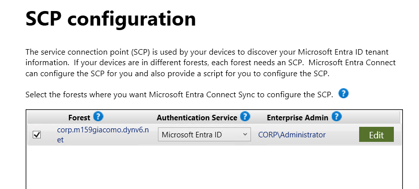

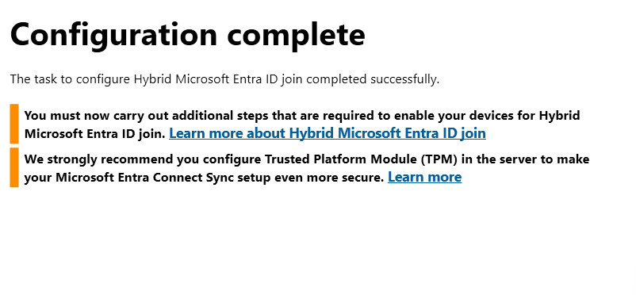

### Gruppenrichtlinie für die automatische Registrierung

Die GPO `Konfiguration Geraeteregistrierung Comp - GB` aktiviert die Richtlinie «Register
domain-joined computers as devices». Sie ist mit der Domäne verknüpft, weil `client1` im
Standardcontainer *Computers* liegt, auf dem man keine GPO verknüpfen kann:

```powershell
New-GPO -Name "Konfiguration Geraeteregistrierung Comp - GB"
New-GPLink -Name "Konfiguration Geraeteregistrierung Comp - GB" -Target $domDN
Set-GPRegistryValue -Name "Konfiguration Geraeteregistrierung Comp - GB" -Key "HKLM\SOFTWARE\Policies\Microsoft\Windows\WorkplaceJoin" -ValueName "autoWorkplaceJoin" -Type DWord -Value 1
```

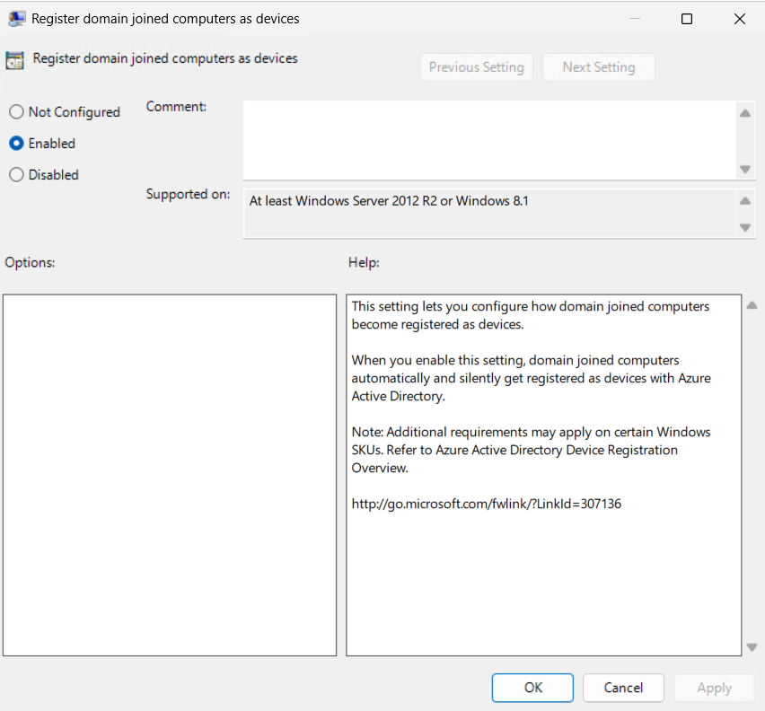

### Test und Fehleranalyse

Auf client1 habe ich die Richtlinie geholt und die Registrierung angestossen. Die Ausgabe von
`dsregcmd` habe ich auf die nötigen Zeilen gefiltert (die komplette Ausgabe enthält die
Tenant-ID). **Vorher:** `DomainJoined YES`, `AzureAdJoined NO`:

```powershell
gpupdate /force
Start-ScheduledTask -TaskPath "\Microsoft\Windows\Workplace Join\" -TaskName "Automatic-Device-Join"
dsregcmd /status | Select-String "AzureAdJoined|DomainJoined|DomainName"
```

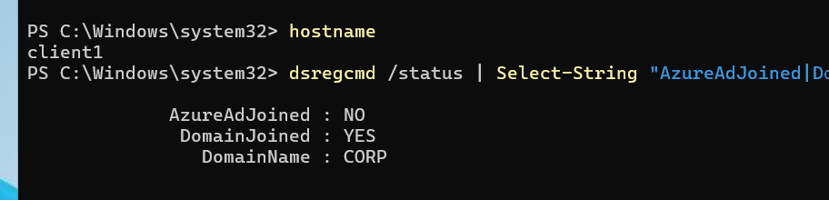

Auch nach dem ersten Versuch blieb `AzureAdJoined` auf `NO`:

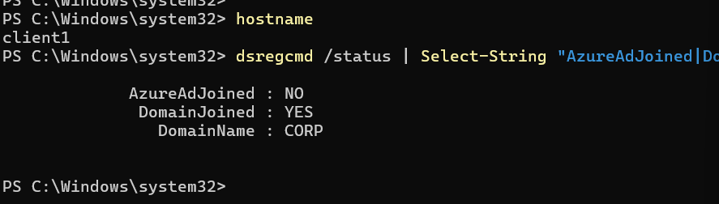

**Fehleranalyse:** Die geplante Aufgabe `Automatic-Device-Join` war bereit und lief mit dem
Ergebnis `0`:

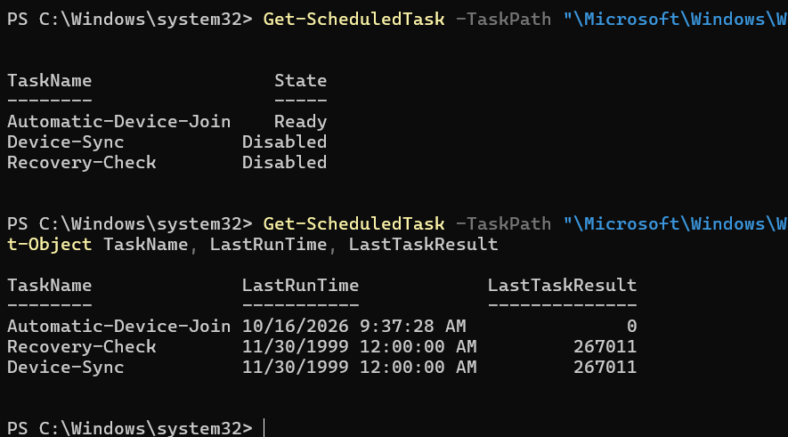

Die Fehlerangaben in `dsregcmd` zeigen den Grund: `Registration Type fallback_sync`, Client
ErrorCode `0x801c03f3` und die Meldung, das Geräteobjekt sei nicht gefunden:

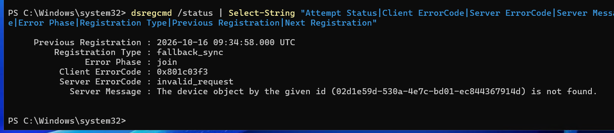

Das ist ein Zwischenzustand bei der Registrierung in einer synchronisierten Umgebung: `client1`
schreibt bei der Registrierung ein Zertifikat in sein Computerobjekt im lokalen AD. Entra
Connect muss dieses Objekt zuerst nach Entra ID synchronisieren, erst dann findet Entra das
Gerät. Beim ersten Versuch war es dort noch nicht.

**Lösung:** Ich habe geprüft, dass das Computerobjekt das Zertifikat enthält, eine
Delta-Synchronisierung gestartet und den Beitritt auf client1 wiederholt:

```powershell
Get-ADComputer client1 -Properties userCertificate | Select-Object Name, @{n='Zertifikate';e={@($_.userCertificate).Count}}
Start-ADSyncSyncCycle -PolicyType Delta
```

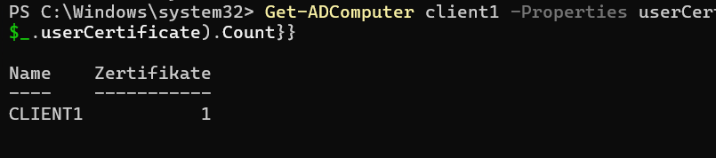

### Ergebnis

Nach dem zweiten Versuch ist `client1` hybrid joined. `dsregcmd /status` zeigt
`AzureAdJoined : YES` bei gleichzeitigem `DomainJoined : YES`:

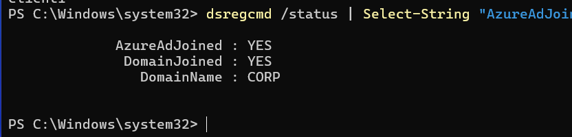
