# Servergespeicherte Benutzerprofile

Dokumentation zu Auftrag 11: Die Daten der Benutzer liegen nicht mehr nur auf dem lokalen PC,
sondern zentral auf einer Dateifreigabe. Ich habe zwei Verfahren umgesetzt: die
**Ordnerumleitung** (Folder Redirection, Stufe 1) und **FSLogix Profile Container** (Stufe 2).
Aufgabenstellung siehe
[Modul-Repository](https://gitlab.com/ch-tbz-it/Stud/m159/-/tree/main/03-auftraege/11-servergespeicherte-benutzerprofile).

Autor: Giacomo Betsch, Klasse Pe24d

Domäne: `corp.m159giacomo.dynv6.net`. Passwörter stehen nicht in diesem Repository.

## 1. Voraussetzungen

Für den Test brauche ich zwei Clients in der Domäne. Ich habe `client1` und `adminctr1`
verwendet. `adminctr1` war noch nicht in der Domäne. Nach dem Umstellen des DNS-Servers auf dc1
(`10.0.0.10`) war der Domänencontroller erreichbar, und ich bin der Domäne beigetreten:

```powershell
Set-DnsClientServerAddress -InterfaceAlias "Ethernet" -ServerAddresses 10.0.0.10
Add-Computer -DomainName "corp.m159giacomo.dynv6.net" -Credential CORP\Administrator -Restart
```

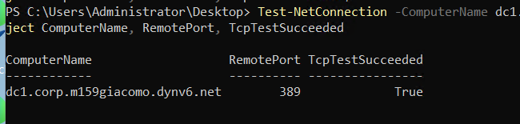

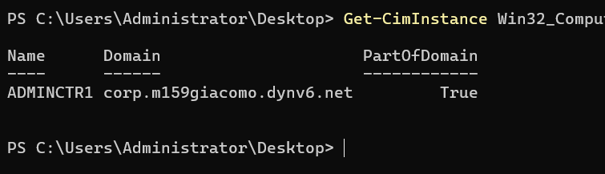

Beide Clients habe ich in die OU `Computer` unter `Sekretariat` verschoben. Im Standardcontainer
*Computers* kann man keine GPO verknüpfen. Dazu habe ich die Gruppe `RDP-Users` (Auftrag 03) in
die lokale Gruppe *Remote Desktop Users* von `adminctr1` aufgenommen, damit sich die
Testbenutzer dort per RDP anmelden dürfen:

```powershell
Move-ADObject -Identity (Get-ADComputer client1).DistinguishedName -TargetPath "OU=Computer,OU=Sekretariat,OU=Intern,$domDN"
Move-ADObject -Identity (Get-ADComputer adminctr1).DistinguishedName -TargetPath "OU=Computer,OU=Sekretariat,OU=Intern,$domDN"
Add-LocalGroupMember -Group "Remote Desktop Users" -Member "CORP\RDP-Users"
```

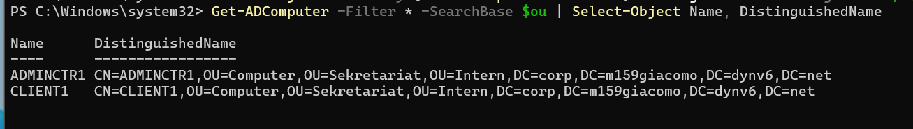

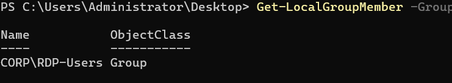

## 2. Freigaben für die Profile (Teil 1)

Es gibt zwei Freigaben auf dc1: `FolderRedirection` für die Ordnerumleitung und `Profiles` für die
FSLogix-Container. Auf Freigabeebene hat `Authenticated Users` Vollzugriff. Eingeschränkt
wird über die NTFS-Rechte, damit jeder Benutzer seinen eigenen Ordner anlegen, aber nicht auf
fremde zugreifen kann:

| Konto | NTFS-Recht | Wirkung |
| --- | --- | --- |
| `Domain Users` | Lesen, Ordner erstellen, nur auf dem Hauptordner (ohne Vererbung) | Jeder darf einen Unterordner anlegen, sieht aber nicht hinein |
| `CREATOR OWNER` | Vollzugriff, nur auf Unterordner und Dateien (Vererbung) | Der Ersteller hat Vollzugriff auf seinen eigenen Ordner, andere nicht |
| `SYSTEM`, `Administrators` | Vollzugriff | Verwaltung |

```powershell
foreach ($n in "FolderRedirection","Profiles") {
    New-Item -ItemType Directory -Path "C:\$n" -Force | Out-Null
    New-SmbShare -Name $n -Path "C:\$n" -FullAccess "Authenticated Users" | Out-Null
    icacls "C:\$n" /inheritance:r | Out-Null
    icacls "C:\$n" /grant "SYSTEM:(OI)(CI)F" "BUILTIN\Administrators:(OI)(CI)F" "CREATOR OWNER:(OI)(CI)(IO)F" "CORP\Domain Users:(RD,AD,X,RA,REA,S)" | Out-Null
}
```

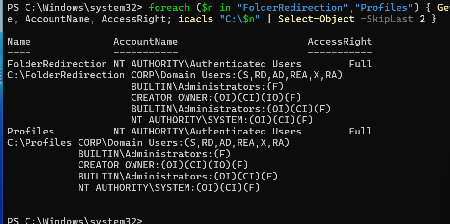

## 3. Ordnerumleitung per GPO (Stufe 1)

Die GPO `Konfiguration Ordnerumleitung User - GB` ist mit `OU=Intern` verknüpft. Sie leitet den
Ordner *Documents* um: *Basic - Redirect everyone's folder to the same location*, ein Ordner
pro Benutzer unter `\\dc1.corp.m159giacomo.dynv6.net\FolderRedirection`:

```powershell
New-GPO -Name "Konfiguration Ordnerumleitung User - GB"
New-GPLink -Name "Konfiguration Ordnerumleitung User - GB" -Target "OU=Intern,$domDN"
```

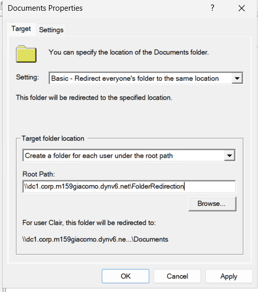

**Test mit `jmueller`.** Nach `gpupdate /force` wird die Umleitung erst bei der nächsten
Anmeldung wirksam (Windows meldet das und fragt, ob man sich abmelden will). Auf `client1`
zeigt `MyDocuments` auf den Server, und die Datei `VonPC1.txt` liegt dort:

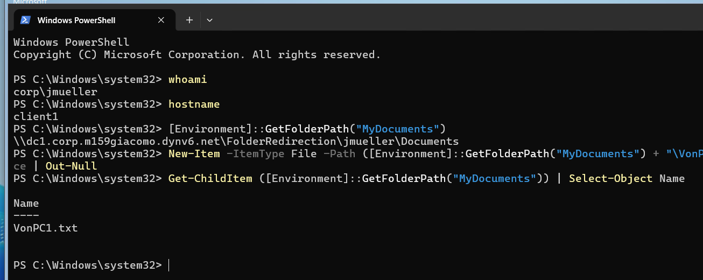

Auf `adminctr1` ist die Datei `VonPC1.txt` sofort da, und `VonPC2.txt` kommt dazu. Mein erster
Versuch dort zeigte noch den lokalen Pfad, weil ich als lokaler Administrator statt als
`jmueller` angemeldet war. Die GPO gilt nur für die Benutzer der OU `Intern`:

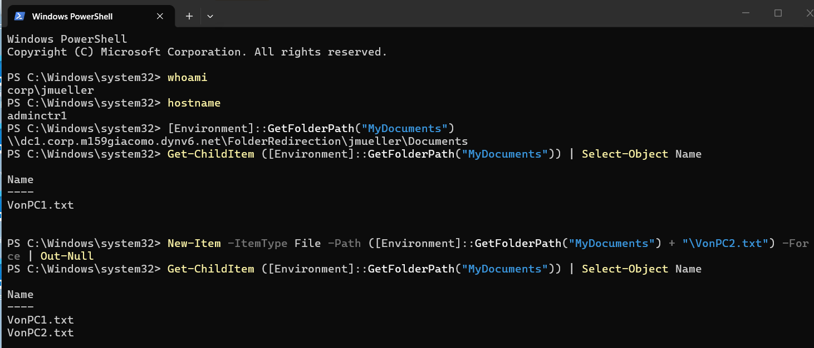

Zurück auf `client1` sind beide Dateien da:

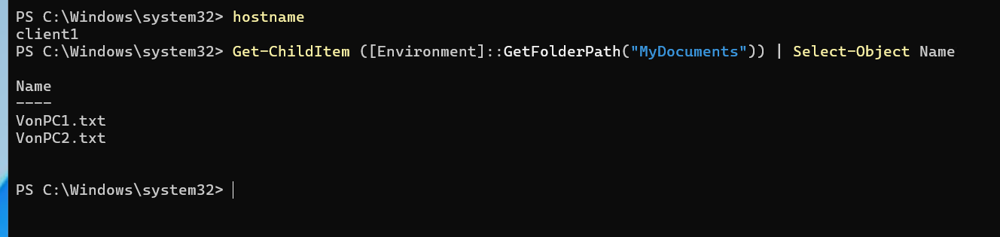

Auf dem Server liegt der Ordner `jmueller\Documents`. Der Zugriff darauf wird sogar dem
Administrator verweigert (Standardeinstellung *Grant the user exclusive rights*), das ist
beabsichtigt:

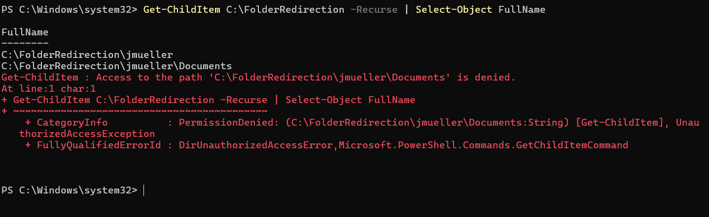

Mit dem Sicherungsrecht (`robocopy /B`, nur Auflisten) sieht man die Dateien trotzdem:

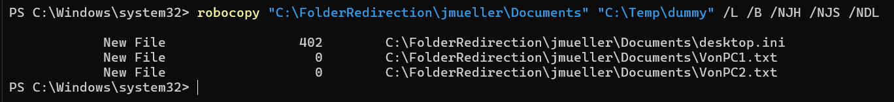

## 4. FSLogix installieren (Teil 2)

FSLogix habe ich bei Microsoft heruntergeladen und auf die Freigabe `Software` kopiert. Es
enthält den Agenten (`FSLogixAppsSetup.exe`) und die Gruppenrichtlinienvorlagen
(`fslogix.admx`, `fslogix.adml`):

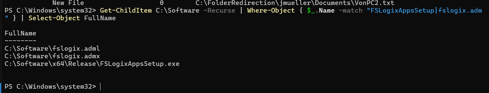

Die Vorlagen habe ich auf dc1 nach `C:\Windows\PolicyDefinitions` kopiert:

```powershell
Copy-Item "C:\Software\fslogix.admx" "C:\Windows\PolicyDefinitions\" -Force
Copy-Item "C:\Software\fslogix.adml" "C:\Windows\PolicyDefinitions\en-US\" -Force
```

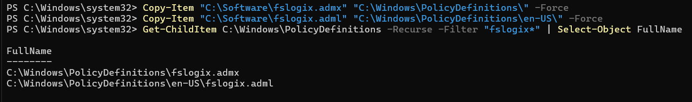

Den Agenten habe ich auf beiden Clients installiert. Der Dienst `frxsvc` läuft:

```powershell
Start-Process "\\dc1.corp.m159giacomo.dynv6.net\Software\x64\Release\FSLogixAppsSetup.exe" -ArgumentList "/install /quiet /norestart" -Wait
Get-Service frxsvc
```

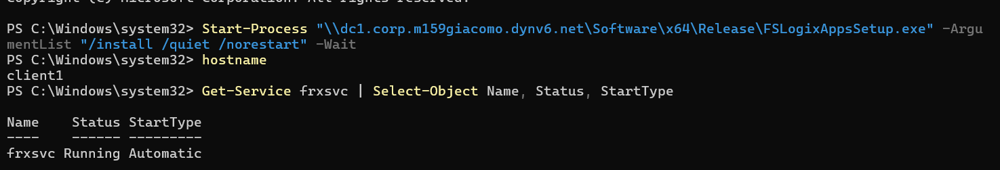

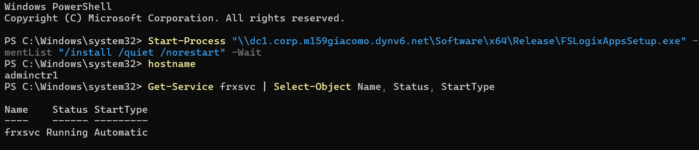

## 5. FSLogix per GPO konfigurieren (Teil 3)

Die GPO `Konfiguration FSLogix Profilcontainer Comp - GB` ist mit der OU verknüpft, in der beide
Clients liegen (`OU=Computer,OU=Sekretariat,OU=Intern`). Mein erster Befehl für die Verknüpfung
schlug fehl, weil die Variable `$domDN` in der neuen PowerShell nicht gesetzt war. Der
Zielpfad endete deshalb auf ein Komma. Nach dem Setzen der Variable klappte es:

```powershell
New-GPO -Name "Konfiguration FSLogix Profilcontainer Comp - GB"
New-GPLink -Name "Konfiguration FSLogix Profilcontainer Comp - GB" -Target "OU=Computer,OU=Sekretariat,OU=Intern,$domDN"
```

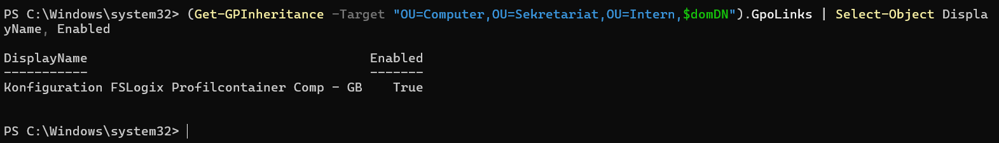

Konfiguriert habe ich unter *Computer Configuration → Policies → Administrative Templates →
FSLogix → Profile Containers*:

| Einstellung | Wert |
| --- | --- |
| Enabled | Enabled |
| VHD Locations | `\\dc1.corp.m159giacomo.dynv6.net\Profiles` |
| Flip Flop Profile Directory Name (Aufgabe: «Swap directory name components») | Enabled |
| Volume Type (VHD or VHDX) (Aufgabe: «Virtual disk type») | VHDX |

In meiner FSLogix-Version heissen die zwei letzten Einstellungen anders als in der Aufgabe. Sie
liegen im Unterordner *Container and Directory Naming*.

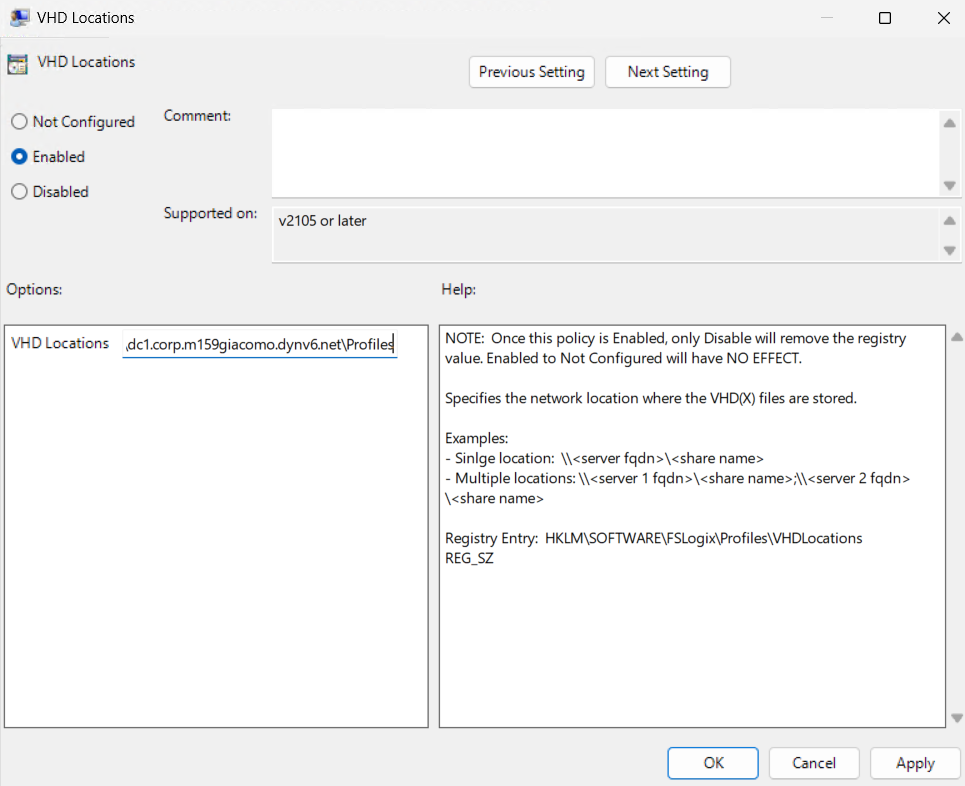

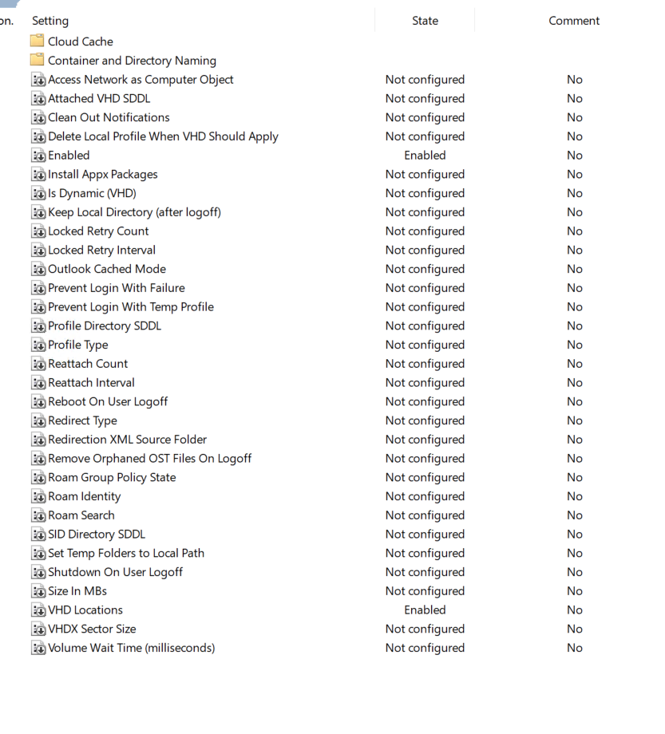

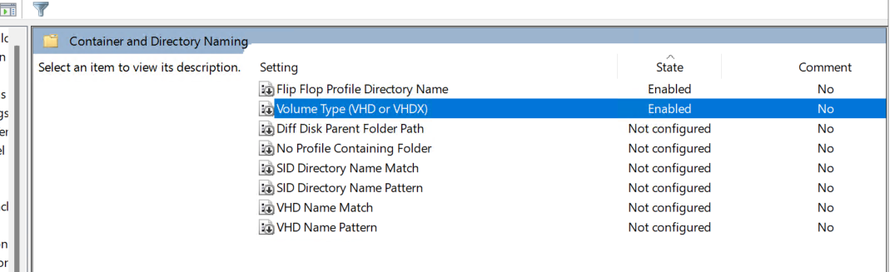

## 6. Test mit `jmueller` (Teil 4)

### Erster Versuch: FSLogix greift nicht

Ich habe den Test gestartet, **bevor** ich die Clients neu gestartet hatte. Eine
Computer-Richtlinie wird erst nach einem Neustart des Computers wirksam. Auf dem Server lag
deshalb nur der Container des Administrators, und zwar als `.vhd` statt `.VHDX`, und kein
Container für `jmueller`:

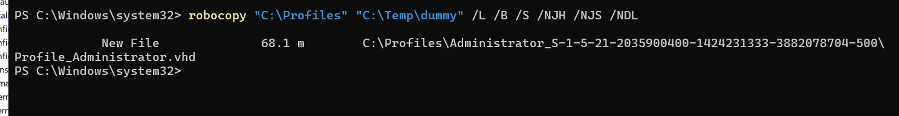

`jmueller` hatte auf `client1` ein lokales Profil mit `VonPC1.txt`:

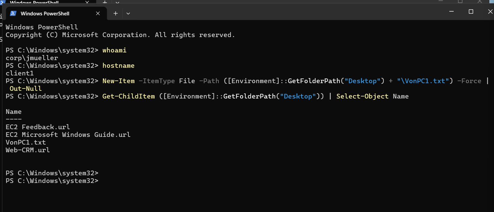

Auf `adminctr1` fehlte `VonPC1.txt`. Das Profil wanderte also nicht:

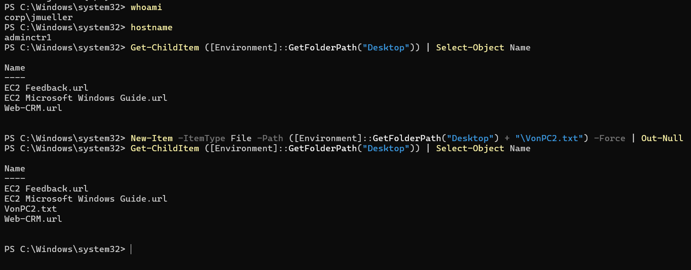

**Lösung:** Beide Clients als `CORP\Administrator` neu gestartet (`gpupdate /force`,
`Restart-Computer -Force`) und die alten lokalen Profile von `jmueller` gelöscht, damit
FSLogix sauber beginnt:

```powershell
Get-CimInstance Win32_UserProfile | Where-Object { $_.LocalPath -like "*\jmueller*" } | Remove-CimInstance
```

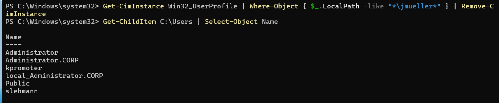

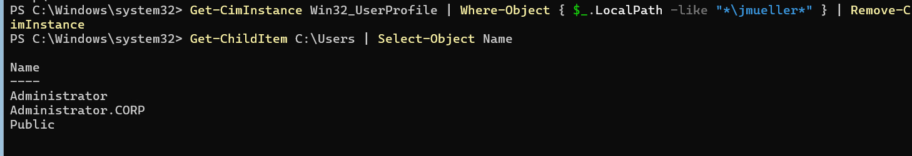

Danach stehen die Einstellungen in der Registry der Clients:

```powershell
Get-ItemProperty "HKLM:\SOFTWARE\FSLogix\Profiles" | Select-Object Enabled, VHDLocations, FlipFlopProfileDirectoryName, VolumeType
```

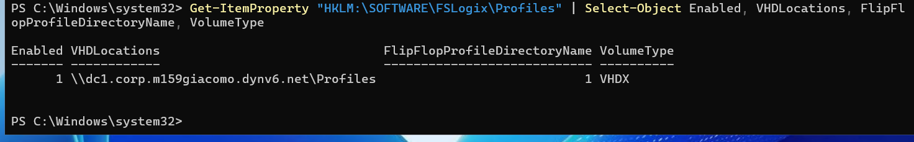

### Zweiter Versuch: erfolgreich

Auf `client1` habe ich mich als `jmueller` angemeldet und `VonPC1.txt` auf dem Desktop angelegt:

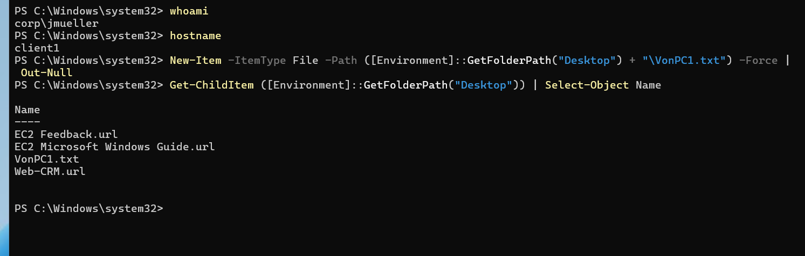

Auf dem Server liegt jetzt der Container von `jmueller`: ein Ordner `jmueller_<SID>` (die
Reihenfolge Benutzername zuerst kommt von *Flip Flop*) mit `Profile_jmueller.VHDX` und einer
`.metadata`-Datei. Die Endung `.VHDX` belegt die Einstellung *Volume Type*:

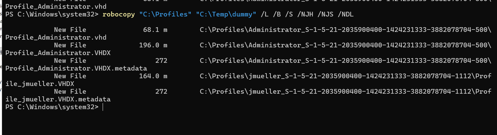

Auf `adminctr1` (nach Abmelden auf `client1`) ist `VonPC1.txt` auf dem Desktop schon da, ich
habe `VonPC2.txt` angelegt:

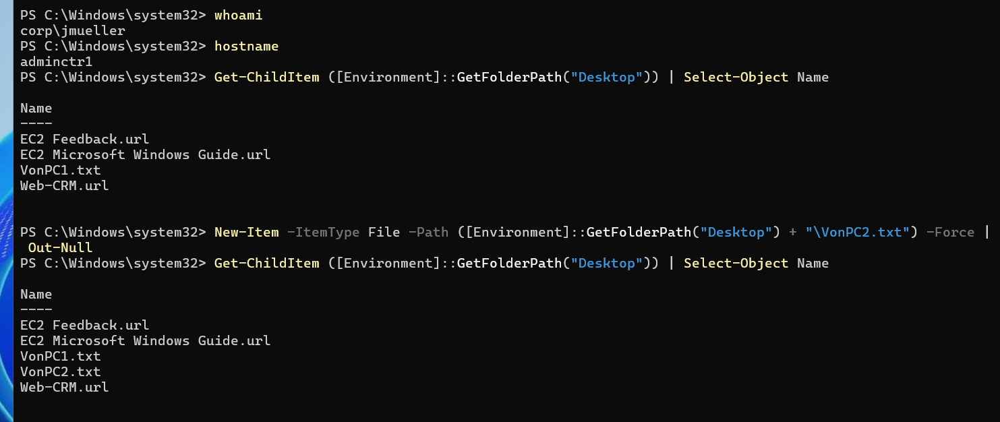

Zurück auf `client1` sind beide Dateien da. Das Profil wandert also über die zwei Computer:

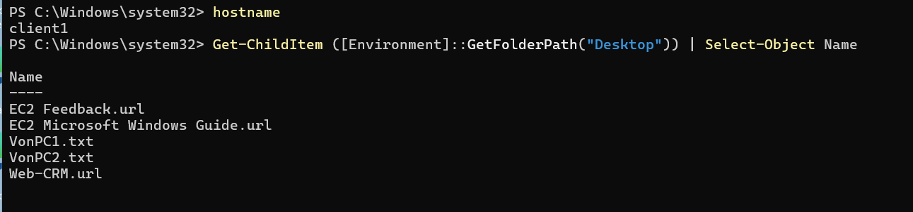

**Hinweis:** Ein FSLogix-Container ist nur für eine Sitzung gleichzeitig nutzbar. Deshalb habe
ich `jmueller` immer abgemeldet, bevor ich mich am anderen Computer angemeldet habe.

## 7. Vergleich

| | Ordnerumleitung | FSLogix Profile Container |
| --- | --- | --- |
| Was wandert | einzelne Ordner (hier *Documents*) | das ganze Profil (Desktop, Einstellungen, Daten) als VHDX |
| Wo gespeichert | ein Ordner pro Benutzer auf der Freigabe | eine VHDX-Datei pro Benutzer |
| Wie am PC | Dateien liegen direkt auf dem Server | der Container wird bei der Anmeldung eingebunden, nicht kopiert |
| Konfiguration | User-GPO | Computer-GPO und Agent auf dem Client |
