# Netzlaufwerk zu Azure Files

Dokumentation zu Auftrag 12: Ein Netzlaufwerk wird in Azure Files bereitgestellt. Zuerst ist es
per Storage-Account-Schlüssel erreichbar (Stufe 1), danach per Single Sign-On über mein lokales
Active Directory, mit Leserecht für das Sekretariat und Schreibrecht für die Buchhaltung
(Stufe 2). Aufgabenstellung siehe
[Modul-Repository](https://gitlab.com/ch-tbz-it/Stud/m159/-/tree/main/03-auftraege/12-netzlaufwerk-to-azure-migration).

Autor: Giacomo Betsch, Klasse Pe24d

Passwörter, der Storage-Account-Schlüssel, die Tenant-ID und die Abonnement-ID stehen nicht in
diesem Repository. Wo sie auf einem Bild vorkamen, habe ich sie abgedeckt.

## 1. Gewählte Authentifizierung

Azure Files kann über drei Verfahren identitätsbasiert angebunden werden: Active Directory
Domain Services (AD DS), Microsoft Entra Domain Services und Microsoft Entra Kerberos. Ich
habe **AD DS** gewählt:

- Mein lokaler Domänencontroller `dc1` stellt dem Client das Kerberos-Ticket für den Share aus.
  Dafür wird der Storage Account als Computerobjekt im lokalen AD registriert.
- Entra Domain Services würde zusätzliche Kosten verursachen und bringt hier keinen Vorteil.
- Entra Kerberos ist laut Aufgabe für mein Szenario nicht geeignet: Der Zugriff geht zurzeit nur
  von Windows-Clientbetriebssystemen aus, mein Client ist ein Windows Server 2025.

## 2. Storage Account und Share

Der Storage Account `m159giacomo4821` liegt in der neuen Ressourcengruppe `rg-m159`, Region
*Switzerland North*, Primärer Dienst *Azure Files*, Medienebene *HDD (Standard)*, Redundanz
*LRS*. Als Abrechnung habe ich *Dateifreigaben mit nutzungsbasierter Bezahlung* gewählt. Die
Alternative «Bereitgestellt v2» verrechnet vorab reservierte Kapazität, auch wenn sie nicht
genutzt wird, das ist für einen kleinen Test teurer.

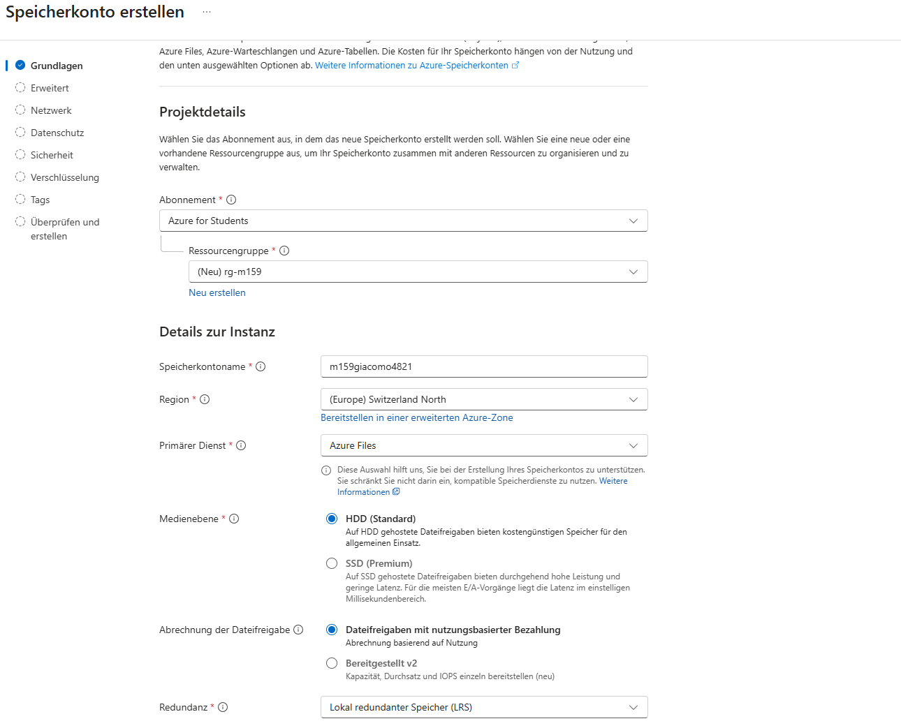

Darin gibt es die Dateifreigabe `daten` mit der Zugriffsebene *Transaktion optimiert*
(`\\m159giacomo4821.file.core.windows.net\daten`):

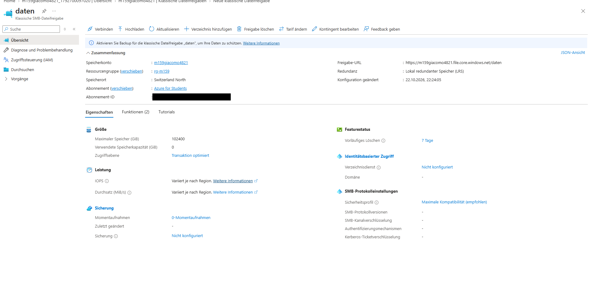

## 3. Verbindung per Schlüssel (Stufe 1)

**Port 445.** SMB braucht ausgehend den Port 445. Von `client1` aus ist er offen:

```powershell
Test-NetConnection -ComputerName m159giacomo4821.file.core.windows.net -Port 445
```

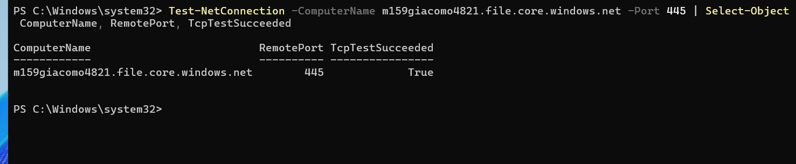

**Verbindung.** Den Schlüssel habe ich im Portal unter *Zugriffsschlüssel* kopiert und bei der
Abfrage `Read-Host -AsSecureString` eingefügt. Er wird nur als Sternchen angezeigt und steht
nirgends im Klartext. Das Laufwerk `Z:` ist verbunden, und die Datei `test-key.txt` liegt auf dem
Share:

```powershell
$key = Read-Host "Storage-Account-Key" -AsSecureString
$cred = New-Object System.Management.Automation.PSCredential("localhost\m159giacomo4821", $key)
New-PSDrive -Name Z -PSProvider FileSystem -Root "\\m159giacomo4821.file.core.windows.net\daten" -Credential $cred -Persist
```

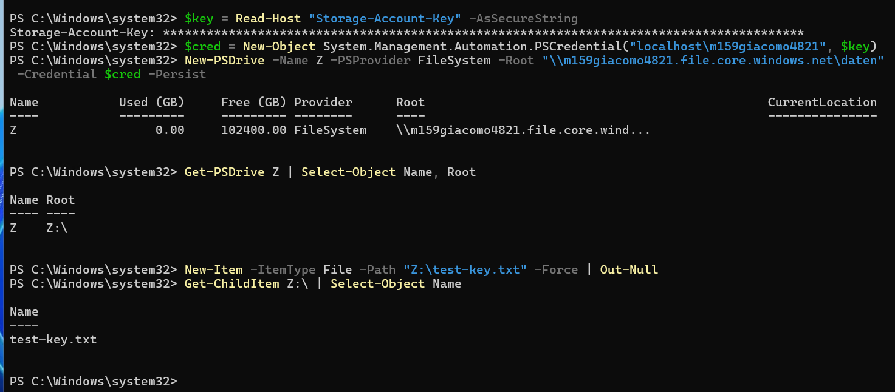

Danach habe ich das Laufwerk wieder getrennt. Der Schlüssel gibt vollen Zugriff, deshalb
verwende ich ihn nur für diesen Test.

## 4. Storage Account ins lokale AD eintragen (Stufe 2)

### Module vorbereiten

Das Microsoft-Modul `AzFilesHybrid` (Version 0.2.3, aus dem GitHub-Repository
`Azure-Samples/azure-files-samples`) habe ich auf dc1 installiert. Es braucht die Az-Module
`Az.Accounts`, `Az.Storage`, `Az.Resources` und `Az.Network`. Beim ersten Import fehlte
`Az.Network`, ich hatte es nicht mitinstalliert:

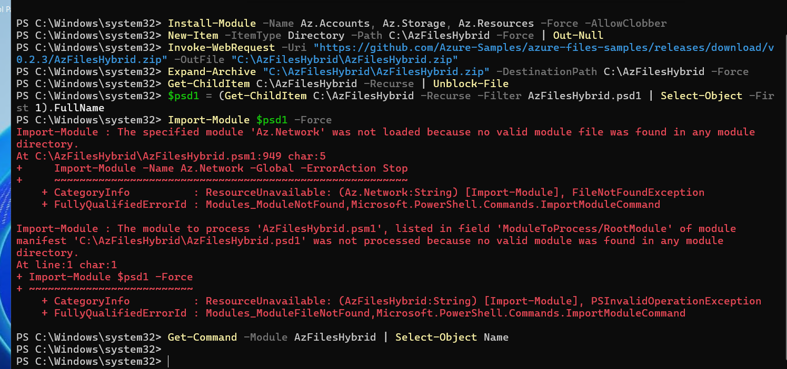

Nach `Install-Module -Name Az.Network` lief der Import. In dieser Version heisst der Befehl
zum Eintragen `Join-AzStorageAccountForAuth`:

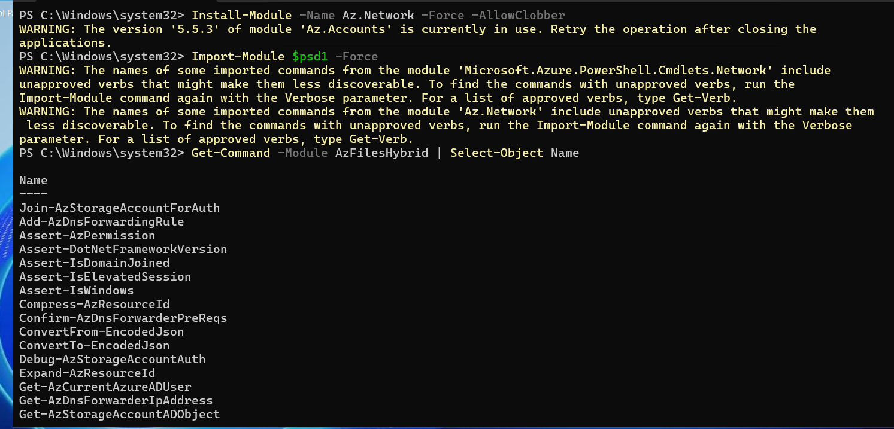

### Anmeldung bei Azure

Die Anmeldung mit `Connect-AzAccount -UseDeviceAuthentication` scheiterte: Die Seite lehnte
den Code mit «Der Code konnte nicht verwendet werden» ab, auch bei einem frischen Code ohne
Tippfehler. Ich vermute den Grund bei meinem Konto (ein privates Microsoft-Konto, das in einem
Entra-Verzeichnis liegt), sicher weiss ich es nicht. Mit Angabe des Verzeichnisses
(`-Tenant`) hat die Anmeldung geklappt:

```powershell
Update-AzConfig -EnableLoginByWam $false | Out-Null
Connect-AzAccount -Tenant "giacomobetschtbzoutlook.onmicrosoft.com" | Out-Null
Select-AzSubscription -SubscriptionName "Azure for Students" | Out-Null
```

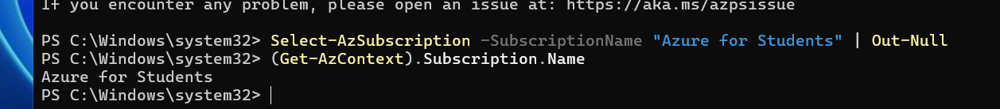

### Computerobjekt anlegen

Der Befehl legt für den Storage Account ein Computerkonto in der OU `Dienstkonten` an
(`ProvisioningState: Succeeded`). Das Objekt `m159giacomo4821` steht danach im AD:

```powershell
Join-AzStorageAccountForAuth -ResourceGroupName "rg-m159" -StorageAccountName "m159giacomo4821" -DomainAccountType ComputerAccount -OrganizationalUnitDistinguishedName "OU=Dienstkonten,DC=corp,DC=m159giacomo,DC=dynv6,DC=net"
```

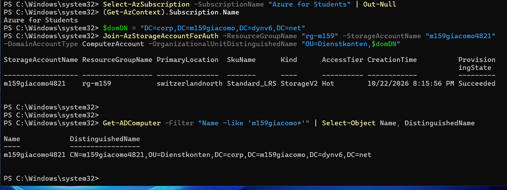

Im Portal steht beim Speicherkonto jetzt «Identitätsbasierter Zugriff: Konfiguriert»:

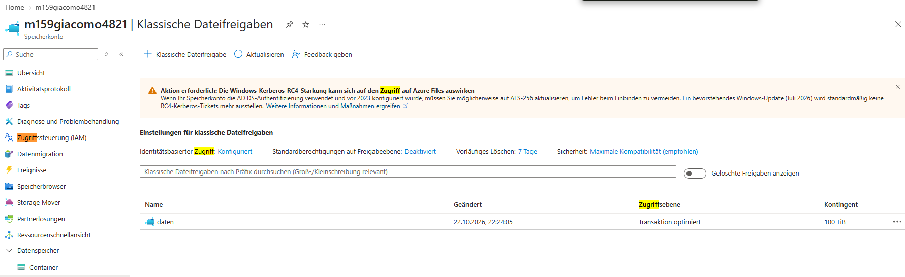

### Verschlüsselung auf AES-256

Das Portal zeigt einen Hinweis zur Kerberos-Verschlüsselung (RC4 wird nach und nach
abgeschaltet). Ich habe das AD-Objekt deshalb auf AES-256 gestellt. Der Befehl wechselt dazu
das Kennwort des Objekts von `kerb1` auf `kerb2`:

```powershell
Update-AzStorageAccountAuthForAES256 -ResourceGroupName "rg-m159" -StorageAccountName "m159giacomo4821"
```

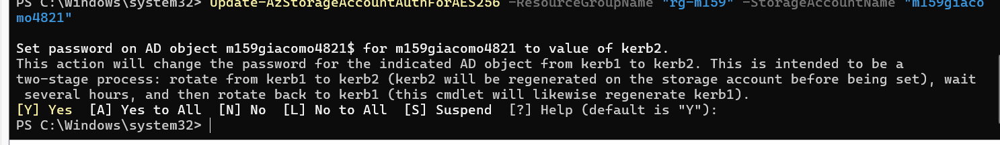

`msDS-SupportedEncryptionTypes` steht danach auf `16`, das heisst nur AES-256:

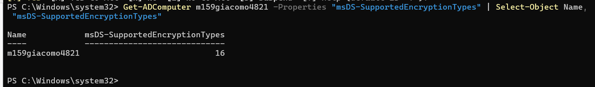

## 5. Kerberos-Zuordnung per GPO

Meine Benutzer melden sich mit dem Suffix `@m159giacomo.dynv6.net` an, Kerberos arbeitet aber
mit dem Realm der lokalen Domäne. Ohne Zuordnung ordnet der Client die Adresse
`m159giacomo4821.file.core.windows.net` dem falschen Realm zu und findet kein passendes
Konto. Die GPO `Konfiguration Kerberos Realm Mapping Comp - GB` ist mit der OU der Clients
(`OU=Computer,OU=Sekretariat,OU=Intern`) verknüpft und setzt unter *Computer Configuration →
Policies → Administrative Templates → System → Kerberos* die Einstellung «Define host
name-to-Kerberos realm mappings» auf *Enabled* mit diesem Eintrag:

| Value name (Realm) | Value (Hosts) |
| --- | --- |
| `CORP.M159GIACOMO.DYNV6.NET` | `.file.core.windows.net` |

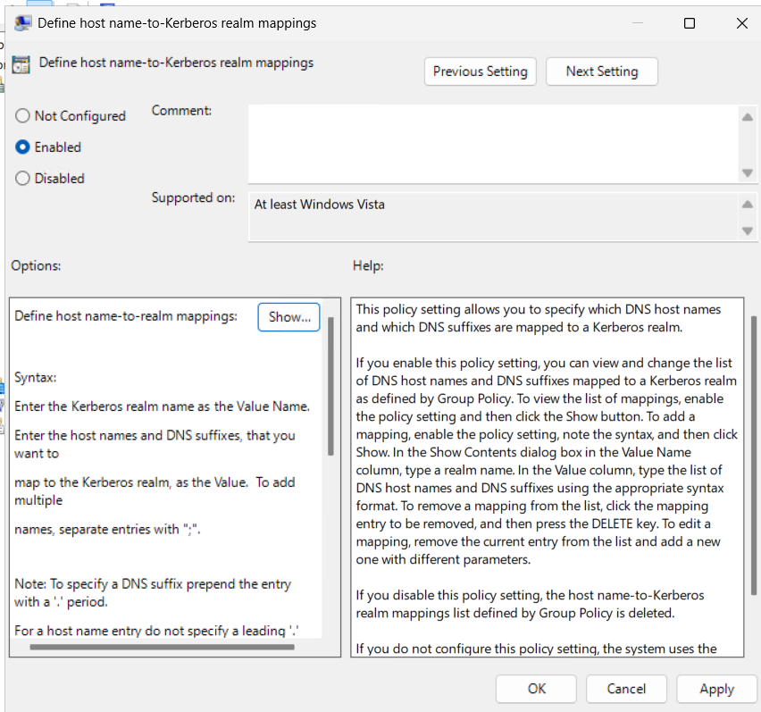

Die Einstellung steht im Unterfenster «Show...», das Bild zeigt nur den aktivierten Zustand.
Beim ersten Versuch hatte ich die benachbarte Einstellung «Define interoperable Kerberos V5
realm settings» geöffnet, sie aber nicht gespeichert (Abbrechen). Als Computer-GPO wirkt sie
erst nach einem Neustart der Clients.

## 6. Rollen auf dem Share

Die Berechtigungen gelten auf dem Share, jeweils für die synchronisierten Entra-Benutzer:

| Benutzer | Abteilung | Rolle | Wirkung |
| --- | --- | --- | --- |
| `jmueller` (Jasmin Müller) | Sekretariat | Storage File Data SMB Share Reader | Lesen |
| `tbucher` (Tom Bucher) | Buchhaltung | Storage File Data SMB Share Contributor | Lesen, Schreiben, Löschen |

Im Portal fehlten die beiden Rollen in der Rollenliste (die Suche nach «Storage File» zeigte
andere Rollen, die nach «SMB Share» nur *SMB MI Admin*):

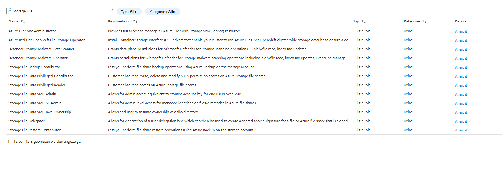

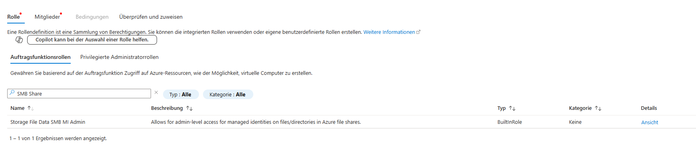

Laut der Microsoft-Dokumentation gibt es die Rollen mit genau diesen Namen. Ich habe sie
deshalb per PowerShell zugewiesen, mit dem Geltungsbereich auf der Freigabe `daten`:

```powershell
$scope = "/subscriptions/$sub/resourceGroups/rg-m159/providers/Microsoft.Storage/storageAccounts/m159giacomo4821/fileServices/default/fileshares/daten"
New-AzRoleAssignment -SignInName "jmueller@m159giacomo.dynv6.net" -RoleDefinitionName "Storage File Data SMB Share Reader" -Scope $scope
New-AzRoleAssignment -SignInName "tbucher@m159giacomo.dynv6.net" -RoleDefinitionName "Storage File Data SMB Share Contributor" -Scope $scope
```

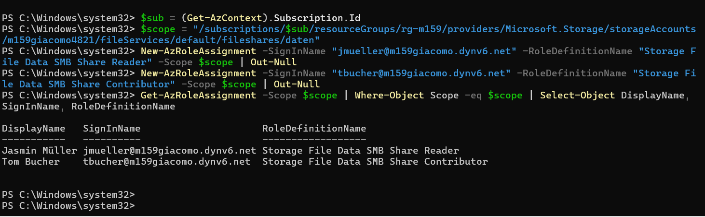

Die anderen Rollen aus der Liste (zum Beispiel *SMB Admin*, gleichwertig mit dem Schlüssel,
oder *Privileged Reader*, für Sicherungsprogramme) habe ich bewusst nicht verwendet.

## 7. Test per SSO ohne Schlüssel

Auf `client1` angemeldet als Domänenbenutzer. Beim Verbinden gebe ich weder Schlüssel noch
Benutzernamen an.

**Sekretariat (`jmueller`).** Der Benutzer hat ein Primary Refresh Token (`AzureAdPrt : YES`),
das heisst, die Anmeldung gegenüber Entra ID läuft ohne zusätzliche Eingabe:

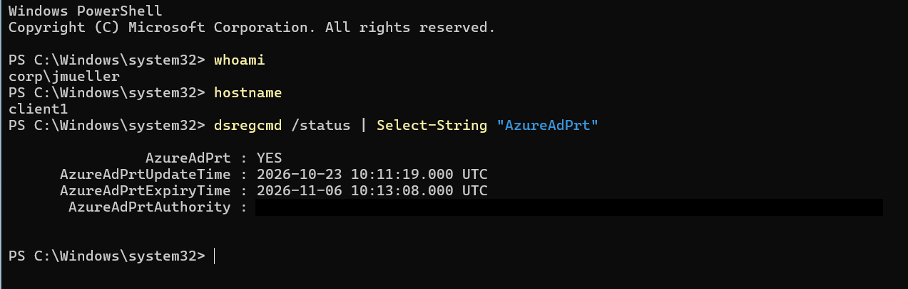

`net use` verbindet den Share ohne Anmeldefenster, `jmueller` sieht die Dateien (hier
`test-key.txt` aus dem ersten Test), das **Anlegen einer Datei wird mit «Access denied»
abgelehnt**. Das ist das Leserecht:

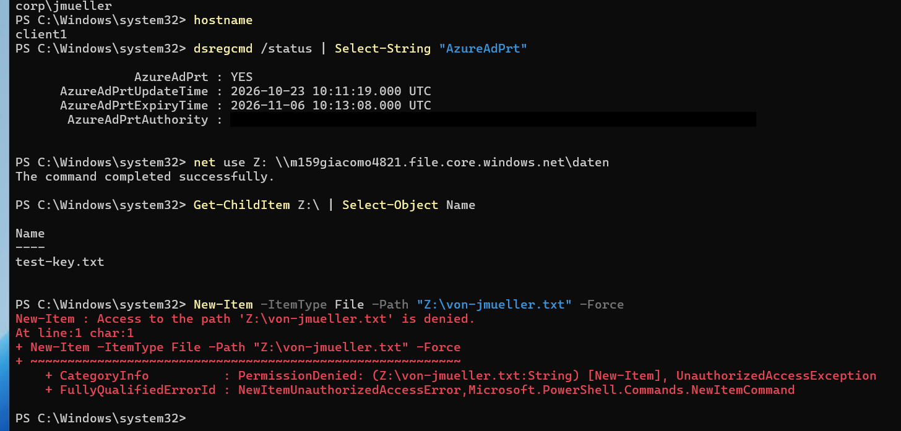

**Buchhaltung (`tbucher`).** Der Benutzer verbindet sich ebenfalls ohne Schlüssel und legt
`von-tbucher.txt` an, das Schreibrecht funktioniert:

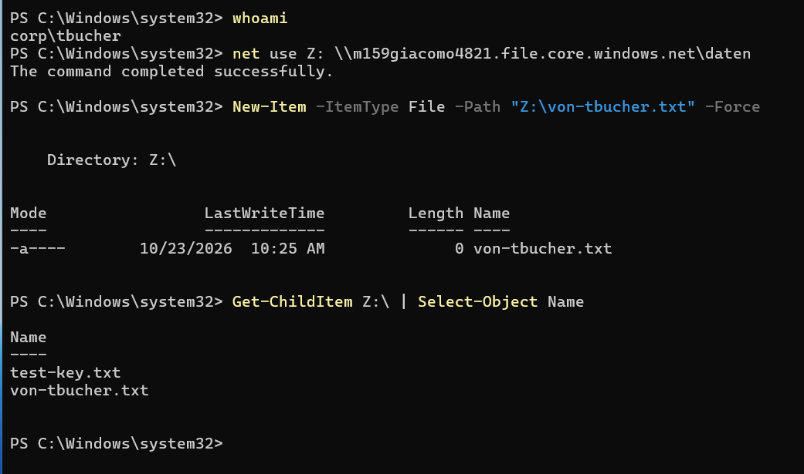

Damit stimmt das verlangte Ergebnis: Sekretariat = Lesen, Buchhaltung = Schreiben.

## 8. Aufräumen

Der Storage Account kostet auch ohne Nutzung etwas. Nach der Abnahme lösche ich ihn mit der
Ressourcengruppe `rg-m159` (dabei verschwinden auch die Testdateien), und das Computerobjekt
`m159giacomo4821` in der OU `Dienstkonten` im AD. Die Rollen verschwinden mit dem Storage
Account.
