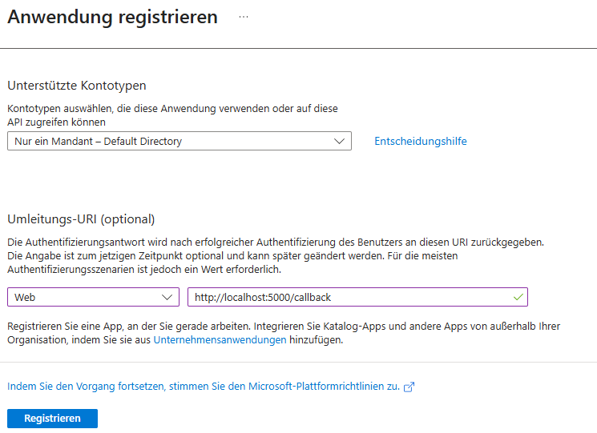
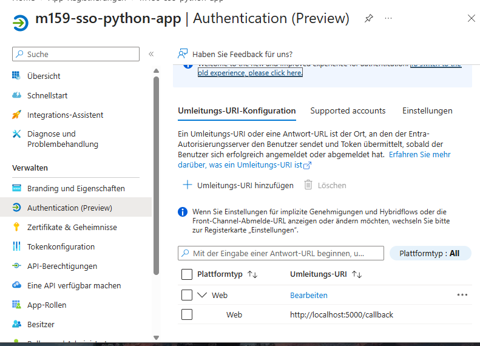
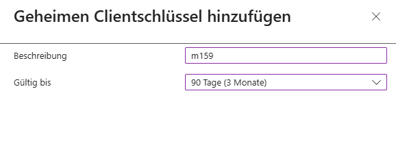
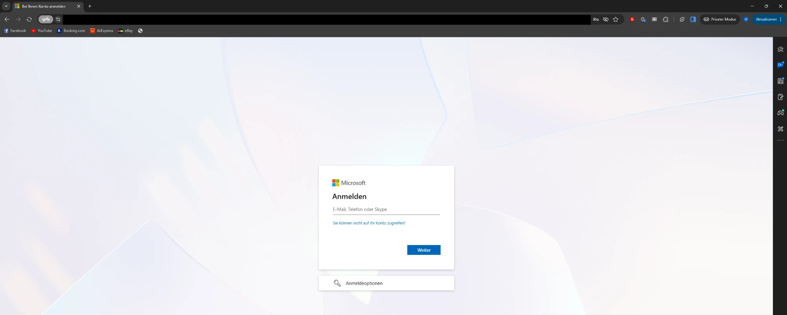
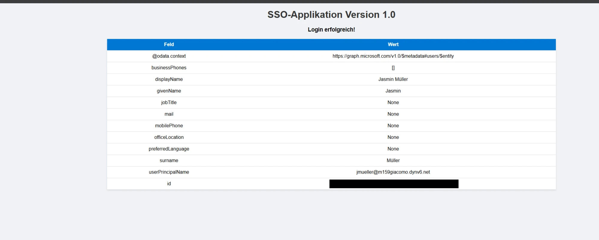
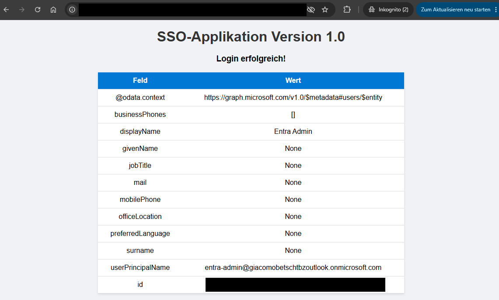
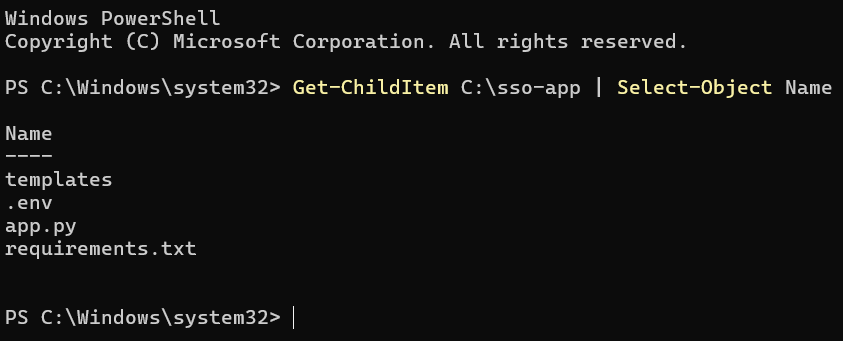
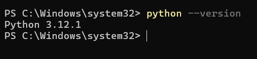
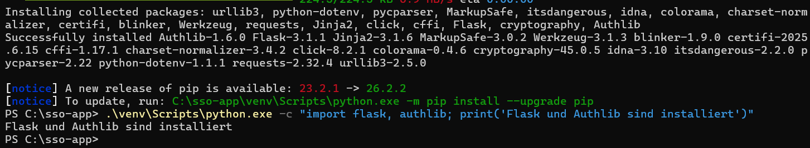

# SSO Python-App

Dokumentation zu Auftrag 13: Eine Python-Webanwendung (Flask) meldet Benutzer über Microsoft
Entra ID an. Ich habe die Anmeldung auf drei Arten getestet: mit manueller Eingabe (Stufe 1),
mit tokenbasiertem SSO in Chrome und mit Windows-integriertem SSO in Edge auf einem
hybrid-joined Client (Stufe 2). Aufgabenstellung siehe
[Modul-Repository](https://gitlab.com/ch-tbz-it/Stud/m159/-/tree/main/03-auftraege/13-sso-python-app).

Autor: Giacomo Betsch, Klasse Pe24d

Das Client Secret, die Client-ID, die Tenant-ID und Objekt-IDs stehen nicht in diesem
Repository. Wo sie auf einem Bild vorkamen, habe ich sie abgedeckt.

## 1. Wie die App funktioniert

Die App nutzt den OAuth-2.0-Ablauf *Authorization Code* mit der Bibliothek Authlib:

1. Wer `http://localhost:5000` aufruft, wird von der App zur Microsoft-Anmeldung (Entra ID)
   weitergeleitet.
2. Entra ID authentifiziert den Benutzer und schickt ihn mit einem Code an die Adresse
   `http://localhost:5000/callback` zurück.
3. Die App tauscht den Code gegen ein Token, ruft damit die Profildaten bei Microsoft Graph ab
   (`/v1.0/me`, Berechtigung `User.Read`) und zeigt sie auf der Seite «SSO-Applikation» an.

Ob dabei ein Passwort verlangt wird, entscheidet nicht die App, sondern die Anmeldung bei
Entra ID: Gibt es schon eine gültige Sitzung oder ein Anmeldetoken, kommt der Benutzer ohne
Passwort durch (Single Sign-On).

## 2. App vorbereiten

Die App (`app.py`, `templates/`, `requirements.txt`) stammt als Vorlage aus dem
Modul-Repository. Ich habe sie auf meinem Laptop in einen Ordner **ausserhalb** meines Repos
kopiert, damit das Secret nicht in Git landet. Dort habe ich mit Python 3.12 eine virtuelle
Umgebung erstellt und die Pakete aus `requirements.txt` installiert (Flask, Authlib,
python-dotenv und weitere). Gestartet wird sie mit `flask run` auf Port 5000.

## 3. App in Entra ID registrieren (Stufe 1)

Registriert habe ich die App `m159-sso-python-app` als **Einzelmandanten-App**: Es können sich
nur Benutzer meines eigenen Verzeichnisses anmelden. Als Umleitungs-URI (Plattform *Web*) ist
`http://localhost:5000/callback` eingetragen:





Für die App gibt es einen geheimen Clientschlüssel (Client Secret), Beschreibung `m159`,
Laufzeit 90 Tage:



Der Wert des Secrets ist nur direkt nach dem Erstellen sichtbar. Zwei Dinge sind mir dabei
aufgefallen:

- Beim ersten Mal stand der Wert im Klartext auf einem Bild. Ich habe dieses Secret deshalb
  gelöscht und ein neues erstellt. Ein Client Secret gehört nicht in ein Bild, einen Chat oder
  ein Repository.
- Beim ersten Eintragen in die `.env` hatte ich die Spalte **Geheime ID** statt **Wert**
  kopiert. Das habe ich an der Prüfung der Datei gesehen: Der Eintrag hatte das Format einer
  ID (GUID), ein echtes Secret hat 40 Zeichen mit einem `~`. Nach dem erneuten Kopieren stimmte
  es.

Die drei Werte stehen in der Datei `.env` der App (`CLIENT_ID`, `CLIENT_SECRET`, `TENANT_ID`).
Diese Datei liegt nicht in Git.

## 4. Login-Test in Chrome mit manueller Anmeldung (Stufe 1)

Der Test lief im Inkognito-Fenster von Chrome. Wichtig ist die Adresse `localhost`: Die App
sagt zwar `127.0.0.1`, aber in Entra ID ist `http://localhost:5000/callback` eingetragen. Mit
`127.0.0.1` käme es zu einem *Redirect URI Mismatch*.

Die App leitet zur Microsoft-Anmeldung weiter:



Nach der Anmeldung als `jmueller@m159giacomo.dynv6.net` (Passwort von Hand eingegeben) zeigt
die App «Login erfolgreich!» mit den Profildaten von Jasmin Müller, der UPN ist der öffentliche
`jmueller@m159giacomo.dynv6.net`:



## 5. Tokenbasiertes SSO in Chrome (Stufe 2)

Diesen Test habe ich auf meinem Laptop gemacht, also auf einem Client, der weder Mitglied
meines lokalen Active Directory noch von Entra ID ist. Ablauf: Im Inkognito-Fenster bei
Microsoft 365 (`m365.cloud.microsoft`) angemeldet, danach in einem neuen Tab die App unter
`http://localhost:5000` geöffnet. Die App zeigt die Profilseite **direkt, ohne
Passwortabfrage**, weil Entra ID die bestehende Anmeldesitzung (Cookie) des Browsers
verwendet.

Angemeldet war bei diesem Test der Benutzer `entra-admin`:



Video des Tests: [sso-chrome.mp4](resources/sso-chrome.mp4)

## 6. Windows-integriertes SSO in Edge auf client1 (Stufe 2)

Hier meldet sich ein Domänenbenutzer ohne jede Eingabe an. Das geht auf `client1`, weil er
hybrid joined ist (Auftrag 10): Wer sich dort mit seinem Domänenkonto anmeldet, bekommt von
Windows ein Primary Refresh Token. Edge reicht es bei der Anmeldung an Entra ID automatisch
weiter. Der Benutzer ist `jmueller` mit dem öffentlichen UPN `@m159giacomo.dynv6.net`. Dieser
Suffix muss in Entra ID verifiziert sein (siehe Auftrag 10), sonst würde das SSO nicht greifen.

Die App muss dafür auf `client1` laufen, weil die Umleitung über `localhost` geht und der
Browser dieselbe Maschine sein muss. Ich habe `app.py`, `templates`, `requirements.txt` und die
`.env` nach `C:\sso-app` kopiert (die virtuelle Umgebung nicht, die ist an den Laptop
gebunden):



Python habe ich auf `client1` installiert (Version 3.12.1 für alle Benutzer, Pfad wird
gesetzt):

```powershell
Invoke-WebRequest -Uri "https://www.python.org/ftp/python/3.12.1/python-3.12.1-amd64.exe" -OutFile "C:\Temp\python-installer.exe"
Start-Process -FilePath "C:\Temp\python-installer.exe" -ArgumentList "/quiet InstallAllUsers=1 PrependPath=1" -Wait
```



Beim ersten Versuch schlug der Download fehl, weil der Ordner `C:\Temp` auf `client1` nicht
existierte. Nach dem Anlegen des Ordners lief er durch. Beim Installieren der Pakete hatte ich
zuerst nur `pip install` ohne `-r requirements.txt` eingegeben, das gab eine Fehlermeldung.
Danach habe ich die virtuelle Umgebung mit ihrem eigenen Python verwendet:

```powershell
cd C:\sso-app
python -m venv venv
.\venv\Scripts\python.exe -m pip install -r requirements.txt
```



Gestartet habe ich die App in der Sitzung von `jmueller`:

```powershell
cd C:\sso-app
.\venv\Scripts\python.exe -m flask --app app run --port 5000
```

In Edge habe ich als `jmueller` zuerst `m365.cloud.microsoft` und danach
`http://localhost:5000` geöffnet. Beides ohne Passwortabfrage.

Video des Tests: [sso-edge.mp4](resources/sso-edge.mp4)

## 7. Einordnung der drei Tests

| Test | Client | Anmeldung | Passwort nötig? |
| --- | --- | --- | --- |
| Chrome, manuell | Laptop | Benutzername und Passwort | ja |
| Chrome, tokenbasiert | Laptop (nicht in der Domäne) | bestehende Browser-Sitzung bei Microsoft 365 | nein |
| Edge, Windows-integriert | `client1` (hybrid joined) | Windows-Anmeldung, Primary Refresh Token | nein |

## 8. Aufräumen

Das Client Secret gilt 90 Tage. Nach der Abnahme lösche ich es in Entra ID, ausserdem den
Ordner `C:\sso-app` auf `client1` (dort liegt eine `.env` mit dem Secret) und den lokalen
Ordner mit der App auf dem Laptop. Die App-Registrierung selbst bleibt.
